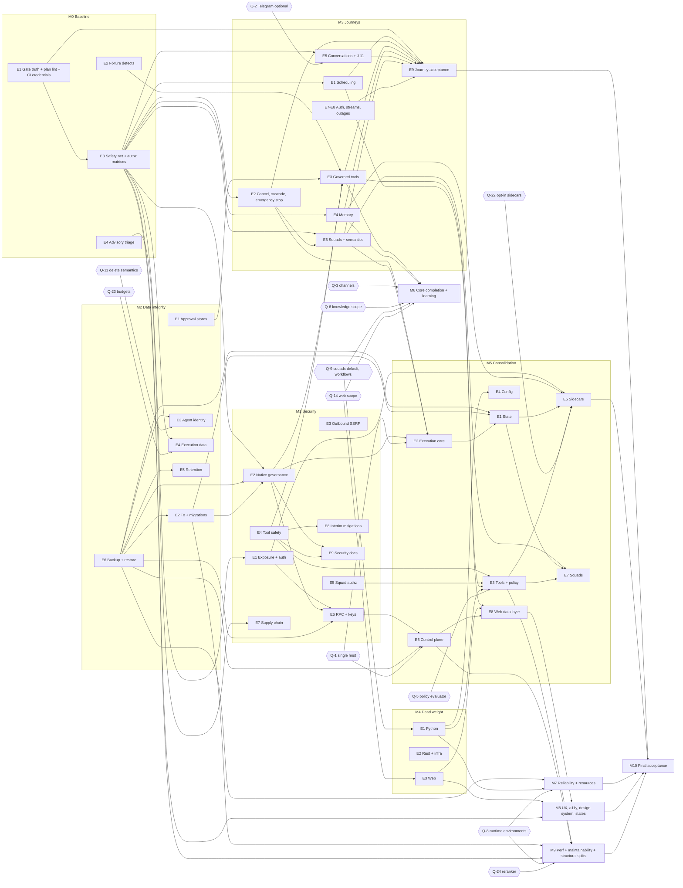

# Master Plan

The consolidation backlog for [MISSION.md](MISSION.md) §9 (Mission → Milestone → Epic → Task). It was built
from the Phase Zero outputs at `7b848cf`, then reconciled with the work that landed up to `5270f23`:
[SYSTEM_INVENTORY.md](SYSTEM_INVENTORY.md), [ARCHITECTURE_AUDIT.md](ARCHITECTURE_AUDIT.md),
[FEATURE_MATRIX.md](FEATURE_MATRIX.md), [TECHNICAL_DEBT.md](TECHNICAL_DEBT.md),
[REFERENCE_RESEARCH.md](REFERENCE_RESEARCH.md), [QUALITY_BASELINE.md](QUALITY_BASELINE.md).

Companions: decisions in [DECISIONS.md](DECISIONS.md), risks in [REMAINING_RISKS.md](REMAINING_RISKS.md),
live state in [EXECUTION_STATUS.md](EXECUTION_STATUS.md), and command evidence in
[VALIDATION_REPORT.md](VALIDATION_REPORT.md).

This plan records intent and order. It claims no fixes. A task moves to `done` only when
VALIDATION_REPORT.md holds its evidence (mission §11).

**Revision 1 (2026-11-14).** An independent review of the first draft found 2 blockers, 13 major and 10
minor issues, 23 coverage gaps and 11 cases of over-engineering. This revision addresses all of them. Tasks
were split, moved or added, and every moved task keeps a pointer from its old ID (section 4.2).

## Contents

1. [How to use this plan](#1-how-to-use-this-plan)
2. [Roles](#2-roles)
3. [Mission to milestones](#3-mission-to-milestones)
4. [Work before this plan, and moved tasks](#4-work-before-this-plan-and-moved-tasks)
5. [Decision and approval register](#5-decision-and-approval-register)
6. [Backlog](#6-backlog)
7. [Dependency graph](#7-dependency-graph)
8. [Ownership and serialization](#8-ownership-and-serialization)
9. [Evidence limits in this environment](#9-evidence-limits-in-this-environment)

---

## 1. How to use this plan

**Order.** Milestones follow the mission §9 priority list:

1. security and data integrity (M1, M2);
2. broken critical journeys (M3);
3. architectural inconsistencies (M4 dead weight first, then M5 consolidation);
4. core functionality (M6);
5. reliability (M7);
6. UX and accessibility (M8);
7. performance and maintainability (M9);
8. polish (M10).

M0 comes before all of them, because later work needs trustworthy gates and tests.

Inside a milestone, tasks are listed by severity, then by dependency. A `ready` task from a later milestone
can run in parallel when it touches no file owned by an active task (section 8). Low-severity items do not
jump ahead of high-severity items in a later milestone just because of their milestone number.

**IDs.**

| Prefix | Source |
|---|---|
| `M<m>-E<e>-T<t>` | Task in this plan |
| `F-<AREA>-NN` | Feature row in FEATURE_MATRIX.md §4 |
| `D-NNN` | Defect in TECHNICAL_DEBT.md Part 1 (three digits) |
| `TD-NNN` | Debt item in TECHNICAL_DEBT.md Part 2 |
| `SM-NN` | Runtime-smoke defect FEATURE_MATRIX.md §3.4 `D-NN` (renamed here to avoid a clash with `D-NNN`) |
| `J-NN` | Journey in FEATURE_MATRIX.md §3.2 |
| `Q-n` | Open decision `D-n` in ARCHITECTURE_AUDIT.md §11 (renamed here). Q-21 to Q-24 are added in section 5. |
| `P<n>` | Design principle in REFERENCE_RESEARCH.md §6 |
| `ADR-NNN` | Entry in DECISIONS.md |
| `R-NN` | Entry in REMAINING_RISKS.md |
| `ES` | Pending finding listed in EXECUTION_STATUS.md |

**Status.**

| Status | Meaning |
|---|---|
| `ready` | Dependencies are done and no gate is open. Start now. |
| `pending` | Waiting on the listed task dependencies. |
| `blocked` | Waiting on something outside the engineering loop: an operator approval, an operator action, a product decision or unavailable infrastructure. |
| `in-progress` / `in-review` / `done` | Set by the execution loop. `in-progress` names the active workflow. `in-review` means the change exists but a done-when item or its evidence is still missing. `done` requires every done-when item to have evidence. |

**Started early.** A task that began before its dependencies were done carries the flag *started early:
real-path regression test required before done* on its status line. The done check (M0-E1-T4) refuses to
mark it `done` until VALIDATION_REPORT.md names a regression test that runs the real path without patching
the code under test.

**Evidence rule.** No task is `done` while its Evidence field reads "—". The plan lint (M0-E1-T4) enforces
this, together with the status rules above, on every change to this file.

**Gate.**

| Gate | Meaning |
|---|---|
| `none` | Routine, reversible work inside mission authority. |
| `approved (<ref>)` | The operator has already approved it. |
| `needs-approval (§13: <clause>)` | Mission §13 applies. Do not start until the operator approves in their own words. Bring the approval package described under "Approval packages" below. `needs-approval (ADR-018 class 2)` is the same gate for deleting a documented feature that never worked. |
| `decision Q-n` | Waits on a product-scope decision that is not a §13 action. The orchestrator records the outcome in DECISIONS.md. |
| `operator-action` | Only the operator can do it, for example repository settings. |
| `infra: <what>` | Needs infrastructure this environment lacks. Evidence comes from CI or a later environment. |

**Validation shorthand** (used in the Tests field):

| Code | Commands |
|---|---|
| `G` | The CLAUDE.md required validation: `ruff check .`, `ruff format --check .`, `mypy koda/ --ignore-missing-imports`, `pytest --cov=koda --cov-report=term-missing`, `pnpm lint:web`, `pnpm test:web`, `pnpm build:web`. Every task runs G. |
| `G-RS` | `cargo fmt --all --check --manifest-path rust/Cargo.toml`, clippy with `-D warnings`, `cargo test --workspace`. Required whenever `rust/` changes. |
| `G-PG` | `POSTGRES_TEST_DSN=… pytest -m postgres` on an isolated database (the session owns its security guard since M0-E2-T1). Required whenever persistence changes. |
| `G-CI` | Evidence from a GitHub Actions run (Docker builds, docker-smoke, Playwright). |

**Definition of done** (mission §11), applied to every task:

- acceptance criteria met;
- tests listed under Tests added and passing;
- `G` green;
- security and authorization impact considered;
- user-visible states handled;
- docs updated in the same change (for auth: `docs/security/authentication.md` plus matching tests, per CLAUDE.md);
- a changelog entry in the same change when the task changes startup validation, an API request or response
  body, a Telegram command, an agent tool list, retry behaviour or a compose default (ADR-030). Such tasks
  list `changelog entry` in their Tests field, and M10-E1-T3 checks that each one has its entry. Tasks that
  land before M1-E7-T6 record the entry text in their evidence, and M1-E7-T6 seeds the changelog with them;
- independent review for any task with risk `high`, or with owner SEC, or that changes a shared contract;
- evidence recorded in VALIDATION_REPORT.md under the task ID.

**Approval packages** (mission §13). A `needs-approval` request brings an impact analysis, migration
strategy, verification plan, rollback approach and the expected operational consequences. Every request
also cites the latest successful restore drill recorded in VALIDATION_REPORT.md under M2-E6-T1, or states
that none exists yet. A task marked "Restore: yes" in section 5.2 touches data, secrets or volumes on
existing installs; whenever its approval was given, it cannot start until a drill no more than 30 days old
is recorded (ADR-029).

**Retry limit.** A task that fails validation three times without a new root-cause hypothesis goes back to
`blocked` with notes. Do not keep patching it.

**Removal rule** (ADR-018, clarified by ADR-037). Remove code without approval only when it has no
runtime consumer (class 1), or has never worked and is neither user-facing nor documented. A configuration
key that nothing reads has no runtime consumer even when it is documented; removing it is class 1 and gets
a changelog entry. Removing working functionality, or a user-facing or documented feature that never
worked (a page, command, tool, overlay or integration), is `needs-approval`. Where a control exists but
does nothing, first disable it or label it "Not available yet" (reversible). Delete the code only after
approval. A deletion-only task (M4) contains no behaviour
change; any behaviour change it would cause is its own task, with a characterisation test and a changelog
entry.

**Decision-dependent work.** A task waiting on a `Q-n` that has two opposite outcomes is a decision task:
it records the outcome and opens one task per outcome, each with its own observable acceptance criteria.
The candidate outcome tasks are drafted inside the decision task so the operator can see what each choice
costs.

**Interim mitigations.** When the full fix for a critical or high security defect waits on an approval,
the plan ships a reversible interim mitigation first (ADR-018 class 2, ADR-037: label, disable or fail
safe) and escalates the approval in the next batch (section 5.3).

## 2. Roles

Mission §3 roles. Owners are accountable, and reviewers are named where review is required.

| Code | Role (mission §) | Typical scope |
|---|---|---|
| ARCH | Principal Architect & Orchestrator (3.1) | ADRs, sequencing, cross-cutting integration |
| PROD | Product & Functional Audit (3.2) | Scope decisions, FEATURE_MATRIX upkeep, docs truthfulness |
| FE | Frontend Architecture & UX Engineering (3.3) | `apps/web` data layer, routes, BFF |
| UX | UI/UX & Design Systems (3.4) | Tokens, components, accessibility, rendered verification |
| BE | Backend & Distributed Systems (3.5) | Control plane, queue, state, persistence |
| AIM | AI Agents, Memory & Orchestration (3.6) | Providers, tools, memory, squads, child runs |
| SEC | Security, Privacy & Governance (3.7) | Auth, policy, approvals, sandboxing, supply chain |
| QA | Quality Engineering & Validation (3.8) | Test strategy, fixtures, E2E, coverage |
| OPS | DevOps, Infrastructure & Reliability (3.9) | Compose, images, CI, release, backup |
| REV | Independent Reviewer & Simplification (3.10) | Review of high-risk and removal tasks |

## 3. Mission to milestones

Mission objective (mission §1): one cohesive, secure and validated agent platform. Operational exit criteria
per milestone:

| ID | Milestone | Exit criteria | Tasks | ready / pending / blocked / in-progress / in-review / done |
|---|---|---|---:|---|
| M0 | Baseline repair and safety net | All gates green on an isolated run. Postgres CI job trusted. Fixture defects fixed. Characterisation tests run the real queue, scheduler, memory, auth and reliability paths, with strict xfails for known defects. Control-plane, worker-runtime and BFF authorization matrices exist. The plan lint runs in CI. CI credentials are requested (M0-E1-T5). | 24 | 20 / 2 / 2 / 0 / 0 / 0 |
| M1 | Security hardening | Every critical or high security defect (D-002 to D-007, and D-162 as reclassified) is fixed, or has a shipped reversible interim mitigation (M1-E8) with its full fix escalated in approval batch 1. Medium security defects are fixed or risk-accepted. Approved governance (ADR-002) and exposure (ADR-003) decisions are implemented with evidence. The security docs match the new boundary (M1-E9-T1). M1-E2-T5 waits on M2-E2-T2 and closes with M2; it does not hold M1 open. | 61 | 28 / 18 / 11 / 3 / 1 / 0 |
| M2 | Data integrity | No cross-agent data loss. Writes are transactional. Migrations are atomic, locked and within the lock budget. A restore drill passes in CI (M2-E6-T1), and every destructive or irreversible task cites it. Destructive changes are made only with approval. | 24 | 12 / 7 / 5 / 0 / 0 / 0 |
| M3 | Broken critical journeys | Through the M0-E3-T2 harness, on Postgres with a stub provider (M3-E9-T1): a scheduled routine runs; a gated tool call is approved and executes (once M3-E3-T1 is approved); a squad conversation delegates and synthesises; memory is recalled across sessions; password recovery works; cancel stops child runs; emergency stop works; **a dashboard-only agent answers in `/sessions` (J-11)**; an MCP server is connected and its tool called; a skill package is installed through review. The real-provider checkpoint (M3-E9-T2) is recorded, or its blocker is stated. | 42 | 18 / 15 / 3 / 6 / 0 / 0 |
| M4 | Dead-weight removal | Zero-consumer code, configuration and files are removed in deletion-only changes. Unreachable web modules are gone. A CI check prevents regrowth. | 22 | 18 / 0 / 4 / 0 / 0 / 0 |
| M5 | Architecture consolidation | One implementation per concern (ARCHITECTURE_AUDIT §7). Default stack reduced toward 6 containers, with a tested rollback for each fold. No `run_coro_sync` on hot paths. | 68 | 10 / 43 / 15 / 0 / 0 / 0 |
| M6 | Core functionality completion | Every in-scope feature is `complete_verified`, or removed or deferred with approval. Controls with no backend are labelled. Governance surfaces are reachable. Learning has a definition and measures (ADR-031). | 25 | 16 / 4 / 5 / 0 / 0 / 0 |
| M7 | Reliability and operations | Health reflects failure. Kernel shutdown is graceful. CI is consolidated and pinned. Resource limits and growth budgets are set. | 20 | 10 / 5 / 5 / 0 / 0 / 0 |
| M8 | UX and accessibility | WCAG 2.2 AA on key routes, with exceptions documented. No raw i18n keys or hydration errors. One design system per mission §6.2 category. Every key route has its interaction-state row (mission §6.3). | 31 | 17 / 14 / 0 / 0 / 0 / 0 |
| M9 | Performance and maintainability | Measured baselines and targets exist. Event loops are not blocked. Hot queries have recorded plans. God modules are split along their seams. | 20 | 9 / 10 / 1 / 0 / 0 / 0 |
| M10 | Polish, documentation and release readiness | Docs match behaviour. Every contract change has its changelog entry. Final acceptance (M10-E1-T5) runs after M1 to M9 exit, with real infrastructure (mission §11, §16). | 5 | 2 / 2 / 1 / 0 / 0 / 0 |
| | **Total** | | **342** | **160 / 120 / 52 / 9 / 1 / 0** |

The counts are as of revision 1. "Ready" means every hard dependency is done and no gate is open. The plan
lint (M0-E1-T4) prints these counts; refresh the table from its output when statuses change (M10-E1-T4).

## 4. Work before this plan, and moved tasks

### 4.1 Completed or in review before this plan

Recorded in VALIDATION_REPORT.md. The closed rows are not repeated as tasks.

| Task | State | Evidence |
|---|---|---|
| P0-BASELINE | closed: baseline gates executed | QUALITY_BASELINE.md |
| P0-FIX-CARGOFMT | closed: documented `cargo fmt` gate command fixed | VALIDATION_REPORT.md |
| M0-PG-FIXTURES | closed: F-QA-02, 186 Postgres tests pass locally; the CI job exists but has not run (M0-E1-T2) | VALIDATION_REPORT.md |
| SEC-PLACEHOLDER-SECRETS | closed: D-007 for the API, runtime UI and web-session secrets (`3f895ee`); the DB and S3 placeholders remain (M1-E8-T3, M1-E1-T10) | VALIDATION_REPORT.md |
| DATA-UNINSTALL-VOLUMES | closed: D-008, F-PLT-21 (`7b848cf`) | VALIDATION_REPORT.md |
| NET-LOOPBACK = M1-E1-T1 | **in-review**: implemented and approved by two review rounds (`307349e`, `52ffc26`); the docker-smoke CI run its done-when requires has not been recorded | VALIDATION_REPORT.md "NET-LOOPBACK" |

In progress when this plan was written (EXECUTION_STATUS "Active tasks"):

- **DEFECT-BATCH-1** covers M1-E1-T2 (D-004), M1-E3-T1 (D-003), M3-E1-T1 (D-001), M3-E1-T2 (D-016), M3-E2-T1 (the D-009 part), M3-E7-T1 (D-018), M3-E8-T1 (the D-022 part) and M3-E8-T2 (D-020).

  Four of them (M1-E1-T2, M3-E1-T1, M3-E1-T2, M3-E2-T1) started before their dependencies were done and carry the *started early* flag (section 1). Where the matching M0-E3 test lands later, it starts as passing instead of xfail.

  Items in those tasks that the batch does not cover stay open in the task: D-087 and D-088 in M3-E2-T1, D-091 in M3-E8-T1.
- **AGENT-AUTONOMY-ADR** is M1-E2-T1. The orchestrator folds D-011 and D-012 into its design. M3-E3-T1 and M3-E3-T2 depend on it as a hard dependency.

### 4.2 Moved, split and replaced tasks (revision 1)

Old IDs are not reused. A reference to an old ID means the new one.

| Old ID | Now | Why |
|---|---|---|
| M7-E2-T1 | M2-E6-T1 | A proven restore mitigates two Critical risks and must precede every destructive task |
| M7-E2-T2 | M2-E6-T2 | `koda update` must back up before the new migration runner ships |
| M6-E1-T1 | M3-E5-T3 | Dashboard-only chat (J-11) is a broken critical journey |
| M5-E3-T7 | M1-E4-T13 | `/cat .env` versus `file_read` parity is a hard dependency of M3-E3-T1 |
| M5-E3-T11 | M1-E4-T10 | D-162 is reclassified as a security defect |
| M1-E6-T4 | M5-E6-T11 | It waits on M5-E6-T7 and must not hold M1 open |
| M5-E6-T5, M5-E6-T6, M5-E7-T3 | M9-E3-T8, M9-E3-T9, M9-E3-T10 | Pure structural splits that no defect fix needs (mission §5.3, §12) |
| M5-E5-T5 | replaced by the Q-6 outcome tasks opened by M6-E1-T4 | Decision-dependent work |
| M10-E1-T5 (part a) | M3-E9-T2 | Real-provider checkpoint after M3; M10-E1-T5 keeps final acceptance |
| M1-E1-T5 | M1-E1-T5, T13, T14, T15 | One auth item per task |
| M1-E3-T3 | M1-E3-T3 to T7 | One outbound-safety item per task |
| M1-E4-T3 | M1-E4-T3, T11, T12 | One package-integrity item per task; content-addressed store dropped |
| M2-E4-T2 | M2-E4-T2 (cost), M2-E4-T5 (budget, Q-23) | Budget enforcement is a product decision |
| M5-E3-T5 | M5-E3-T5, T12 to T17 | One policy store per task |
| M5-E5-T4 | M5-E5-T4 (projections), M5-E5-T10 (engine removal) | One review per step. There is no separate default flip: recall is ported directly in M5-E5-T3, with no runtime flag (ADR-014) |
| M7-E1-T3 | M7-E1-T3, T5, T6; TD-117 to M9-E3-T7 | Restore and Reconcile wait on Q-8 |
| M8-E5-T1 | M8-E5-T1, T6, T7 | One review per migration step |
| M8-E4-T1 (TD-147) | M9-E3-T6 | Editor split is separate from the defect fixes |
| Behaviour changes inside M4-E1-T3, T6, T10 and M4-E2-T2 | M7-E1-T9, M7-E1-T7, M6-E3-T4, M7-E1-T8 | M4 stays deletion-only |
| Cascade-routing removal inside M6-E3-T1 | M4-E1-T13 | A removal belongs in M4 |
| Tempo removal inside M7-E3-T2 | M7-E3-T3 | ADR-018 class 2 needs approval |

Kept by decision, with no task: TD-063 (keyword runtime classifier) and TD-095 (task policy defaults stay
in `koda/knowledge`). Both are cheap to leave; revisit only if the code is touched.

## 5. Decision and approval register

### 5.1 Product and architecture decisions (Q-n)

| Q | Question | Proposed default | State | Gates |
|---|---|---|---|---|
| Q-1 | Single host, one worker per agent? | Yes | open | M5-E2-T10, M5-E6-T9 (remove outcome), M5-E6-T13 (keep outcome) |
| Q-2 | Must every agent be a Telegram bot? | No, Telegram optional | open; escalated in batch 1 (broken journey J-11) | M3-E5-T3 |
| Q-3 | Non-Telegram channels in scope? | None; remove adapters and UI | open | M6-E1-T3 (remove outcome; M6-E1-T2 disables them meanwhile) |
| Q-4 | Provider-native permission bypass | Option C: governed by default plus confinement | **approved 2026-11-14** | M1-E2-* |
| Q-5 | Authoritative policy evaluator; retire the legacy policy stores and their routes | Runtime evaluator, chosen on the offline replay report (M5-E3-T2) | open | M5-E3-T3, M5-E3-T5, M5-E3-T12 to T17 |
| Q-6 | Knowledge v2 in scope? Producer, embedding model and dimension? | Decide scope first | open | M6-E1-T4 (decision task that opens the outcome tasks) |
| Q-7 | Memory engine: Rust or Python SQL? | Python SQL with Postgres FTS | default adopted (ADR-014), subject to the spec tests and the one-off comparison in M5-E5-T3 | M5-E5-T3, M5-E5-T4, M5-E5-T10 |
| Q-8 | Runtime environments in scope? | Keep behind the flag; decide before investing in restore or the controller split | open | M7-E1-T5, M7-E1-T6, M9-E3-T2 |
| Q-9 | Squads on by default? Keep the workflow engine? | Opt-in until the M3 journey passes; remove workflows | open | M6-E1-T7, M4-E1-T12 |
| Q-10 | Loopback-only ports by default? | Yes, with explicit opt-in | **approved 2026-11-14; implemented** (NET-LOOPBACK) | M1-E1-T1 (in review: CI evidence pending) |
| Q-11 | Agent delete: archive or hard delete? | Archive by default; hard delete purges everything | open | M2-E3-T3 |
| Q-12 | Token scopes? Admin gate for dangerous Telegram commands? | Read-only vs owner scopes; admin gate | open | M6-E2-T2 |
| Q-13 | Replay transcript for stateless providers? | Yes, within the prompt budget | default adopted: restores advertised behaviour | M3-E5-T1 |
| Q-14 | Web scope: generative UI, tour, WebGL orb, locales, composer mentions, video and music slots | Remove generative UI and the orb; keep locales; fix the tour | open | M4-E3-T3, M4-E3-T4, M6-E3-T3 |
| Q-15 | On outage: synthetic HTTP 200 or 503? | 503 plus a visible state | default adopted (ADR-020) | M3-E8-T3 |
| Q-16 | Can improvement proposals auto-apply? | No; relabel | default adopted | M6-E1-T9 |
| Q-17 | Purge vendor bundles from git history? | Licensing review decides | open (§13) | M1-E7-T7 |
| Q-18 | Observability topology | Prometheus scrapes the workers through a service-discovery endpoint served by the supervisor (no metrics proxy) | default adopted (technical) | M7-E3-T1, M7-E3-T2 |
| Q-19 | Is a direct `python -m koda --agent-id` launch supported? | Keep it working by reloading config after hydration | default adopted: no removal | M5-E4-T3 |
| Q-20 | Artifact auto-discovery scope | Task workspace only | default adopted | M1-E4-T8 |
| Q-21 | Is the Docker-free local-native path supported? (SYSTEM_INVENTORY §9 #12) | Remove the broken path | open | M4-E2-T5 |
| Q-22 | Remove the opt-in policy-engine and bot-gateway sidecars? (FEATURE_MATRIX §6 decision 3) | Remove both | open | M5-E5-T6, M5-E5-T7 |
| Q-23 | Enforce per-agent budgets, or remove the budget setting? (D-052, R-26) | Enforce, with a visible "budget reached" state and a changelog entry | open | M2-E4-T5 |
| Q-24 | Keep the reranker? (TD-103) | Keep only if the M9-E1-T6 eval shows a measurable gain | open | M9-E1-T6, M9-E1-T2 |

### 5.2 Approvals required

Each row is a task the operator must approve before work starts. "Restore" means the request must cite
a restore drill from M2-E6-T1 (section 1, ADR-029).

| Task | Clause | Ask | Main impact | Restore |
|---|---|---|---|---|
| M0-E1-T5 | §13: paid service | Provision CI test credentials, including a spend-capped provider key | A recurring provider bill, capped | — |
| M1-E1-T9 | §13: security policy affecting users | Revoke personal API tokens on password reset | Automation tokens stop working after a reset | — |
| M1-E1-T10 | §13: security policy; production credentials | Refuse placeholder Postgres and S3 secrets at start | Manual installs still on placeholders must rotate first | — |
| M1-E1-T11 | §13: weakens a security policy | Allow an explicit insecure-cookie opt-out in production | Weaker cookie policy when enabled | — |
| M1-E1-T12 | §13: new unauthenticated route | Make the OAuth relay a public single-use route, or remove it | New public route, or loss of browser CLI login | — |
| M1-E2-T3 | §13: production secrets | Move the master key off the runtime-kernel volume on existing installs | Loss of the key means loss of every secret; copy, verify, then move | yes |
| M1-E2-T5 | §13: production credentials | Scoped Postgres role for agent workers | New database credentials and grants | yes |
| M1-E4-T4 | §13: security policy affecting users | Code in skill or plugin packages needs explicit trust, or runs out of process | Install flow changes | — |
| M1-E4-T7 | §13: security policy affecting users | Fail closed when an MCP server's egress allowlist cannot be enforced | Some MCP servers stop starting under bubblewrap | — |
| M1-E6-T1 | §13: production credentials; deployment change on existing installs | Kernel RPC token and the web container leaving the backend network | New install-time secret; compose network topology changes on upgrade | yes |
| M1-E7-T7 | §13: irreversible data operation | Rewrite git history to purge vendor bundles | Force-push; every clone must be re-cloned | — |
| M2-E3-T3 | §13: destructive data | Archive by default; hard delete purges all per-agent rows | Deletes secrets and rows that are orphaned today | yes |
| M2-E3-T5 | §13: irreversible migration | Canonical `agent_id` casing data migration | Rewrites rows on existing installs | yes |
| M2-E5-T2 | §13: destructive data | Enable retention deletes for `query_history`, `audit_events` and `runtime_*` | Historical rows deleted per retention defaults | yes |
| M2-E5-T3 | §13: deleting user data | `/forget` hard-deletes; stored secret previews purged | Irreversible removal | yes |
| M3-E3-T1 | §13: permission policy affecting users | Policy-approved shell, git and supervised writes start executing | Calls that fail closed today start running for the listed agents | — |
| M4-E1-T12, M4-E2-T5, M4-E3-T3, M4-E3-T4 | §13: removing user-facing functionality | Workflow engine, Docker-free path, WebGL orb, generative UI | Features removed | — |
| M5-E1-T5 | §13: irreversible migrations | TIMESTAMPTZ, BOOLEAN and foreign-key migrations | Table rewrites on existing installs | yes |
| M5-E3-T3, M5-E3-T5, M5-E3-T12 to T17 | §13: permission policy | One policy evaluator; one task per policy store migration (route removal afterwards is M5-E3-T19, not gated) | Effective permissions may change; the replay report shows each difference | — |
| M5-E5-T6, M5-E5-T7 | §13: removing functionality | Policy-engine and bot-gateway sidecars | Documented opt-in features removed; bot-token table dropped | yes (M5-E5-T7) |
| M5-E6-T9 | §13: removing functionality | Remove cluster mode | Multi-supervisor deployments unsupported | — |
| M5-E6-T11 | §13: production secrets | Master-key rotation command | Re-encrypts every secret | yes |
| M6-E1-T3, M6-E2-T2, M6-E3-T3 | §13: removing functionality; permission policy | Channel code removal; token scopes and admin gate; speculative UI | Feature and permission changes | — |
| Q-6 outcome B tasks (opened by M6-E1-T4) | §13: removing functionality | Knowledge write side, asset UI and retrieval stack | Documented features removed | yes |
| M7-E2-T3 | §13: data operation on volumes | Distinct compose project name for packaged installs | Volume rename migration | yes |
| M7-E2-T5 | §13: removing an exposed command | Drop the Python `koda` console script | Anyone invoking it must use `koda-control-plane` | — |
| M7-E3-T3 | ADR-018 class 2 | Remove the Tempo overlay, which is documented but never received spans | Documented overlay removed | — |

Operator actions (not §13): M0-E1-T3 (required checks), M0-E1-T5 (secret provisioning, which also needs
the paid-service approval above) and M1-E7-T8 (security contact).

### 5.3 Approval batches

Approvals are requested in batches, so that blocked security work does not wait on one question at a
time. The orchestrator sends each batch as one message with one approval package per row, and records
each answer in DECISIONS.md.

| Batch | When | Contents |
|---|---|---|
| 1 | Now | Q-2 (J-11 is broken); M3-E3-T1 (with its impact report); M1-E4-T4 and M1-E1-T10 (the full fixes behind the M1-E8 interim mitigations); M1-E6-T1; M1-E1-T9; M1-E4-T7; M1-E1-T12; M0-E1-T5 |
| 2 | After the first restore drill passes (M2-E6-T1) | M1-E2-T3, M1-E2-T5, M2-E3-T3 with Q-11, M2-E3-T5, M2-E5-T2, M2-E5-T3, M5-E1-T5, M5-E6-T11, M7-E2-T3 |
| 3 | After M3 exit | Scope and removals: Q-1, Q-3, Q-6, Q-8, Q-9, Q-12, Q-14, Q-17, Q-21, Q-22, Q-23, Q-24 and the removal tasks they gate (M1-E7-T7, M4-E1-T12, M4-E2-T5, M4-E3-T3, M4-E3-T4, M5-E5-T6, M5-E5-T7, M5-E6-T9, M6-E1-T3, M6-E2-T2, M6-E3-T3, M7-E2-T5, M7-E3-T3) |
| 4 | After the offline policy replay report (M5-E3-T2) | Q-5, M5-E3-T3, M5-E3-T5, M5-E3-T12 to T17 |

### 5.4 Reference principles (REFERENCE_RESEARCH §6)

Every principle has a recorded disposition. "Defer" means no task in this plan, with the reason; it is
revisited at the M10-E1-T4 refresh.

| P | Principle | Disposition | Tasks or reason |
|---|---|---|---|
| P1 | Three edited layers per agent | Accept, verify first | M8-E2-T5 checks the editor against the three layers; M6-E2-T6 covers the child-run part |
| P2 | Effective config and its origin | Defer | Needs the typed settings work (M5-E4-T3) first; the resolved-config view is new UI with no defect behind it |
| P3 | Draft, publish, diff and roles | Partial: the draft and publish lifecycle is kept; roles are rejected | A single-owner product has no Manager or Collaborator (mission §12). Pre-publish diff deferred |
| P4 | One handle, explicit bindings, pairing limits | Accept (pairing limits) | M1-E5-T3; bindings follow Q-2 and Q-3 |
| P5 | Small squads, one owner per stage | Accept | M6-E2-T7 |
| P6 | Coordination mode as an explicit setting | Defer the setting; record the semantics now | ADR-032 and M3-E6-T7 define the current mode (lead synthesizes) and test it; a mode selector waits for a second mode with a user |
| P7 | Child runs bounded and capability subset | Accept | M6-E2-T6, M3-E2-T4 |
| P8 | Child runs panel with cascade wording | Accept (wording) | M6-E2-T5 states the cascade, which M3-E2-T4 implements |
| P9 | The supply-chain check is the install UI | Accept (minimal) | M1-E4-T3 and M1-E8-T2 show hash and verdict at the operator review; rescans deferred |
| P10 | Visibility and authority shown apart | Defer | Depends on one tool catalog (M5-E3-T1); revisit with M8-E2-T5 |
| P11 | Skill lifecycle, Pin and Lock | Reject for now | No requirement or consumer; skill telemetry exists |
| P12 | Budgeted core memory above recall | Defer | Recall must work first (M3-E4); ADR-031 defines what is measured |
| P13 | One learning inbox | Defer | ADR-031 keeps two queues (memory review, proposals) until a measured need; M6-E1-T9 keeps proposals honest |
| P14 | Learned items editable and deletable | Accept | M6-E4-T2, M2-E5-T3 |
| P15 | Standard approval verbs, narrow Always, fail closed | Accept | M6-E2-T5, M3-E3-T2 |
| P16 | Policy resolves toward strictness | Accept (resolution rule) | M5-E3-T3 and the per-store tasks keep "tighten only" as an acceptance check; the AI-reviewer tier is rejected |
| P17 | Stopping does not undo work | Accept | M6-E2-T5, M3-E2-T5 |
| P18 | Agent profile organized around activity | Defer | UX review first (M8-E2-T5) |
| P19 | Three planes and a Needs-you count | Defer | M8-E2-T5 evaluates it; no task until that review |
| P20 | Row-first, low density | Accept (already the design rule) | Applied by M8-E5 tasks; no separate task |

---

### 5.3 Operator resolutions (delegated, 2026-11-14)

The operator delegated decisions to the recommended long-term option ("siga com aquilo que você achar ser
o mais recomendado … solução long-term ideal … consolidação completa"). Resolutions applied by the
orchestrator; each still ships with tests, review and recorded evidence.

**Approval batch 1 — resolved**

| Item | Resolution |
|---|---|
| M3-E3-T1 | Governed shell, `shell_bg`, `git_*` and supervised writes execute only when the agent's published policy enables them (per-agent opt-in, default off), consistent with ADR-002 / AG backlog. |
| Q-2 | Telegram becomes optional per agent; dashboard-only agents are first-class (fixes J-11). |
| M1-E4-T4 | Skill/plugin handler code runs out of process under Koda confinement (ADR-002 process class U/M), admitted only for an operator-trusted package hash. The interim M1-E8-T2 review gate stays until then. |
| M1-E1-T10 | Refuse to start on placeholder `POSTGRES_PASSWORD` / `S3_*` secrets; `scripts/generate_env_secrets.py --all` and the upgrade notes cover rotation. |
| M1-E6-T1 | Kernel RPC token minted at install/update, held by supervisor and workers; the web container leaves the backend network (upgrade + rollback plans attached to the task). |
| M1-E1-T9 | Password **reset** revokes all sessions and personal API tokens; password **change** revokes other sessions only. |
| M1-E4-T7 | Fail closed when an MCP server's egress allowlist cannot be enforced, with an explicit audited per-server override. |
| M1-E1-T12 | Keep the OAuth relay as a public, single-use, short-lived route bound to the login session and `state`. |
| ADR-002 O-1..O-8 | Resolved in `adr/ADR-agent-native-tool-governance.md` §9 (key never moves; worker data copied to `koda-worker-state`). |

**Still needs the operator (cannot be delegated)**

| Item | Why |
|---|---|
| M0-E1-T5 | Paid service and credentials: a spend-capped provider API key, a Telegram test bot/chat, an MCP test server for CI. |
| M0-E1-T3 | Repository settings: mark `python-quality`, `python-tests`, `python-postgres-tests`, `web-quality`, `rust-quality`, `docker-smoke` as required checks. |
| M1-E7-T8 | Enable GitHub private vulnerability reporting or provide a security contact. |
| Q-17 / M1-E7-T7 | Git history rewrite with force-push is irreversible for every clone; requires an explicit yes. |

**Approval batches 2–4 — conditional**

Batch 2 (destructive/irreversible data operations) is accepted in principle under the delegation but each
task runs only after the CI restore drill (M2-E6-T1) passes, with a pre-change backup, a tested rollback and
the impact note shipped in `MIGRATION.md`; the orchestrator reports each before it lands on the default
branch. Batch 3 (scope/removal, after M3) is decided by a product-vision review against
`REFERENCE_RESEARCH.md` — removal is not chosen merely because it is smaller (e.g. multi-channel support is
weighed against the multi-channel reference products). Batch 4 follows ADR-008 after the offline replay
report (O-3).

## 6. Backlog

Task format: the heading gives the ID and title. The next line gives owner, risk, gate, status and
dependencies. The bullets give addresses, files, expected implementation ("Do"), acceptance criteria
("Done when"), required tests and the evidence slot. Line numbers in Files come from the audit tree and
drift; search for the symbol.

### M0 — Baseline repair and safety net

The test strategy is ADR-027. Known defects are encoded as `xfail(strict=True)` here and flipped by the task
that fixes them.

#### M0-E1 — Gate truth

#### M0-E1-T1 · Re-baseline every required gate
Owner QA · Risk low · Gate none · **ready** · Deps —
- **Addresses:** F-QA-26, F-QA-01, F-QA-08, F-QA-11
- **Files:** no source change; `docs/engineering/VALIDATION_REPORT.md`, `docs/engineering/EXECUTION_STATUS.md`
- **Do:** run G, G-RS and G-PG on HEAD, which includes NET-LOOPBACK. Repeat after each DEFECT-BATCH-1 merge. Use an isolated database (each session owns its security guard once M0-E2-T1 lands). Compare against QUALITY_BASELINE (4,897 passed and 200 skipped; 692 web tests).
- **Done when:** every gate exits 0, or each failure has a root cause and a new task in this plan.
- **Tests:** G, G-RS, G-PG · **Evidence:** —

#### M0-E1-T2 · Make the Postgres CI job trustworthy
Owner QA (OPS) · Risk low · Gate none · **ready** · Deps —
- **Addresses:** D-108, F-QA-02, F-QA-12
- **Files:** `.github/workflows/pr-quality.yml`, `tests/postgres_fixtures.py`, `tests/conftest.py`, `tests/test_postgres_fixture_smoke.py`
- **Do:** confirm the first GitHub run of `python-postgres-tests` with `gh run view`. Add `KODA_REQUIRE_POSTGRES=1`, so that a postgres-marked test that would skip for a missing DSN errors at collection. Add `--cov` and upload the result. Add the job to docker-smoke `needs`.
- **Done when:** a CI run is green with at least 186 passed and no unexpected skip. A local run with the flag set and no DSN fails.
- **Tests:** negative case in the fixture smoke test; `actionlint` · **Evidence:** —

#### M0-E1-T3 · Required status checks on the default branch
Owner OPS · Risk low · Gate operator-action · **blocked** · Deps M0-E1-T2
- **Addresses:** D-108 (required check), F-QA-26
- **Files:** repository settings only
- **Do:** ask the operator to mark python-quality, python-tests, python-postgres-tests, web-quality, rust-quality and docker-smoke as required.
- **Done when:** branch protection lists them (`gh api` output recorded).
- **Tests:** none · **Evidence:** —

#### M0-E1-T4 · Plan status lint
Owner QA (ARCH) · Risk low · Gate none · **ready** · Deps —
- **Addresses:** review finding "done without evidence" (M1-E1-T1); status drift; section 1 evidence and started-early rules
- **Files:** new `scripts/check_master_plan.py`, new `tests/test_master_plan_lint.py`, `.github/workflows/pr-quality.yml`
- **Do:** parse every task heading and status line in `docs/engineering/MASTER_PLAN.md`. Fail when:
  - a task is `done` and its Evidence field reads "—";
  - a task is `ready` and one of its dependencies is not `done`;
  - a task is `in-progress` with an unfinished dependency and lacks the *started early* flag;
  - a dependency names an ID that does not exist, or the dependency graph has a cycle.

  Tasks listed as rows of a table (for example M5-E3-T12 to T17) are parsed like headed tasks.

  Print the per-milestone status counts, so that section 3 can be refreshed from the output.
- **Done when:** the lint runs in pr-quality, passes on HEAD, and fails on each of four seeded violations in the test.
- **Tests:** the new test; G · **Evidence:** —

#### M0-E1-T5 · Provision CI test credentials and infrastructure
Owner OPS (QA, SEC) · Risk low · Gate operator-action; needs-approval (§13: paid service, for the provider key) · **blocked** · Deps —
- **Addresses:** R-12; unblocks M3-E9-T2, M10-E1-T5, M1-E1-T12 and the live checks in M5-E3-T10 and M5-E2-T8
- **Files:** repository secrets and variables only; `.github/workflows/live-checks.yml` (new, manual trigger)
- **Do:** ask the operator for:
  - one provider API key with a spend cap;
  - a Telegram test bot token and a test chat id;
  - either an MCP test server URL, or permission to start the reference MCP server inside the CI job;
  - confirmation that GitHub-hosted runners (which have Docker) may run the docker-smoke and live jobs.

  The live workflow authenticates each credential without printing it and never runs on pull requests from forks.
- **Done when:** `gh secret list` shows the secret names (never values), and a manual `live-checks` run records one successful authentication per credential.
- **Tests:** `actionlint` · **Evidence:** —

#### M0-E2 — Test-fixture defects

#### M0-E2-T1 · Isolate the security-guard fixture
Owner QA · Risk low · Gate none · **done** · Deps —
- **Addresses:** D-175, TD-121, EXECUTION_STATUS "Discovered regressions" note (111 spurious failures)
- **Files:** `tests/conftest.py` (~86-110)
- **Do:** start the guard on a free port picked per session and export it as `SECURITY_GRPC_TARGET`. Never attach to a listener that is already running. When cargo is missing, skip with a clear message, or error under `CI=1`.
- **Done when:** two concurrent full runs on one host both pass. A stale guard on 50065 is ignored.
- **Tests:** two concurrent `pytest` sessions; unit test for port selection · **Evidence:** VALIDATION_REPORT.md "M0-E2-T1" (two concurrent full runs 4928 passed each with a decoy guard on 50065; per-session Unix socket instead of a port, after review)

#### M0-E2-T2 · Integration fixture fails instead of skipping in CI
Owner QA · Risk low · Gate none · **ready** · Deps —
- **Addresses:** D-174, F-QA-04
- **Files:** `tests/integration/conftest.py` (~44)
- **Do:** under `CI=1`, a failed `cargo build` fails the session. Always run the incremental build, and never reuse a stale binary.
- **Done when:** a simulated build failure turns the job red. Local behaviour without CI is unchanged.
- **Tests:** fixture unit test with a failing build command · **Evidence:** —

#### M0-E2-T3 · Test hygiene: anchored paths, shared truncate helper, fixture docs
Owner QA · Risk low · Gate none · **ready** · Deps —
- **Addresses:** D-173, D-146, D-155
- **Files:** the 7 tests that read `Path('koda/...')` or `Path('docs/...')` (for example `tests/test_telegram_offset_persistence.py`), `tests/test_squads/*`, `tests/postgres_fixtures.py`
- **Do:** anchor paths with `Path(__file__).resolve().parents[N]`. Extend `reset_squad_runtime_tables` to every squad table and use it everywhere. Fix the `db_transaction` docstring and document that the Postgres suite is serial-only.
- **Done when:** the 7 files pass when pytest runs from `/tmp`. No direct squad `TRUNCATE` remains.
- **Tests:** G, G-PG · **Evidence:** —

#### M0-E2-T4 · Global approval fixture becomes opt-in; D-011 regression tests
Owner QA (SEC) · Risk med · Gate none · **ready** · Deps —
- **Addresses:** TD-041, D-011 (characterisation), F-GOV-08, F-SKL-06, F-SKL-07
- **Files:** `tests/conftest.py:195-202`, the tests that depend on it, new `tests/test_services/test_approval_context_regression.py`
- **Do:** replace the autouse `_execution_approved` fixture with an opt-in fixture. Add it only to tests that model an approved context, and record the list. Add `xfail(strict=True)` tests that run `shell_execute` and `git_status` through `_run_agent_loop` with a policy allow and no approval context, plus a supervised-mode write.
- **Done when:** the suite is green, the new tests fail as expected, and the opted-in tests are listed in VALIDATION_REPORT.md.
- **Tests:** G, plus the new regression file · **Evidence:** —

#### M0-E2-T5 · Strict markers and dead test scaffolding
Owner QA · Risk low · Gate none · **ready** · Deps —
- **Addresses:** TD-181, TD-182, TD-183, F-QA-13, F-QA-14, F-QA-20; dead testcontainers branch (SYSTEM_INVENTORY §3.13)
- **Files:** `pyproject.toml:91-108`, `tests/e2e/`, `tests/eval/`, `tests/_artifacts/`, `tests/_provider_plugin.py`, `tests/postgres_fixtures.py:41-78`
- **Do:** add `--strict-markers` and drop the 11 unused markers. Delete the empty scaffolds, the unused provider plugin and the testcontainers branch.
- **Done when:** collection fails on an unknown marker, and the test count matches the baseline.
- **Tests:** G · **Evidence:** —

#### M0-E2-T6 · Deterministic time in tests
Owner QA · Risk low · Gate none · **ready** · Deps —
- **Addresses:** D-176
- **Files:** `tests/test_squads/test_router.py` (~171) and the TTL and latency tests named in D-176; the clock seams they need in `koda/squads`
- **Do:** inject a clock into the TTL logic under test. Move wall-clock latency assertions to `tests/benchmarks`.
- **Done when:** no unit test sleeps more than 0.1 s or asserts on elapsed real time.
- **Tests:** G, G-PG · **Evidence:** —

#### M0-E2-T7 · Type-check web tests
Owner FE (QA) · Risk low · Gate none · **ready** · Deps —
- **Addresses:** D-129, F-QA-08
- **Files:** `apps/web/tsconfig.json:34`, new `apps/web/tsconfig.test.json`, `apps/web/package.json`, `package.json` (`lint:web`), `.github/workflows/pr-quality.yml`, the 21 failing test files
- **Do:** add `tsc --noEmit -p tsconfig.test.json` to `lint:web`, so that it is part of G, and to CI. Fix the 52 errors without weakening any test.
- **Done when:** `pnpm lint:web` type-checks the tests and passes.
- **Tests:** G · **Evidence:** —

#### M0-E2-T8 · Squads projection tests are independent of machine speed
Owner QA · Risk low · Gate none · **ready** · Deps —
- **Addresses:** D-225
- **Files:** `tests/test_squads/test_projections.py`, `koda/squads/projections.py`, `koda/squads/coordinator_engine.py` (TTL inputs only if the cause is there)
- **Do:** reproduce the two observed failures under CPU pressure; find the time-dependent input; make the tests set or freeze time instead of relying on wall-clock speed. If the root cause is in production code (a lease that can lapse mid-request), fix it there and test that path.
- **Done when:** the two tests pass 50 consecutive runs under induced load, and the root cause is recorded in TECHNICAL_DEBT.md.
- **Tests:** the reproduction loop; G-PG · **Evidence:** —

#### M0-E3 — Characterisation safety net

#### M0-E3-T1 · Control-plane auth middleware route-matrix test
Owner SEC (QA) · Risk low · Gate none · **ready** · Deps —
- **Addresses:** D-048, F-QA-22, F-SET-11, TD-079 (part)
- **Files:** new `tests/test_control_plane_auth_matrix.py`. Read `koda/control_plane/api.py:329-368` and the public list in `apps/web/src/proxy.ts`.
- **Do:** use an aiohttp TestClient over the supervisor-built middlewares and enumerate every registered route. Assert 401 without credentials except for the public allowlist. Assert the allowlist equals the OpenAPI `security: []` set. Record any difference from the web list (a known drift is `onboarding/readiness`). Cover prefix variants such as `/auth/login/x`.
- **Done when:** all 302 routes are covered, and adding an unauthenticated route fails the test.
- **Tests:** the new test; G · **Evidence:** —

#### M0-E3-T2 · Agent-turn characterisation tests on real Postgres
Owner QA (BE) · Risk low · Gate none · **ready** · Deps —
- **Addresses:** D-021, F-QA-21, TD-027 (part), F-ORC-01, F-ORC-21
- **Files:** new `tests/test_services/test_agent_turn_e2e.py`; a stub provider runner and fake bot under `tests/fakes/`
- **Do:** drive `_execute_single_task` with a stub provider at the adapter boundary, a fake bot and real Postgres. Cover:
  - success, with the delivered message and the persisted execution row;
  - a retryable provider error, then retry, then DLQ;
  - a read tool called through `<agent_cmd>`;
  - cancellation (`xfail(strict=True)` for D-009);
  - a squad follow-up under the real lock (`xfail(strict=True)` for D-019).

  Do not patch `_execute_single_task` or `_run_with_provider_fallback`.
- **Done when:** the scenarios run with no mock on the orchestration path.
- **Tests:** G-PG · **Evidence:** —

#### M0-E3-T3 · Worker entrypoint and handler-registration test
Owner QA · Risk low · Gate none · **ready** · Deps —
- **Addresses:** F-QA-24, TD-046
- **Files:** `koda/__main__.py` (only a `build_application()` seam if one is needed, with no behaviour change), new `tests/test_worker_entrypoint.py`
- **Do:** build the PTB application without network. Assert every command and callback handler is registered and wrapped by the auth guard.
- **Done when:** the test lists every registered command and fails on an unguarded handler.
- **Tests:** G · **Evidence:** —

#### M0-E3-T4 · Scheduler dispatch end-to-end test
Owner QA · Risk low · Gate none · **ready** · Deps —
- **Addresses:** TD-065 (part), F-SCH-01, F-SCH-02; characterises D-001
- **Files:** new `tests/test_services/test_scheduled_dispatch_postgres.py`
- **Do:** on Postgres, create a recurring job, run one dispatcher tick, and check that the materialised run executes through the queue with a stub provider. The stub lives in a `tests/fakes/` module shared with M0-E3-T2; whichever task lands first adds it. Mark it `xfail(strict=True)` until D-001 is fixed.
- **Done when:** the test fails for exactly the D-001 reason ("policy snapshot is missing").
- **Tests:** G-PG · **Evidence:** —

#### M0-E3-T5 · Memory recall against a real `napkin_log`
Owner QA (AIM) · Risk low · Gate none · **ready** · Deps —
- **Addresses:** TD-093, TD-191 (part), F-MEM-02, F-MEM-20; characterises D-013 and D-070
- **Files:** new `tests/integration/test_memory_recall_real.py`
- **Do:** build `koda-memory-engine` and write `napkin_log` rows for one user across two tasks. Assert that recall from a later task returns them (strict xfail for D-013), and that a zero-overlap memory is not admitted (strict xfail for D-070). If the build exceeds the 4-CPU budget, record the task as `blocked` with evidence.
- **Done when:** both behaviours are characterised against the real binary.
- **Tests:** G-PG, G-RS (build) · **Evidence:** —

#### M0-E3-T6 · Operator auth on real Postgres
Owner QA (SEC) · Risk low · Gate none · **ready** · Deps —
- **Addresses:** TD-187, F-SET-01..05
- **Files:** `tests/test_control_plane_operator_auth.py:19-500`
- **Do:** replace the SQL-string fake with Postgres-backed tests for setup, login, recovery, password change and personal API tokens. Keep the DB-free unit tests.
- **Done when:** the fake is gone and the auth flows pass on Postgres. Behaviour is unchanged, so authentication.md needs no update.
- **Tests:** G-PG · **Evidence:** —

#### M0-E3-T7 · Playwright smoke in CI
Owner QA (OPS) · Risk med · Gate infra: Docker (evidence from CI) · **ready** · Deps —
- **Addresses:** D-107, D-109, F-QA-09, F-QA-10, TD-142 (part)
- **Files:** `.github/workflows/pr-quality.yml` (~265), `scripts/docker_smoke.sh` (~84), `apps/web/tests/e2e/*`, `apps/web/playwright.config.ts`, `scripts/seed_e2e_data.py`
- **Do:** add a Playwright `smoke` project (auth.setup plus smoke.spec) to the docker-smoke job, using the seed scripts and the bootstrap code. Replace the curl page probes with an authenticated API round trip.
- **Done when:** the CI run shows Playwright passing on the docker-smoke stack, and an intentional login break turns it red.
- **Tests:** G, G-CI · **Evidence:** —

#### M0-E3-T8 · Coverage gate ratchet and baseline correction
Owner QA · Risk low · Gate none · **pending** · Deps M0-E1-T2, M0-E3-T2
- **Addresses:** TD-189, F-QA-12; D-107 (doc part)
- **Files:** `pyproject.toml:110-114`, `docs/engineering/QUALITY_BASELINE.md`
- **Do:** add `[tool.coverage.run] branch = true` and merge Postgres coverage. Set `fail_under` to measured line coverage minus one point. Correct "no Playwright suite exists".
- **Done when:** the gate is within one point of measured coverage and the baseline doc is accurate.
- **Tests:** G · **Evidence:** —

#### M0-E3-T9 · Worker runtime API authorization matrix
Owner SEC (QA) · Risk low · Gate none · **ready** · Deps —
- **Addresses:** mission §8 (authorization on every privileged operation); F-MON-15; R-57
- **Files:** read `koda/services/runtime/api.py` (`setup_runtime_routes` ~1802) and `koda/services/runtime_access_service.py`; new `tests/test_services/runtime/test_runtime_api_auth_matrix.py`
- **Do:** start the worker health server app in an aiohttp TestClient and enumerate every route that `setup_runtime_routes` registers (about 57 HTTP and WebSocket routes). For each route assert:
  - a request without `X-Runtime-Token`, or with an expired token or a token for another agent, is rejected with 403;
  - a read-capability token cannot call a mutating route;
  - a WebSocket upgrade without a valid token is refused.

  Any route that fails becomes a strict xfail that names a new task.
- **Done when:** every registered route is in the matrix, and registering a new route without an authorization decision fails the test.
- **Tests:** the new test; G · **Evidence:** —

#### M0-E3-T10 · BFF route inventory test
Owner FE (SEC) · Risk low · Gate none · **ready** · Deps —
- **Addresses:** mission §8; ARCHITECTURE_AUDIT §5.5 (two public-path lists); R-57
- **Files:** `apps/web/src/app/api/**/route.ts`, `apps/web/src/proxy.ts`, new `apps/web/src/app/api/__tests__/route-inventory.test.ts`, new committed list of public BFF routes with a reason per route
- **Do:** glob every route handler under `apps/web/src/app/api`. Each must either forward the operator session through the shared proxy helper, or appear on the committed public list with its reason. Compare the public list with the backend allowlist from M0-E3-T1.
- **Done when:** a new route that neither uses the session helper nor is on the list fails `pnpm test:web`, and the two public lists agree or each difference is recorded.
- **Tests:** the new test; G · **Evidence:** —

#### M0-E3-T11 · Reliability characterisation: timeout, rate limit, duplicates, partial failure
Owner QA (BE) · Risk low · Gate none · **pending** · Deps M0-E3-T2
- **Addresses:** mission §7.6 (timeout, rate limiting, duplicate requests, partial failure); D-051 (characterisation)
- **Files:** `tests/test_services/test_agent_turn_e2e.py` (extended), `tests/fakes/*`
- **Do:** reuse the M0-E3-T2 harness (real Postgres, stub provider at the adapter boundary, fake bot) to add:
  - a provider that hangs past the configured timeout: the task fails with a timeout status and the next queued item runs;
  - a provider 429 with `Retry-After`: retried per the current policy, and the user sees a rate-limit message;
  - the same Telegram update id delivered twice: exactly one task;
  - the same dashboard message posted twice with one client request id: exactly one task;
  - a write tool that succeeds, then a provider error: the tool runs once (strict xfail for D-051 until M2-E4-T1).

  Each known gap is a strict xfail that names its fixing task, or a new task.
- **Done when:** the five scenarios run with no mock on the orchestration path.
- **Tests:** G-PG · **Evidence:** —

#### M0-E4 — Supply-chain baseline

#### M0-E4-T1 · Dependency advisory triage
Owner SEC · Risk low · Gate none · **done** · Deps —
- **Addresses:** ES "Supply chain" (352 Dependabot alerts: 23 critical, 163 high), F-QA-27, R-03
- **Files:** no source change; R-03 in `REMAINING_RISKS.md`; refines M1-E7-T2..T4
- **Do:** export alerts with `gh api`. Run `pip-audit` on `uv export`, `pnpm audit`, and `cargo audit` on both lockfiles. Classify each finding by ecosystem, severity and reachability (runtime, dev or build-only).
- **Done when:** every critical and high finding has a disposition: upgrade, not reachable (with the reason), or no fix available.
- **Tests:** none (analysis) · **Evidence:** `docs/engineering/SUPPLY_CHAIN_TRIAGE.md` (workflow `wf_d4d7a684-2ed`, 20 agents: 4 ecosystem analysts, 26 skeptic/feasibility verdicts, 3 claims overturned and corrected); raw data: pip-audit over the full uv lock, `pnpm audit` and `--prod`, RustSec advisory-db matched against both Cargo.lock files (matcher cross-checked 29/29)

### M1 — Security hardening

#### M1-E1 — Exposure and authentication

#### M1-E1-T1 · Land loopback-by-default port binding
Owner OPS (review SEC, REV) · Risk med · Gate approved (Q-10, 2026-11-14) · **in-review** (CI evidence missing) · Deps —
- **Addresses:** D-044, D-045, D-007 (exposure part), F-PLT-15, F-PLT-17, F-PLT-19, ADR-003, R-02
- **Files:** `docker-compose.yml`, `docker-compose.prod.yml`, `packages/cli/release/bundle/{docker-compose.release.yml,.env.bootstrap}`, `packages/cli/release/CHECKSUMS.txt`, `.env.example`, `docs/install/{local,vps}.md`, `docs/security/{authentication,cluster-mode}.md`, `tests/test_compose_port_exposure.py`, `tests/test_installation_assets.py`
- **Do:** implemented. Recorded for traceability: API fixed to `127.0.0.1`; dashboard on `${WEB_PUBLISH_ADDRESS:-127.0.0.1}`; the prod overlay no longer repeats ports; a fixed internal port, with `CONTROL_PLANE_PUBLIC_PORT` for the relay URL; docs updated. Remaining step: trigger a GitHub Actions run on the branch and record `gh run view` output for the docker-smoke job. The cluster overlay's `replicas: 3` with a fixed host port is not part of this task; it is resolved by M5-E6-T9 (remove) or M5-E6-T13 (keep), per Q-1.
- **Done when:**
  - the API binds 127.0.0.1 only, in every compose file (met: contract test);
  - the dashboard is loopback unless opted in (met: contract test and reviewer renders);
  - the reviewer approves (met: round 2);
  - docker-smoke is green in CI (**not yet evidenced**).
- **Tests:** `tests/test_compose_port_exposure.py`; G; G-CI; changelog entry · **Evidence:** VALIDATION_REPORT.md "NET-LOOPBACK": contract test and full `pytest` (4,920 passed, 200 skipped), `ruff`, `ruff format --check`, `mypy`, `actionlint`, reviewer `docker compose config` renders of base, prod, dev, cluster and release. Missing: a GitHub Actions docker-smoke run (`gh run view`).

#### M1-E1-T2 · Trusted-proxy client IP for rate limits
Owner SEC · Risk med · Gate none · **done** · Deps M1-E1-T1, M0-E3-T1
- **Addresses:** D-004, SM-02, F-SET-12, J-15, R-35
- **Files:** `koda/control_plane/rate_limit.py:97`, `koda/config.py`, `.env.example`, `apps/web/src/app/api/control-plane/auth/*/route.ts`, `docs/security/authentication.md`
- **Do:** honour `X-Forwarded-For` only from `CONTROL_PLANE_TRUSTED_PROXIES` (default: loopback plus the web container network). Have the BFF auth routes forward the browser client IP. Give 429 its own message instead of "Invalid credentials."
- **Done when:**
  - a spoofed XFF from an untrusted peer keeps the caller's own bucket;
  - two browsers get separate buckets;
  - a J-15 replay no longer locks the owner out;
  - the auth doc is updated.
- **Tests:** unit matrix for `_client_ip`; web route test for the forwarded IP; G; changelog entry (429 message) · **Evidence:** VALIDATION_REPORT.md "DEFECT-BATCH-1" (D-004): _client_ip unit matrix, dashboard XFF rewrite and route-table tests, IPv6 /64; the 429 message moved to M1-E1-T18 (ADR-038); two review rounds

#### M1-E1-T3 · Minimal pre-login onboarding status
Owner SEC · Risk med · Gate none · **ready** · Deps —
- **Addresses:** D-050, D-193, SM-05, F-SET-16, R-36
- **Files:** `koda/control_plane/manager.py` (`get_onboarding_status` ~5595), `koda/control_plane/api.py` (public paths), `koda/services/onboarding_readiness.py` (~155), `apps/web/src/proxy.ts` and the setup and onboarding consumers, `docs/openapi/control-plane.json`, `docs/security/authentication.md`
- **Do:** an unauthenticated response returns only `{has_owner, bootstrap_required}`; the full payload requires auth. Align the web and backend public-path lists. Readiness checks return real statuses, and the constant "warning" checks are removed.
- **Done when:** an unauthenticated GET through :3000 and :8090 returns two fields, and J-01 and J-03 still pass.
- **Tests:** route test in both states; web unit test; route matrix updated; G; changelog entry · **Evidence:** —

#### M1-E1-T4 · Control-plane logging with redaction
Owner SEC · Risk low · Gate none · **ready** · Deps —
- **Addresses:** D-049, SM-03, F-GOV-19, R-37
- **Files:** `koda/control_plane/__main__.py`, `launcher.py` (removed later in M4-E2-T3), `koda/logging_config.py:120`, `docs/security/authentication.md`
- **Do:** call `setup_logging()` before anything logs. Turn off rich `show_locals` outside debug. Make the bootstrap code appear once in a console banner and be redacted in structured logs, and match the doc to that.
- **Done when:** `LOG_FORMAT=json` takes effect, and the setup code does not appear in structured logs or in tracebacks.
- **Tests:** log-capture unit test of the control-plane entrypoint; G · **Evidence:** —

#### M1-E1-T5 · Failed logins return 401
Owner SEC · Risk med · Gate none · **pending** · Deps M0-E3-T1, M0-E3-T6
- **Addresses:** D-135, F-SET-01
- **Files:** `koda/control_plane/operator_auth.py`, `koda/control_plane/api.py` (~363), `apps/web/src/app/api/control-plane/auth/login/route.ts`, `docs/security/authentication.md`
- **Do:** raise a typed `AuthError` for bad credentials and map it to 401, so that the auth-failure rate-limit bucket applies. Keep the UI copy.
- **Done when:** a wrong password returns 401 from :8090, the auth-failure bucket counts it, and J-05 shows the same UI copy.
- **Tests:** unit test; Postgres auth test; route matrix; G; changelog entry · **Evidence:** —

#### M1-E1-T13 · Login timing floor for unknown identifiers
Owner SEC · Risk med · Gate none · **pending** · Deps M0-E3-T6
- **Addresses:** D-136, F-SET-02
- **Files:** `koda/control_plane/operator_auth.py` (~49), `docs/security/authentication.md`
- **Do:** run a dummy argon2 verify for unknown identifiers and pad every failed login to a fixed floor (default 300 ms, a named constant).
- **Done when:** in a test of 1,000 failed logins each for a known and an unknown identifier, every attempt takes at least the floor and the two medians differ by less than 10 ms.
- **Tests:** timing test (marked slow, run in G); G · **Evidence:** —

#### M1-E1-T14 · Regenerate an expired bootstrap file
Owner SEC · Risk low · Gate none · **pending** · Deps M0-E3-T6
- **Addresses:** D-195, F-SET-01
- **Files:** `koda/control_plane/bootstrap_file.py` (~95), `docs/security/authentication.md`
- **Do:** count the bootstrap TTL from the time the file was written, and regenerate the file when it has expired and no owner exists.
- **Done when:** with an injected clock, a file past its TTL is replaced by a new code at the next start, and an owner-exists install never writes one.
- **Tests:** unit tests with an injected clock; G · **Evidence:** —

#### M1-E1-T15 · Authenticate the cluster drain endpoints
Owner SEC (OPS) · Risk low · Gate none · **pending** · Deps M0-E3-T1
- **Addresses:** D-033, F-PLT-18
- **Files:** `koda/control_plane/supervisor.py` (~231), `docs/security/cluster-mode.md`
- **Do:** `/cluster/drain` and `/cluster/undrain` require the operator bearer token, like every other privileged route. This stands whether Q-1 keeps or removes cluster mode.
- **Done when:** both routes return 401 without a token, and the route matrix covers `/cluster/*`.
- **Tests:** route matrix; unit test; G · **Evidence:** —

#### M1-E1-T6 · Secret-handling correctness fixes
Owner SEC · Risk low · Gate none · **ready** · Deps —
- **Addresses:** D-083, SM-10, F-GOV-21, F-SET-10, F-PLT-23; ES items: empty HMAC key accepted, CLI comma-list token, doctor S3 key name
- **Files:** `koda/services/runtime_access_service.py:50`, `packages/cli/bin/koda.mjs:629`, `scripts/doctor.py:76`
- **Do:** `RuntimeAccessService` raises on an empty key. CLI recovery sends the first token of the `CONTROL_PLANE_API_TOKEN` list. Doctor builds the DSN from `POSTGRES_*`, reads `S3_*`, probes the published ports and honours `OBJECT_STORAGE_REQUIRED`.
- **Done when:** doctor passes the storage and DSN checks on a generated `.env`, and CLI recovery works during a `new,old` token rotation.
- **Tests:** service unit test; CLI test with a fake docker; doctor test; G · **Evidence:** —

#### M1-E1-T7 · Explicit failure for session cookies over plain HTTP
Owner FE (SEC) · Risk low · Gate none · **ready** · Deps —
- **Addresses:** D-085, SM-04, F-SET-14, J-14, TD-173 (the `SECURE_COOKIES` arg)
- **Files:** `apps/web/src/lib/web-operator-session.ts`, `apps/web/src/proxy.ts`, the login screen, the troubleshooting doc, the web Dockerfile and compose build args
- **Do:** in production, detect plain HTTP from a non-loopback host. Show a clear error that HTTPS or a reverse proxy is required, instead of bouncing to `/setup`. Fix the troubleshooting entry and remove the build arg nothing reads.
- **Done when:** a J-14 replay shows the explicit message with no redirect loop.
- **Tests:** web unit tests for the detection; G · **Evidence:** —

#### M1-E1-T8 · Auth contract doc and OpenAPI security parity
Owner SEC (PROD) · Risk low · Gate none · **pending** · Deps M1-E1-T2, M1-E1-T3, M1-E1-T4, M1-E1-T5, M1-E1-T6, M1-E1-T7, M1-E1-T13, M1-E1-T14, M1-E1-T15
- **Addresses:** D-034, SM-09, F-SET-15, F-PLT-14 (security markings), R-23
- **Files:** `docs/security/authentication.md`, `docs/openapi/control-plane.json`, new `tests/test_auth_doc_parity.py`
- **Do:** correct every drift listed in D-034 against the final behaviour. Mark the 4 protected routes as protected in OpenAPI. Add a parity test that checks the numbers in the doc (rate budgets, session TTL) and the OpenAPI security against the code constants and the route matrix.
- **Done when:** the parity test passes, and changing a budget constant without the doc fails it.
- **Tests:** the new parity test; G · **Evidence:** —

#### M1-E1-T9 · Revoke personal API tokens on password reset
Owner SEC · Risk med · Gate needs-approval (§13: auth policy affecting users) · **blocked** · Deps M0-E3-T6
- **Addresses:** D-032, F-SET-08, R-34
- **Files:** `koda/control_plane/operator_auth.py` (~405), `docs/security/authentication.md`, tests
- **Do:** revoke `cp_operator_tokens` on reset, and optionally on change (operator to choose). Audit the revocation.
- **Done when:** a `kpat_` minted before a reset gets 401 afterwards, and the doc states the rule.
- **Tests:** G-PG auth tests; changelog entry · **Evidence:** —

#### M1-E1-T10 · Refuse placeholder database and S3 secrets
Owner SEC (OPS) · Risk med · Gate needs-approval (§13: security policy; production credentials) · **blocked** · Deps M1-E1-T6
- **Addresses:** ES "POSTGRES_PASSWORD / S3_* placeholders are still accepted", D-007 (rest), F-PLT-07
- **Files:** `docker-compose*.yml`, the release compose file, `koda/config.py`, `scripts/generate_env_secrets.py`, `docs/install/local.md`
- **Do:** compose interpolation and the runtime reject `replace-with-*` values for the Postgres and S3 secrets, with a message that points to the generator. Document the rotation steps for existing installs.
- **Done when:** a stack on placeholders refuses to start with that guidance, and generated secrets start normally. Until approval, M1-E8-T3 warns instead.
- **Tests:** config unit tests; compose render test; G; changelog entry · **Evidence:** —

#### M1-E1-T11 · Runtime opt-out for insecure cookies
Owner SEC · Risk med · Gate needs-approval (§13: weakens a security policy) · **blocked** · Deps M1-E1-T7
- **Addresses:** D-085 (alternative fix), F-SET-14
- **Files:** `apps/web/src/lib/web-operator-session.ts`, `apps/web/src/proxy.ts`, `.env.example`, docs
- **Do:** honour an explicit `ALLOW_INSECURE_COOKIES=true` in production with a persistent warning banner and a startup log line.
- **Done when:** the flag is off by default, and when on, LAN HTTP login works and shows the banner.
- **Tests:** web unit tests; G; changelog entry · **Evidence:** —

#### M1-E1-T12 · OAuth relay: public single-use route, or removal
Owner SEC (AIM) · Risk med · Gate needs-approval (§13: new unauthenticated route); infra: a live Claude CLI login · **blocked** · Deps M0-E3-T1
- **Addresses:** D-069, F-ADM-03
- **Files:** `koda/control_plane/api.py` (~131 public paths), `koda/services/provider_auth.py`, `docs/openapi/control-plane.json`, docs
- **Do:** either make `/oauth-relay/{session_id}` public, with session ids that are random, single-use and expire within minutes, or remove the relay and document the CLI login fallback.
- **Done when:** browser callback login works live, or the route and the rewrite are gone.
- **Tests:** route matrix; relay unit tests; changelog entry · **Evidence:** —

#### M1-E1-T16 · Bundled reverse proxy matches the auth model
Owner OPS (SEC) · Risk med · Gate none · **ready** · Deps DEFECT-BATCH-1 (D-004) merged
- **Addresses:** D-220, D-004 (remainder), R-35
- **Files:** `packages/cli/release/bundle/proxy/nginx.conf`, `packages/cli/release/bundle/MIGRATION.md`, `docs/install/vps.md`, `CHECKSUMS.txt` (via `scripts/release_metadata.py --write`)
- **Do:** route `/`, `/setup`, `/login`, `/forgot-password`, `/control-plane` and the browser-facing `/api/control-plane/*` and `/api/runtime/*` paths to the dashboard; send to :8090 only requests that carry `Authorization` (API-token clients) and `/openapi/control-plane.json`; add WebSocket upgrade headers for the runtime relay; set `X-Forwarded-For` so `CONTROL_PLANE_TRUSTED_PROXIES` sees the real client.
- **Done when:** a contract test over the rendered config proves each route's upstream, and browser login, the runtime relay WebSocket and an API-token call work through it (docker smoke in CI).
- **Tests:** config contract test; G; G-CI; changelog entry · **Evidence:** —

#### M1-E1-T17 · Setup codes accept the same input forms as recovery codes
Owner SEC · Risk low · Gate none · **ready** · Deps DEFECT-BATCH-1 (D-018) merged
- **Addresses:** D-221
- **Files:** `koda/control_plane/operator_auth.py` (`_normalize_bootstrap_code` ~107, bootstrap comparison), `koda/control_plane/bootstrap_file.py`, `docs/security/authentication.md`, tests
- **Do:** canonicalize setup codes with the recovery-code canonicalizer on both the stored and the typed side, so dashes, spaces and case do not matter.
- **Done when:** a setup code typed without dashes, with spaces or in lower case registers the owner; a wrong code still fails with the generic error.
- **Tests:** unit tests; route test; G · **Evidence:** —

#### M1-E1-T18 · Account-independent rate-limit message on auth screens
Owner FE (SEC) · Risk low · Gate none · **ready** · Deps DEFECT-BATCH-1 (D-004) merged
- **Addresses:** D-004 (remainder: a rate-limited login still shows "Invalid credentials."), SM-02
- **Decision:** the per-client `429` is independent of whether the account exists, so a distinct "Too many attempts, wait N minutes" message reveals nothing about accounts. Per-account lockout and every identity error stay on the single generic key. Amend the "Auth screens" rule in `apps/web/CLAUDE.md` accordingly (DECISIONS.md entry).
- **Files:** `apps/web/src/app/api/control-plane/auth/*/route.ts`, the auth screen components and i18n resources, `apps/web/CLAUDE.md`, `docs/security/authentication.md`
- **Do:** pass `429` and `Retry-After` through the auth routes and show a localized, generic "too many attempts" message with the wait time; keep every other failure on the generic key.
- **Done when:** a rate-limited login, setup or recovery attempt shows the wait message in every locale, and a locked account still shows the generic error.
- **Tests:** route tests; component tests; i18n contract; G · **Evidence:** —

#### M1-E2 — Agent-native tool governance (ADR-002, Option C approved)

#### M1-E2-T1 · Finish the native tool governance ADR
Owner SEC (ARCH, review REV) · Risk low · Gate approved (Q-4) · **done** · Deps —
- **Addresses:** D-002, F-GOV-10, Q-4, R-01
- **Files:** `docs/engineering/adr/ADR-agent-native-tool-governance.md`, `docs/engineering/DECISIONS.md` (ADR-002 link)
- **Do:** produce a per-provider permission-mode matrix: Claude permission modes with allowed and disallowed tools; Codex sandbox and approval policy; Gemini approval modes. Map it from the Koda execution policy. Define the per-agent opt-in field, the operator migration notice and the test plan. Also define how policy-approved `<agent_cmd>` shell, git and supervised writes are authorised (D-011) and how pending approvals cross processes (D-012), since M3-E3-T1 and M3-E3-T2 implement them.
- **Done when:** the ADR contains:
  - a matrix with one row per provider mode (each Claude permission mode, each Codex sandbox and approval-policy pair, each Gemini approval mode), naming the Koda policy state that selects it and the argv it produces;
  - the schema of the per-agent opt-in field and its audit event;
  - the text of the operator migration notice;
  - a test plan that names each argv test M1-E2-T2 must add and each D-011 and D-012 test M3-E3-T1 and M3-E3-T2 must add;

  and SEC and REV each record an approving review in VALIDATION_REPORT.md.
- **Tests:** none (design) · **Evidence:** `docs/engineering/adr/ADR-agent-native-tool-governance.md` (commit d72ac53): judge-panel design (3 designs, 3 judges), per-provider matrix, invariants, backlog AG-01..AG-32, operator resolutions O-1..O-8 (§9)

#### M1-E2-T2 · Governed-by-default provider permission modes
Owner SEC (AIM, review REV) · Risk high · Gate approved (Q-4; impact accepted) · **pending** · Deps M1-E2-T1, M0-E3-T2
- **Addresses:** D-002, F-GOV-10, F-ORC-26, F-ORC-27, F-ORC-28, R-01
- **Files:** `koda/services/claude_runner.py` (~339), `codex_runner.py` (~278), `gemini_runner.py`, `queue_manager.py` (~3101), `koda/config.py` (~226-227, `CODEX_SANDBOX`), `koda/agent_contract.py`, publish checks in `koda/control_plane/manager.py`, the web execution-policy editor, docs
- **Do:** default to governed modes. Use `bypassPermissions`, `danger-full-access` or `yolo` only when the agent's published policy opts into native autonomy; the opt-in is visible and audited. Supervised agents never bypass. Publish warns and lists the agents affected.
- **Done when:** argv tests show governed flags by default and bypass only with the opt-in, and a release note describes the migration.
- **Tests:** per-runner argv unit tests; policy publish test; G; changelog entry · **Evidence:** —

#### M1-E2-T3 · Master key off the runtime-kernel volume
Owner OPS (SEC, review REV) · Risk high · Gate needs-approval (§13: operation on the key material of existing installs; Option C approved in principle, migration plan needs sign-off) · **blocked** · Deps M1-E2-T1, M1-E1-T1, M2-E6-T1
- **Addresses:** D-047, TD-078 (part), ADR-002, ADR-026, R-01, R-07
- **Files:** `docker-compose.yml`, the release compose file, `Dockerfile.runtime-kernel`, `koda/control_plane/crypto.py` (key path), `packages/cli/bin/koda.mjs` (install and update migration), `docs/operations/backup-restore.md`
- **Do:** keep the master key on an app-only volume, and have the runtime-kernel mount only what workers need. The installer takes a backup with M2-E6-T1's tooling, copies the key, checks that every secret decrypts, and only then removes the old copy. Rollback keeps the old copy until verification passes.
- **Done when:**
  - workers cannot see the key path;
  - an existing install migrates and decrypts every secret;
  - rollback is tested.
- **Tests:** CLI migration test with a fake docker; compose render test; G; G-CI · **Evidence:** —

#### M1-E2-T4 · Environment and working-directory allowlist for spawned processes
Owner SEC · Risk high · Gate approved (Q-4) · **pending** · Deps M1-E2-T1, M1-E4-T10
- **Addresses:** D-047, D-002, R-01
- **Files:** `koda/services/provider_env.py`, `koda/services/cli_runner.py`, `koda/services/shell_runner.py`, `koda/services/shell_tools.py`, the spawn environment in `rust/koda-runtime-kernel/src/*`
- **Do:** every process a worker spawns (provider CLIs, `<agent_cmd>` shell and git, background shell) gets an explicit environment allowlist. The allowlist excludes the Postgres DSN, the S3 secret, the master-key path and the runtime-kernel RPC token (M1-E6-T1). State-volume paths stay out of the cwd and the arguments. Network limits are out of scope: they wait for a concrete kernel mechanism and a requirement (R-01 records the residual).
- **Done when:** a regression test spawns each kind of process through the real worker path and shows that none of the excluded variables is in its environment and that its cwd is outside the state volume. If a same-user process can still read the worker's own `/proc/<pid>/environ`, the test records it and R-01 names the residual.
- **Tests:** unit and integration tests; G; G-RS · **Evidence:** —

#### M1-E2-T5 · Scoped Postgres role for agent workers
Owner OPS (SEC) · Risk high · Gate needs-approval (§13: new production credentials) · **blocked** · Deps M2-E2-T2, M2-E6-T1
- **Addresses:** D-047, R-01. This is the one M1 task that waits on M2 work; it does not hold M1 open and closes with M2 (section 3).
- **Files:** migrations (GRANTs), `koda/config.py`, compose files, the installer
- **Do:** workers connect as a role that has DML only on the tables they use, and no access to `cp_secret_values` or `cp_operator_*`.
- **Done when:** a worker cannot select from secret tables, and the full suite passes with the role.
- **Tests:** G-PG with the scoped role · **Evidence:** —

#### M1-E3 — Outbound request safety

#### M1-E3-T1 · Harden the SSRF guard
Owner SEC · Risk med · Gate none · **done** · Deps —
- **Addresses:** D-003, F-SKL-08, TD-065 (SSRF tests), R-05
- **Files:** `koda/services/http_client.py` (~86), `tests/test_services/test_http_client.py`
- **Do:** unmap IPv4-mapped IPv6. Block with the `ipaddress` predicates (private, loopback, link-local, reserved, unspecified, multicast), plus `0.0.0.0/8` and `100.64.0.0/10`. Connect to the validated IP through a custom resolver, with no second lookup.
- **Done when:** `0.0.0.0`, `[::ffff:127.0.0.1]`, `100.64.0.1` and a rebinding resolver are all rejected, and public fetches still work against a local test server.
- **Tests:** unit matrix; G · **Evidence:** VALIDATION_REPORT.md "DEFECT-BATCH-1" (D-003): probe matrix (0.0.0.0, IPv4-mapped IPv6, 100.64.0.0/10, rebinding, IDNA host mismatch) rejected end to end against a local aiohttp server; public fetches pass; two review rounds

#### M1-E3-T2 · Browser SSRF guard for the whole context lifetime
Owner SEC · Risk med · Gate none · **pending** · Deps M1-E3-T1
- **Addresses:** D-027, F-SKL-09
- **Files:** `koda/services/browser_manager.py` (~418)
- **Do:** register the safety route once per BrowserContext, so it covers JS, clicks, forms and history. Have `open_tab` check redirects. Use one `allow_private` resolution that honours `BROWSER_ALLOW_PRIVATE_NETWORK`.
- **Done when:** a local page that navigates by JS to a private address is blocked.
- **Tests:** unit tests on the route handler; real-browser test in CI; G · **Evidence:** —

#### M1-E3-T3 · MCP redirects never carry credentials across origins
Owner SEC · Risk med · Gate none · **pending** · Deps M1-E3-T1
- **Addresses:** D-029, F-SKL-18
- **Files:** `koda/services/mcp_client.py` (~439)
- **Do:** refuse a redirect that changes origin (scheme, host or port), or drop Authorization, OAuth bearer and API-key headers before following it. Apply the M1-E3-T1 guard to every hop.
- **Done when:** a local server that redirects to a second origin never receives the credential header, and a same-origin redirect still works.
- **Tests:** unit test with two local servers; G · **Evidence:** —

#### M1-E3-T4 · SSRF checks on OAuth metadata discovery
Owner SEC · Risk med · Gate none · **pending** · Deps M1-E3-T1
- **Addresses:** D-131, F-SKL-19
- **Files:** `koda/services/mcp_oauth.py` (~306)
- **Do:** fetch the resource metadata, authorization-server, token and registration URLs through the shared guarded client with automatic redirects disabled.
- **Done when:** a metadata document that points at `127.0.0.1`, `169.254.169.254` or a redirect to either is rejected, and a public-looking local fake completes discovery.
- **Tests:** unit matrix; G · **Evidence:** —

#### M1-E3-T5 · OAuth redirect URIs allowlisted by parsed origin
Owner SEC · Risk med · Gate none · **pending** · Deps M1-E3-T1
- **Addresses:** D-030 (validation part), F-SKL-19
- **Files:** `koda/services/mcp_oauth.py` (~134), `koda/config.py`, `.env.example`, `docs/security/authentication.md`
- **Do:** compare the parsed scheme, host and port of the redirect URI with an allowlist that defaults to `WEB_PUBLIC_BASE_URL`, instead of a string prefix.
- **Done when:** `https://koda.example.com.evil.net/cb` and `https://koda.example.com@evil.net/cb` are rejected, and the configured origin is accepted.
- **Tests:** unit matrix; G · **Evidence:** —

#### M1-E3-T6 · No redirect to a query-supplied frontend callback
Owner SEC (FE) · Risk low · Gate none · **ready** · Deps —
- **Addresses:** D-030 (open-redirect part), F-SKL-28
- **Files:** `koda/control_plane/api.py` (~4969-4977)
- **Do:** on an OAuth callback failure, redirect only to the configured web origin with an error code, and ignore `frontend_callback_uri` from the query.
- **Done when:** a callback with `frontend_callback_uri=https://evil.example` redirects to the configured origin.
- **Tests:** route test; G · **Evidence:** —

#### M1-E3-T7 · One localhost policy for MCP registration and transport
Owner SEC · Risk low · Gate none · **pending** · Deps M1-E3-T1
- **Addresses:** D-192, F-SKL-18
- **Files:** `koda/integrations/custom_mcp_registry.py` (~196), `koda/services/mcp_client.py`, `koda/config.py`, `.env.example`
- **Do:** one predicate, behind an explicit development flag that is off by default, decides whether localhost and private MCP URLs are allowed. Registration and transport both call it.
- **Done when:** with the flag off, registering `http://localhost:9000` fails with the same message the transport gives; with it on, both accept.
- **Tests:** unit tests; G · **Evidence:** —

#### M1-E3-T8 · Remaining outbound fetches go through the guarded client
Owner SEC · Risk med · Gate none · **ready** · Deps DEFECT-BATCH-1 (D-003) merged; coordinate with M1-E3-T3, M1-E3-T4 and M1-E3-T7 (same files)
- **Addresses:** D-223, TD-040 (classifier part)
- **Files:** `koda/services/mcp_client.py` (`_validate_url`, `_urlopen_safely`), `koda/services/artifact_ingestion.py` (yt-dlp), `koda/services/generation_stubs.py` (`_download_image_url`), `koda/services/provider_auth.py` (verifier), the Ollama and control-plane runtime fetches
- **Do:** use the M1-E3-T1 classifier and validated-IP connect for every listed fetch, ignore `*_proxy` env for guarded requests, normalize yt-dlp input to a canonical watch URL as `link_analyzer` does, and give operator-configured local endpoints (Ollama, Tailscale MCP servers) an explicit private-network grant instead of a blanket bypass.
- **Done when:** the SSRF probe matrix (0.0.0.0, IPv4-mapped IPv6, 100.64.0.0/10, NAT64, DNS rebinding, cross-origin redirect) is rejected on every listed path, and configured local endpoints still work.
- **Tests:** shared probe matrix applied per path; G · **Evidence:** —

#### M1-E4 — Tool execution and prompt-injection safety

#### M1-E4-T1 · Block git option injection
Owner SEC · Risk low · Gate none · **ready** · Deps —
- **Addresses:** D-026, F-SKL-07
- **Files:** `koda/services/tool_dispatcher.py` (`_validate_git_args` ~2861)
- **Do:** reject ref, target, remote, branch and start_point values that start with `-`. Use `--end-of-options`. Deny `--output`, `--receive-pack`, `--upload-pack` and `--exec`.
- **Done when:** the injection probes are rejected and normal git tool calls pass.
- **Tests:** unit matrix; G · **Evidence:** —

#### M1-E4-T2 · Frame tool output as untrusted data
Owner SEC (AIM) · Risk med · Gate none · **ready** · Deps —
- **Addresses:** D-025, F-ORC-10, F-SKL-16, F-QA-05
- **Files:** `koda/services/tool_dispatcher.py` (~976), `koda/services/tool_prompt.py`, `koda/services/mcp_bridge.py`
- **Do:** escape `</tool_result>`, `<agent_cmd` and the sibling delimiters inside tool results. Wrap results in an explicit untrusted-data frame, and do not translate the existing PT-BR prompt text. Sanitise and cap third-party MCP tool descriptions.
- **Done when:** injection fixtures cannot close the frame or inject `<agent_cmd>`, and prompt snapshots are reviewed.
- **Tests:** unit tests plus new adversarial guardrail cases; G · **Evidence:** —

#### M1-E4-T3 · The model cannot approve its own package review
Owner SEC · Risk med · Gate none · **ready** · Deps —
- **Addresses:** D-031, F-SKL-21
- **Files:** `koda/services/tool_dispatcher.py` (~3116), the control-plane skill routes, the web skills tab
- **Do:** remove `review_accepted` and `approved` as model-supplied parameters, and drop the scan message that tells the model to retry with them. A review is accepted only through an operator-authenticated control-plane action bound to the package's `package_hash`, and the review screen shows the hash, the scanner version and the verdict.
- **Done when:** a model call with `review_accepted=true` cannot install a review-required package, and an operator approval through the control plane can.
- **Tests:** unit tests; G-PG for the approval record; G; changelog entry (tool parameters) · **Evidence:** —

#### M1-E4-T11 · Verify the approved package hash at load time
Owner SEC · Risk med · Gate none · **ready** · Deps —
- **Addresses:** D-037, F-SKL-22
- **Files:** `koda/skills/_package.py` (~555)
- **Do:** before loading package code, hash the files on disk and compare them with the approved `package_hash`. On a mismatch, refuse to load and report the package as modified. A rollback whose files no longer match also refuses, and asks for a reinstall. No new package store is introduced.
- **Done when:** a file changed after approval makes the package refuse to load with a clear status, and an untouched package loads.
- **Tests:** unit tests; G · **Evidence:** —

#### M1-E4-T12 · Plugin handler paths stay inside the plugin
Owner SEC · Risk low · Gate none · **ready** · Deps —
- **Addresses:** D-138, F-SKL-21
- **Files:** `koda/plugins/registry.py` (~175)
- **Do:** apply `_safe_child_path` in `_load_handler` and on the legacy reload path, and load handlers without mutating `sys.path`.
- **Done when:** a handler `/tmp/evil.fn` or `../x.fn` is rejected, and `sys.path` is unchanged after a reload.
- **Tests:** unit tests; G · **Evidence:** —

#### M1-E4-T4 · Trust model for skill and plugin code
Owner SEC (ARCH) · Risk med · Gate needs-approval (§13: security policy affecting users; approval batch 1) · **blocked** · Deps M1-E4-T3, M1-E4-T11
- **Addresses:** D-005, TD-003 (`PLUGIN_SANDBOX_ENABLED`), TD-101 (two manifest systems), F-SKL-21, F-SKL-22, F-SKL-23, R-06. The interim mitigation is M1-E8-T2.
- **Files:** `koda/skills/_package.py` (~964), `koda/plugins/*`, `docs/security/skill-supply-chain-scanner.md`, `koda/config.py`
- **Do:** implement the approved option. Either (a) a package that contains code needs explicit operator trust per hash, with a warning in the UI, or (b) handlers run out of process. Remove the flag nothing reads. Consolidate on KodaSkill manifests, retiring legacy `plugin.yaml` and the example plugin.
- **Done when:** the bypass probe in D-005 cannot run unapproved code, and one manifest system remains.
- **Tests:** adversarial package fixtures; G; changelog entry · **Evidence:** —

#### M1-E4-T5 · Unknown tools are write tools
Owner SEC · Risk low · Gate none · **ready** · Deps —
- **Addresses:** D-132, F-SKL-01
- **Files:** `koda/services/tool_dispatcher.py` (`_is_write_tool` ~999)
- **Do:** treat uncatalogued, non-skill-package tools as write tools, matching the policy envelope.
- **Done when:** the dry-run, supervised, confidence and skip-after-blocked-write gates apply to them.
- **Tests:** unit tests; G · **Evidence:** —

#### M1-E4-T6 · Apply stored MCP isolation settings
Owner SEC (BE) · Risk med · Gate none · **ready** · Deps —
- **Addresses:** D-028, D-133, F-GOV-13, TD-039 (prerequisite)
- **Files:** `koda/services/mcp_bootstrap.py` (~84), `koda/services/mcp_isolation.py` (~392), `koda/services/mcp_bridge.py`
- **Do:** pass `isolation_profile` and the constraints from the catalog into `ensure_started` and `McpServerInstance`. In Docker mode, pass env with `-e NAME` instead of temp files. When bubblewrap cannot enforce `egress_allowlist`, log a warning and report `egress: unrestricted` in the server status.
- **Done when:** the stored constraints appear in the spawned command, no env files are left behind, and the status is truthful.
- **Tests:** unit tests with a fake process runner; G · **Evidence:** —

#### M1-E4-T7 · Fail closed on unsupported MCP egress
Owner SEC · Risk med · Gate needs-approval (§13: security policy; some servers stop starting) · **blocked** · Deps M1-E4-T6
- **Addresses:** D-028 (strict variant), F-GOV-13
- **Files:** `koda/services/mcp_isolation.py`, docs
- **Do:** refuse to start a server whose required egress policy the isolation backend cannot enforce, unless the operator overrides it per server.
- **Done when:** a bubblewrap server with `egress_allowlist` either refuses to start or carries an explicit override.
- **Tests:** unit tests; G; changelog entry · **Evidence:** —

#### M1-E4-T8 · Scope artifact auto-discovery to the task
Owner SEC (BE) · Risk med · Gate none (Q-20 default) · **pending** · Deps M0-E3-T2
- **Addresses:** D-023, Q-20, F-ORC-22, R-38
- **Files:** `koda/services/queue_manager.py` (~5709)
- **Do:** discover only paths reported by tools or the provider, or a per-task output directory, and never the home directory. Run the scan in a thread.
- **Done when:** a file written by another task is not attached, and the scan does not block the loop.
- **Tests:** unit tests plus an agent-turn scenario; G · **Evidence:** —

#### M1-E4-T9 · Interim policy-evaluator parity
Owner SEC · Risk med · Gate none · **ready** · Deps —
- **Addresses:** D-024, F-GOV-03, F-GOV-01, TD-031 (prerequisite)
- **Files:** `koda/services/execution_policy.py` (~236), `koda/control_plane/execution_policy.py`, the control-plane evaluate and simulate route
- **Do:** fail-safe changes only, so that no decision becomes more permissive:
  - a deny rule applies when either today's runtime matcher or fnmatch (the validation semantics) matches the call, so a deny can only match more calls than before;
  - allow rules keep today's runtime semantics, and validation rejects new allow patterns whose meaning differs between the two matchers;
  - the simulate endpoint calls the runtime evaluator;
  - shared test vectors run against both evaluators.

  Precondition: a read-only replay evaluates every stored policy under both semantics. If any allow decision would widen, the task stops and the case goes to Q-5 (M5-E3-T2).
- **Done when:**
  - a `mcp_*__delete_*` deny is enforced at runtime;
  - the replay over every stored policy on a seeded copy shows no call that was denied before and is allowed after;
  - the preview equals the runtime decision for every vector.
- **Tests:** parity unit tests; replay test on a seeded copy; G · **Evidence:** —

#### M1-E4-T10 · Governed background shell
Owner SEC (BE) · Risk med · Gate none · **ready** · Deps —
- **Addresses:** D-162, reclassified here from low reliability to **high security**: `shell_bg` bypasses both the runtime kernel (its cgroups) and `check_execution_approved`, so it is a live bypass today while `shell_execute` fails closed. F-SKL-06. TECHNICAL_DEBT.md is corrected at the next status refresh (M10-E1-T4).
- **Files:** `koda/services/shell_tools.py` (~66), `koda/services/shell_runner.py`
- **Do:** run background commands through the kernel `ExecuteCommand` path and the same approval check and command guard as `shell_execute`. Call `cleanup_finished` periodically, and kill the whole process group. Until M3-E3-T1 lands, `shell_bg` fails closed exactly like `shell_execute`.
- **Done when:** an adversarial test shows that a command denied for `shell_execute` is denied for `shell_bg` by the same guard and policy, that an allowed one runs through the kernel path, and that no process is left after a kill.
- **Tests:** unit tests; adversarial guardrail cases; G; changelog entry (tool behaviour) · **Evidence:** —

#### M1-E4-T13 · One safe-path resolver
Owner SEC · Risk med · Gate none · **ready** · Deps —
- **Addresses:** TD-033, D-066, F-SKL-05; formerly M5-E3-T7, pulled forward because M3-E3-T1 needs `/cat .env` and `file_read .env` to agree before shell goes live
- **Files:** `koda/utils/files.safe_resolve`, `tool_dispatcher._validate_file_path` (~2394), `koda/utils/workdir.validate_work_dir`, `provider_env.validate_runtime_file_path`
- **Do:** one resolver, relative to `work_dir`, with one extension and secret-file policy, used by the commands and the file tools.
- **Done when:** `/cat .env` and `file_read .env` give the same decision, and documented relative paths resolve under the work dir.
- **Tests:** unit matrix; G · **Evidence:** —

#### M1-E5 — Multi-agent authorization

#### M1-E5-T1 · Squad administration category and caller authorization
Owner SEC (AIM) · Risk med · Gate none · **ready** · Deps —
- **Addresses:** D-038, D-041, TD-111, F-SQD-14, F-SQD-23, F-SQD-29
- **Files:** `koda/services/tool_dispatcher.py` (~354-357, ~4689, ~4900), `koda/squads/access.py`, the control-plane squad routes
- **Do:** add a `squad_admin` category. Elect, demote, bind, unbind and router_tick require an operator principal, or the current coordinator within the workspace. Drop `force_replace` and `force` from the agent tools. The Telegram bind tools apply the same admin and forum checks as `/squad_bind`.
- **Done when:** a non-coordinator agent cannot elect itself, and a messaging grant no longer grants admin.
- **Tests:** unit tests; G-PG squad tests · **Evidence:** —

#### M1-E5-T2 · Scope broadcast, squad identity and recall users
Owner SEC · Risk low · Gate none · **ready** · Deps —
- **Addresses:** D-040, D-134, D-137, F-SQD-06
- **Files:** `koda/agents/postgres_message_bus.py` (~647), `koda/services/runtime/api.py` (~1510), `rust/koda-memory-engine/src/main.rs` (~1061)
- **Do:** broadcast only to the current thread's participants, never to pseudo-agents. Derive squad message identity on the server. Recall rejects `user_id <= 0`.
- **Done when:** each probe is rejected.
- **Tests:** unit tests; G-PG; G-RS · **Evidence:** —

#### M1-E5-T3 · Channel gateway pairing limits and persistence
Owner SEC · Risk low · Gate none · **ready** · Deps —
- **Addresses:** D-182, F-CHN-03, P4 (pairing expiry and failure lockout)
- **Files:** `koda/channels/gateway.py` (~580)
- **Do:** rate-limit pairing attempts per sender and lock out after repeated failures. Pairing codes expire. Persist identity only on state transitions, in the primary backend, instead of a whole-file JSON rewrite on every message. Drop the file fallback.
- **Done when:** brute-forcing pairing codes is throttled, and concurrent agent and control-plane writes no longer overwrite each other.
- **Tests:** unit tests; G-PG · **Evidence:** —

#### M1-E5-T4 · Coordinators stay inside thread access rules; break-glass audits fail closed
Owner SEC (AIM) · Risk med · Gate none · **ready** · Deps —
- **Addresses:** F-SQD-02 (coordinator bypass and suppressed audit failures), R-42
- **Files:** `koda/squads/access.py` (~200-238, ~377)
- **Do:** the coordinator role grants coordination actions only on threads where the coordinator is a participant, and never grants access to a private thread it is not party to. If the break-glass audit write fails, the break-glass action is refused instead of proceeding silently.
- **Done when:** an elected coordinator cannot read a private thread it is not in, and an injected audit-write failure blocks the break-glass action with an error.
- **Tests:** G-PG squad access tests · **Evidence:** —

#### M1-E6 — Internal service boundary and keys

M1-E6-T4 (master-key rotation) moved to M5-E6-T11 (section 4.2).

#### M1-E6-T1 · Authenticated runtime-kernel RPC; web off the backend network
Owner SEC (OPS, review REV) · Risk high · Gate needs-approval (§13: production credentials; deployment change on existing installs; approval batch 1) · **blocked** · Deps M1-E1-T1, M1-E2-T4, M2-E6-T1
- **Addresses:** D-042, F-GOV-20, ADR-001, ADR-035, R-04
- **Files:** `rust/koda-runtime-kernel/src/server.rs` (~3238), `koda/internal_rpc/runtime_kernel.py`, `koda/control_plane/runtime_kernel_link.py`, `docker-compose*.yml` (networks), installer secret generation, `packages/cli/bin/koda.mjs` (update path), `docs/operations/upgrade.md`
- **Do:** the kernel listens on a UDS or loopback and requires a shared-secret metadata token.
  - **Token holders:** the supervisor (`app`) and the agent worker processes, which call the kernel for command execution. Provider CLI subprocesses and tool subprocesses never receive it: the M1-E2-T4 allowlist strips it.
  - **Threat addressed:** network peers, chiefly the web container and the remaining sidecars (R-04). Code that already runs inside the kernel container is out of scope for this token; ADR-002 (B) covers it.
  - **Network:** the web container leaves the backend network, and `app` joins the frontend network.
  - **Upgrade plan:** `koda update` generates the token, writes it to `.env` with mode 0600, and recreates `app` and `runtime-kernel` together.
  - **Rollback plan:** the previous release ignores the token and uses the old networks, so a downgrade with `koda update --version <previous>` restores service. Both directions are tested.

  Do not add interim tokens to the other sidecars. Agent code runs in the container that would hold them, so folding them (M5-E5) is the fix.
- **Done when:**
  - an unauthenticated `ExecuteCommand` is rejected;
  - web cannot reach the sidecar ports;
  - a provider CLI subprocess spawned through the real worker path has no token in its environment (M1-E2-T4 test extended);
  - an upgrade from the previous release and a downgrade back both work in a CI job;
  - CI smoke is green.
- **Tests:** Rust interceptor unit test; Python client test; G; G-RS; G-CI; changelog entry (compose networks) · **Evidence:** —

#### M1-E6-T2 · Remove the broken `GRPC_TLS_ENABLED` switch
Owner OPS · Risk low · Gate none · **ready** · Deps —
- **Addresses:** D-139, F-GOV-20
- **Files:** `koda/internal_rpc/common.py` (~72), `koda/config.py`, docs
- **Do:** remove the switch, which breaks most sidecar connections. Fail at startup with a clear message if it is set.
- **Done when:** the setting is rejected with guidance, and no partial-TLS path remains.
- **Tests:** unit test; G; changelog entry (startup refusal) · **Evidence:** —

#### M1-E6-T3 · Distinct signing key
Owner SEC · Risk med · Gate none · **ready** · Deps —
- **Addresses:** TD-078 (part), F-ADM-09, R-07
- **Files:** `koda/control_plane/crypto.py` (~84-121), `koda/services/runtime_access_service.py`
- **Do:** derive the HMAC signing key with HKDF and a distinct info label, instead of reusing the Fernet key. Runtime tokens (300 s) are re-issued transparently.
- **Done when:** the signing key differs from the Fernet key, tokens verify across a supervisor restart, and old tokens simply expire.
- **Tests:** unit tests; G · **Evidence:** —

#### M1-E6-T5 · Stop storing secret previews
Owner SEC · Risk low · Gate none · **ready** · Deps —
- **Addresses:** TD-077, F-ADM-07
- **Files:** `koda/control_plane/manager.py` (~12042-12052, ~12385-12398)
- **Do:** stop writing `preview` for new or updated secrets, and never return it. The column stays. Existing values are purged only under M2-E5-T3.
- **Done when:** new secrets have a null preview.
- **Tests:** unit test; G-PG · **Evidence:** —

#### M1-E7 — Supply chain

#### M1-E7-T1 · Pin provider CLIs
Owner OPS (SEC) · Risk med · Gate infra: Docker (evidence from CI) · **ready** · Deps —
- **Addresses:** D-046, TD-173 (unlocked `pip install playwright`), TD-177 (part), R-21
- **Files:** `Dockerfile` (5-8, 86), `Dockerfile.runtime-kernel`, `.github/dependabot.yml`
- **Do:** install exact versions of the three provider CLIs through build ARGs that Dependabot tracks, or from a committed lockfile. Drop the unlocked Playwright install.
- **Done when:** images build in CI with pinned versions, and a hygiene test rejects an unpinned `npm install -g`.
- **Tests:** hygiene test; G; G-CI · **Evidence:** —

#### M1-E7-T2 · Remediate Python advisories
Owner SEC · Risk med · Gate none · **ready** · Deps M0-E4-T1
- **Addresses:** R-03
- **Files:** `pyproject.toml`, `uv.lock`
- **Do:** upgrade reachable critical and high findings first. Record unreachable ones with a reason. Apply SUPPLY_CHAIN_TRIAGE.md §5 batches P1–P5 in order, one commit per batch, each with its listed gates and regression checks.
- **Done when:** no reachable critical or high Python advisory remains, or each remaining one is risk-accepted in REMAINING_RISKS.md.
- **Tests:** G, G-PG; `pip-audit` · **Evidence:** —

#### M1-E7-T3 · Remediate Node advisories
Owner SEC (FE) · Risk med · Gate none · **ready** · Deps M0-E4-T1
- **Addresses:** R-03
- **Files:** `package.json` (`pnpm.overrides`), `apps/web/package.json`, `pnpm-lock.yaml`
- **Do:** same approach as M1-E7-T2. Apply SUPPLY_CHAIN_TRIAGE.md §5 batches N1–N4 in order, one commit per batch, each with its listed gates and regression checks.
- **Done when:** no reachable critical or high Node advisory remains, or each remaining one is risk-accepted.
- **Tests:** G; `pnpm audit` · **Evidence:** —

#### M1-E7-T4 · Remediate Rust advisories
Owner SEC · Risk med · Gate none · **ready** · Deps M0-E4-T1
- **Addresses:** R-03
- **Files:** `rust/Cargo.toml`, `rust/Cargo.lock`, plus the `koda-command-guard` lockfile unless M4-E2-T1 lands first
- **Do:** same approach as M1-E7-T2. Apply SUPPLY_CHAIN_TRIAGE.md §5 batches R1–R6 in order, one commit per batch, each with its listed gates and regression checks.
- **Done when:** no reachable critical or high Rust advisory remains, or each remaining one is risk-accepted.
- **Tests:** G-RS; `cargo audit` · **Evidence:** —

#### M1-E7-T5 · Pin CI and image inputs
Owner OPS · Risk med · Gate none · **ready** · Deps —
- **Addresses:** TD-177, TD-178, F-PLT-24, R-21
- **Files:** `.github/workflows/*.yml`, `Dockerfile*`, `packages/cli/release/manifest.json`, `scripts/release_metadata.py`, new `rust-toolchain.toml`
- **Do:**
  - pin actions by SHA, with a version comment;
  - pin base images by digest, with Dependabot updates;
  - record image digests in the release manifest;
  - pin Rust 1.95 in `rust-toolchain.toml`;
  - use the image's Node major in CI.
- **Done when:** `actionlint` is clean, and a release dry run produces a manifest with digests.
- **Tests:** release metadata tests; G · **Evidence:** —

#### M1-E7-T6 · Remove foreign files from HEAD
Owner OPS · Risk low · Gate none · **ready** · Deps —
- **Addresses:** D-128, D-084, TD-179, R-15
- **Files:** `main-BwqrdVu3.js`, `app-server-manager-signals-BEaGjuc8.js`, `CHANGELOG.md`, `tests/test_open_source_hygiene.py`
- **Do:** `git rm` both bundles. Replace the changelog with Koda's own, starting at 1.0.18. Add a hygiene test that bans root-level `*.js` and foreign changelog headers.
- **Done when:** the files are gone and the test guards against their return.
- **Tests:** hygiene test; G · **Evidence:** —

#### M1-E7-T7 · Purge vendor bundles from git history
Owner OPS · Risk high · Gate needs-approval (§13: irreversible history rewrite; Q-17 licensing review) · **blocked** · Deps M1-E7-T6
- **Addresses:** Q-17, R-15
- **Files:** git history
- **Do:** run `git filter-repo` on a mirror, coordinate the force-push, and give re-clone instructions.
- **Done when:** no ref contains the blobs.
- **Tests:** `git rev-list --objects --all` check · **Evidence:** —

#### M1-E7-T8 · Private vulnerability reporting
Owner SEC · Risk low · Gate operator-action · **blocked** · Deps —
- **Addresses:** D-143
- **Files:** `SECURITY.md`
- **Do:** the operator enables GitHub private vulnerability reporting or supplies a contact address. Link it from SECURITY.md.
- **Done when:** SECURITY.md names a working private channel.
- **Tests:** hygiene test · **Evidence:** —

#### M1-E7-T9 · Verify model downloads
Owner SEC · Risk low · Gate none · **ready** · Deps —
- **Addresses:** D-164, F-ADM-04
- **Files:** `koda/services/whisper_manager.py` (~159), the Kokoro and Hugging Face download helpers
- **Do:** check the full sha256 and the byte count before the rename, using one verified download helper.
- **Done when:** a truncated or tampered file is rejected and never reported as downloaded.
- **Tests:** unit tests with a local server; G · **Evidence:** —

#### M1-E7-T10 · Image and parser hardening from the advisory triage
Owner SEC (BE) · Risk med · Gate none · **ready** · Deps M1-E7-T2 batch P2
- **Addresses:** D-224, SUPPLY_CHAIN_TRIAGE.md §5.1 code-level items (Pillow, pypdf), R-03
- **Files:** the three `Image.open` call sites, the pypdf extraction path in `koda/services/artifact_ingestion.py`, the `/pip` command guard (`BLOCKED_PIP_PATTERN`)
- **Do:** pass `formats=["JPEG", "PNG", "WEBP", "GIF"]` to `Image.open`; run Pillow and pypdf extraction off the event loop with a timeout; reject `--index-url`/`--extra-index-url` in `/pip`.
- **Done when:** a TIFF/EPS upload is rejected, a pathological PDF times out without stalling the loop, and `/pip install --index-url …` is blocked.
- **Tests:** unit tests per item; G · **Evidence:** —

#### M1-E7-T11 · Dashboard WebSocket relay limits
Owner FE (SEC) · Risk low · Gate none · **ready** · Deps M1-E7-T3 batch N1
- **Addresses:** SUPPLY_CHAIN_TRIAGE.md §5.2 code-level items (ws GHSA-96hv defence in depth)
- **Files:** `apps/web/server.mjs` (~78, ~125), `apps/web/next.config.ts`
- **Do:** set `maxPayload` on both WebSocket servers, validate the relay descriptor and token before `handleUpgrade`, and set `images.unoptimized: true` until M1-E7-T3 batch N2 lands.
- **Done when:** an oversized frame and an unauthenticated upgrade are rejected before any relay work, and `/_next/image` is not served.
- **Tests:** server tests; G · **Evidence:** —

#### M1-E7-T12 · Postgres transport security in cluster mode
Owner OPS (SEC) · Risk med · Gate none · **ready** · Deps M1-E7-T4 batch R3
- **Addresses:** RUSTSEC-2026-0179/0178 residual (NoTls at `rust/koda-postgres/src/lib.rs:155`, `rust/koda-policy-engine/src/store.rs:133`), `docs/operations/cluster-mode.md`
- **Do:** support `sslmode=require`/`verify-full` in the Rust Postgres clients and the Python pool, or, if that is not taken, document that multi-host cluster mode requires a private network and enforce it in doctor.
- **Done when:** a cluster-mode stack connects over TLS (CI), or doctor fails a multi-host DSN without TLS and the docs state the requirement.
- **Tests:** G-RS; G-PG; doctor test · **Evidence:** —

#### M1-E8 — Interim mitigations (ADR-018 class 2, ADR-037)

Each task here is reversible and is undone by the full fix named in it.

#### M1-E8-T1 · Label the routine read-only and allowed-paths controls "Not enforced yet"
Owner FE (SEC) · Risk low · Gate none · **ready** · Deps —
- **Addresses:** D-006 (interim; the fix is M3-E1-T4), F-SCH-09, R-53
- **Files:** `apps/web/src/components/routines/routine-editor.tsx` (~700), i18n resources
- **Do:** show both controls as "Not enforced yet" with a short explanation, and disable them for new routines. Existing values stay stored, so M3-E1-T4 can enforce them. M3-E1-T4 removes the label when it lands.
- **Done when:** no routine screen implies that writes are blocked or paths restricted, in either locale.
- **Tests:** web component test; G · **Evidence:** —

#### M1-E8-T2 · Code-bearing packages always need the operator review
Owner SEC · Risk med · Gate none · **pending** · Deps M1-E4-T3
- **Addresses:** D-005 (interim; the full trust model is M1-E4-T4), R-06
- **Files:** `koda/skills/_package.py` (~964), `koda/plugins/*`, the web skills tab
- **Do:** a new install or update of a package that contains executable code is `review_required` whatever the scanner verdict, so it needs the operator review from M1-E4-T3, bound to its `package_hash`. Packages already installed keep loading, and the skills tab lists them with a "contains code: review recommended" badge. This narrows only the install path, and M1-E4-T4 replaces it.
- **Done when:** the D-005 bypass package (`importlib.import_module('sub'+'process')`) cannot be installed without an operator review, and installed packages are unaffected.
- **Tests:** adversarial package fixtures; G; changelog entry (install flow) · **Evidence:** —

#### M1-E8-T3 · Warn on placeholder Postgres and S3 secrets
Owner SEC (OPS) · Risk low · Gate none · **ready** · Deps —
- **Addresses:** D-007 (remainder, interim; the refusal is M1-E1-T10), F-PLT-07
- **Files:** `koda/config.py`, `koda/control_plane/supervisor.py` (startup), `scripts/doctor.py`, the dashboard shell banner
- **Do:** when `POSTGRES_PASSWORD` or an `S3_*` secret still starts with `replace-with-`, log a warning at every start, fail `doctor`, and show a persistent dashboard banner that links to the rotation steps. Nothing refuses to start yet.
- **Done when:** a stack on placeholders shows the banner and the log line, and doctor fails with the rotation command.
- **Tests:** config unit test; doctor test; web test; G · **Evidence:** —

#### M1-E9 — Security documentation

#### M1-E9-T1 · Threat model, ASVS matrix and guardrail matrix match the new boundary
Owner SEC (REV) · Risk low · Gate none · **pending** · Deps M1-E2-T2, M1-E2-T4, M1-E4-T2, M1-E4-T10
- **Addresses:** D-002, D-047, R-04 (documentation of the changed trust boundary); mission §8
- **Files:** `docs/security/threat-model.md`, `docs/security/asvs-remediation-matrix.md`, `docs/security/guardrail-test-matrix.md`
- **Do:** update the three documents for governed provider modes, the spawned-process allowlist, untrusted tool-output framing and the governed background shell, and record each control that is still pending (M1-E6-T1, M1-E2-T3, M1-E2-T5) as open with its task ID. Repeat when those land.
- **Done when:** every control the documents name points at a test or at an open task, and the guardrail matrix lists the M1-E4-T10 and M1-E4-T2 adversarial cases.
- **Tests:** doc link test · **Evidence:** —

### M2 — Data integrity

#### M2-E1 — Approval storage

#### M2-E1-T1 · Approval tables in the registry, with agent-scoped writes
Owner BE (SEC) · Risk med · Gate none · **ready** · Deps —
- **Addresses:** D-059, D-060, TD-006 (part), TD-119 (part), F-GOV-07, R-17
- **Files:** `koda/state/pending_approvals.py` (~63-73), `koda/state/approval_grants.py` (~93, ~298), `_migrations()` in `koda/knowledge/v2/postgres_backend.py` (~536)
- **Do:** create both tables in a numbered migration with BIGINT user and chat ids plus `agent_id`. Remove the runtime DDL. Replace the unscoped `replace_approval_grants` delete-and-reinsert with per-grant upsert and delete, scoped by `agent_id` and run in a transaction.
  - **Widening:** INTEGER to BIGINT loses no data and is not gated. M5-E1-T6 classifies the same change on other tables the same way. These tables are small, so the rewrite stays inside the lock budget from M2-E2-T2.
  - **Existing grants have no `agent_id`.** A row whose agent can be derived from its stored scope or chat binding gets that agent. Every other row is expired, with one audit row per expired grant, so the user re-approves on next use. No legacy row is ever applied to every agent.
- **Done when:**
  - an id above 2^31 persists and survives a restart;
  - using a grant in agent A leaves agent B's grants intact;
  - a crash mid-write leaves the grants unchanged;
  - on a seeded copy with legacy rows, each row either has a derived `agent_id` or is expired with an audit row, and none matches a second agent.
- **Tests:** G-PG store tests (none exist today); G · **Evidence:** —

#### M2-E1-T2 · Retire JSON approval fallbacks
Owner BE · Risk low · Gate none · **pending** · Deps M2-E1-T1
- **Addresses:** TD-043 (part), ARCHITECTURE_AUDIT §8.8 (JSON fallbacks), D-059 (lost overflow entries)
- **Files:** `koda/state/pending_approvals.py`, `koda/state/approval_grants.py`, `STATE_ROOT_DIR` handling
- **Do:** on startup, import any `approval_grants.json` entries into Postgres once. Rename the file `*.migrated` instead of deleting it. Remove the fallback write path.
- **Done when:** a seeded JSON grant appears in Postgres after one boot, and no code writes approval JSON.
- **Tests:** G-PG · **Evidence:** —

#### M2-E2 — Transactions and migrations

#### M2-E2-T1 · Transactions for multi-statement writes
Owner BE · Risk med · Gate none · **ready** · Deps —
- **Addresses:** D-056, F-SET-01, F-SET-04, F-AGT-04
- **Files:** `koda/state/control_plane_store.py` (~106), `koda/control_plane/operator_auth.py`, `koda/control_plane/manager.py` (agent and workspace delete), `docs/security/authentication.md` (atomicity note, as CLAUDE.md requires for `operator_auth.py` changes)
- **Do:** add `async with store.transaction()`. Use it for owner registration, password reset, agent delete and workspace delete.
- **Done when:** a fault injected mid-operation leaves no partial state, for example no owner without recovery codes.
- **Tests:** G-PG fault-injection tests; G · **Evidence:** —

#### M2-E2-T2 · Transactional, locked migration runner
Owner BE (OPS, review REV) · Risk high · Gate none · **pending** · Deps M2-E6-T2
- **Addresses:** D-100, F-PLT-03, ADR-004, R-10
- **Files:** `koda/knowledge/v2/postgres_backend.py` (~329, ~536), `koda/cli/migrate.py`, `koda/__main__.py`, `koda/control_plane/__main__.py`
- **Do:** only the control plane and `koda migrate` apply DDL. Workers wait, with a bounded timeout, until the schema version is current. Two migration kinds (ADR-028):
  - **Transactional (default).** One transaction under `pg_advisory_xact_lock`, with `SET LOCAL lock_timeout` set to the lock budget (default 5 s). If the lock cannot be taken in time, the migration fails cleanly and is retried at the next start.
  - **Online (non-transactional).** For `CREATE INDEX CONCURRENTLY` and batched backfills. It runs under a session-level `pg_advisory_lock`, one statement at a time. Each statement must be idempotent (`IF NOT EXISTS`; an `INVALID` index left by a failed build is dropped and rebuilt). Backfills run in batches that each commit within the lock budget. The migration is recorded as applied only after every statement succeeds.
- **Done when:**
  - concurrent boots of 3 processes apply each migration exactly once;
  - a failing transactional migration rolls back completely;
  - an online index build interrupted midway completes on the next run, with no `INVALID` index left;
  - on a seeded table of 1 million rows, an online index build and a batched backfill never block a concurrent writer for longer than the lock budget (measured by a writer loop in the test);
  - workers start after the supervisor migrates.
- **Tests:** G-PG concurrency and lock-budget tests; G · **Evidence:** —

#### M2-E2-T3 · Artifact schema in the registry
Owner BE · Risk med · Gate none · **ready** · Deps —
- **Addresses:** D-113, TD-006 (part), F-PLT-13
- **Files:** `rust/koda-artifact-engine/src/main.rs` (~425, `ensure_artifact_tables`), the migration registry
- **Do:** move the DDL into a numbered migration. The engine checks the schema version once at start and never runs DDL on a request.
- **Done when:** no ACCESS EXCLUSIVE lock is taken during artifact traffic or health calls.
- **Tests:** G-RS; G-PG migration test · **Evidence:** —

#### M2-E2-T4 · Pool-level codecs and schema-qualified SQL
Owner BE · Risk med · Gate none · **ready** · Deps —
- **Addresses:** D-076, F-PLT-01
- **Files:** `koda/state/primary.py` (~334)
- **Do:** install type codecs once in the pool `init` hook and schema-qualify the SQL, instead of calling `set_type_codec` and `SET search_path` on every call.
- **Done when:** knowledge-backend queries on a shared pool always get datetimes, and the statement cache is no longer dropped per call.
- **Tests:** G-PG regression test that mixes callers on one pool · **Evidence:** —

#### M2-E2-T5 · A migrations gate that detects drift
Owner OPS · Risk low · Gate none · **ready** · Deps —
- **Addresses:** D-106, TD-125, F-PLT-04
- **Files:** `.github/workflows/migrations-gate.yml` (~61), `docs/operations/upgrade.md`
- **Do:** apply the previous release's schema, apply the current migrations, and diff the result against a fresh install. Use `uv sync --locked`. Correct the claim in the upgrade doc.
- **Done when:** a PR that changes DDL outside a migration fails the gate, and a PR that adds a transactional `CREATE INDEX` on a table the gate lists as large fails it too (it must use the online kind).
- **Tests:** `actionlint`; G-CI · **Evidence:** —

#### M2-E2-T6 · One-shot migration scripts tracked or retired
Owner BE (OPS) · Risk med · Gate none · **pending** · Deps M2-E2-T2
- **Addresses:** F-PLT-31, TD-176 (the scripts M4-E2-T3 does not delete)
- **Files:** `scripts/migrate_object_storage.py`, `scripts/migrate_execution_policies.py`, the migration registry, `docs/operations/upgrade.md`
- **Do:** for each script, write a read-only check that tells whether its effect is already present on a database. A script whose effect is present on every supported version is deleted, and its check becomes a recorded no-op migration. A script that would still rewrite data on some install becomes its own `needs-approval` task (§13: data operation), with the check as its verification query.
- **Done when:** neither script remains outside `schema_migrations`, and the upgrade doc says what replaced each one.
- **Tests:** G-PG on a seeded copy · **Evidence:** —

#### M2-E3 — Agent identity and deletion

#### M2-E3-T1 · Conflict on agent ID collisions; server-side IDs
Owner BE (FE) · Risk med · Gate none · **ready** · Deps —
- **Addresses:** D-055, TD-149, F-AGT-02, F-AGT-03
- **Files:** `koda/control_plane/manager.py` (~9824), `koda/control_plane/api.py`, `apps/web/src/hooks/use-create-agent.ts`, `agent-catalog.tsx` (~871-889), `tabs/tab-publicacao.tsx` (~53-62)
- **Do:** create and clone return 409 when an id exists or collides after normalisation. The server generates ids. Remove the client-side id and health_port allocation. Add the 409 to OpenAPI.
- **Done when:** creating `my-agent` after `My Agent` returns 409, and the UI shows the conflict.
- **Tests:** G-PG; web unit tests; G; changelog entry (409) · **Evidence:** —

#### M2-E3-T2 · Canonical per-agent table list
Owner BE · Risk low · Gate none · **ready** · Deps —
- **Addresses:** D-054 (part), TD-079 (part), F-AGT-04
- **Files:** `koda/control_plane/manager.py` (~9897), a new constant module, tests
- **Do:** define one list of per-agent tables and use it for both repair and delete. A schema test fails when a table with an `agent_id` column is neither listed nor explicitly exempt. Delete behaviour does not change yet.
- **Done when:** the test enumerates the live schema and passes.
- **Tests:** G-PG · **Evidence:** —

#### M2-E3-T3 · Agent delete semantics
Owner BE (SEC, review REV) · Risk high · Gate needs-approval (§13: destructive data operation; Q-11) · **blocked** · Deps M2-E3-T2, M2-E2-T1, M2-E6-T1
- **Addresses:** D-054, F-AGT-04, F-AGT-05, ADR-023
- **Files:** `koda/control_plane/manager.py` (delete and `archive_agent` ~9886), `api.py`, the web catalog delete flow, docs
- **Do:** archive is the default. Hard delete removes every listed table, including `cp_secret_values`, in one transaction. Recreating an agent with the same id never inherits old secrets.
- **Done when:** a hard delete leaves zero rows in every listed table, and archive is reversible.
- **Tests:** G-PG; web unit tests; changelog entry · **Evidence:** —

#### M2-E3-T4 · PATCH status goes through the lifecycle methods
Owner BE · Risk low · Gate none · **ready** · Deps —
- **Addresses:** D-150, F-AGT-08
- **Files:** `koda/control_plane/manager.py` (~9847)
- **Do:** route a `status` change in PATCH through `pause_agent` or `activate_agent`, which do the queue rollback, wake signal and audit. Otherwise reject `status` in PATCH.
- **Done when:** a PATCH pause leaves no zombie `running` items and writes an audit row.
- **Tests:** G-PG; changelog entry (PATCH may reject `status`) · **Evidence:** —

#### M2-E3-T5 · Canonical `agent_id` casing
Owner BE · Risk high · Gate needs-approval (§13: irreversible data migration on existing installs) · **blocked** · Deps M2-E2-T2, M2-E6-T1
- **Addresses:** D-061, TD-009, F-MEM-19
- **Files:** `koda/state/agent_scope.py` (~19), `koda/knowledge/manager.py` (~234), `postgres_backend.py` (~175), `rust/koda-memory-engine/src/main.rs` (~77)
- **Do:** add one shared normaliser and a data migration that rewrites existing rows, with a backup through M2-E6-T1's tooling and a verification query. Rewrites run in batches and the new indexes use the online kind (M2-E2-T2). Drop the `lower() = lower()` comparisons. The Rust memory engine changes only its join (~77), because it is removed later (M5-E5-T10).
- **Done when:** the memory engine join populates `source_query_preview`, and queries use indexes.
- **Tests:** G-PG migration test on a seeded copy; G-RS · **Evidence:** —

#### M2-E4 — Execution data integrity

#### M2-E4-T1 · No tool replay on task retry
Owner BE (AIM) · Risk med · Gate none · **pending** · Deps M0-E3-T2
- **Addresses:** D-051, F-ORC-04
- **Files:** `koda/services/queue_manager.py` (~7955)
- **Do:** a run that has executed a write tool is non-retryable at task level. A later provider failure resumes with the accumulated tool results, or surfaces the failure. It never replays the turn.
- **Done when:** in the characterisation test, a provider error after a write tool executes the tool once.
- **Tests:** G-PG scenario added to M0-E3-T2 · **Evidence:** —

#### M2-E4-T2 · Cost accounting per attempt
Owner BE · Risk med · Gate none · **pending** · Deps M0-E3-T2
- **Addresses:** D-052 (accounting part), F-MON-12, F-MON-13, R-26
- **Files:** `koda/services/queue_manager.py` (~7113, ~7126), `codex_runner.py`, the pricing helpers
- **Do:** record cost for every attempt, including failed and fallback attempts, with an atomic database increment and one pricing helper. Count Codex cached tokens once. Persist child-run totals correctly. Budgets are not touched here (M2-E4-T5).
- **Done when:** in the characterisation test, a fallback chain's recorded cost equals the sum of its attempts, a Codex run with cached tokens is counted once, and a child run's total matches its attempts.
- **Tests:** G-PG; unit tests for pricing · **Evidence:** —

#### M2-E4-T3 · Coordinator synthesis idempotency key
Owner AIM · Risk med · Gate none · **ready** · Deps —
- **Addresses:** D-058, F-SQD-16
- **Files:** `koda/services/queue_manager.py` (~6835), `koda/squads/*`, a migration (unique key)
- **Do:** gate synthesis on a database unique key, such as a synthesis row or an obligation. Remove the 4×0.5 s retry-and-sleep loop.
- **Done when:** two concurrent final workers enqueue synthesis exactly once.
- **Tests:** G-PG concurrency test · **Evidence:** —

#### M2-E4-T4 · Spec editors never save an unloaded prompt
Owner FE · Risk low · Gate none · **ready** · Deps —
- **Addresses:** D-062, TD-158, F-AGT-16
- **Files:** `apps/web/src/components/control-plane/catalog/squad-spec-editor.tsx` (~41), `workspace-spec-editor.tsx` (~37-39), `koda/control_plane/manager.py` (~2440-2502)
- **Do:** track load errors, show an error state, and disable save until a load succeeds. Drop the always-empty `spec` field from the workspace and squad spec API, keeping `documents.system_prompt_md`.
- **Done when:** a failed load cannot PUT an empty document.
- **Tests:** web component tests; G; changelog entry (`spec` field dropped) · **Evidence:** —

#### M2-E4-T5 · Budget enforcement follows Q-23
Owner BE (FE, PROD) · Risk med · Gate decision Q-23 · **blocked** · Deps M2-E4-T2
- **Addresses:** D-052 (`budget_exceeded` never read), TD-014 (part), R-26
- **Files:** `koda/services/queue_manager.py` (`budget_exceeded`), the agent settings UI, the session and Telegram reply paths, `docs/config/reference.md`
- **Do:** carry out Q-23. If budgets are enforced (proposed default): a run that would exceed the agent's budget is not started, the dashboard and Telegram show a "budget reached" state with the amount and how to raise it, and the stop is audited. If budgets are removed: delete the setting, its UI and `budget_exceeded`.
- **Done when (enforce):** with a budget of $1 and recorded spend of $1, the next message is not run, the user sees the budget-reached state, and an audit row exists. **Done when (remove):** no budget field remains in the API, UI or config.
- **Tests:** G-PG; web tests; changelog entry · **Evidence:** —

#### M2-E5 — Retention and privacy

#### M2-E5-T1 · Retention job in report-only mode
Owner BE (OPS) · Risk low · Gate none · **ready** · Deps —
- **Addresses:** D-053 (part), F-PLT-06, TD-028
- **Files:** `koda/state/history_store.py` (~1431), `koda/services/audit.py` (~376), `koda/services/lifecycle_supervisor.py`, `koda/__main__.py` (~807 stale comment)
- **Do:** target the real tables (`query_history`, `audit_events`) with TIMESTAMPTZ comparisons. Log what would be deleted, without deleting, until M2-E5-T2 is approved. The daily job stops failing.
- **Done when:** the job runs daily without warnings and reports counts.
- **Tests:** G-PG · **Evidence:** —

#### M2-E5-T2 · Enable retention deletes
Owner BE (OPS) · Risk high · Gate needs-approval (§13: destructive data operation; retention defaults) · **blocked** · Deps M2-E5-T1, M2-E6-T1
- **Addresses:** D-053, D-112 (retention part), F-PLT-06, ADR-024, R-18
- **Files:** as M2-E5-T1, plus `koda/services/runtime/postgres_store.py` (~1367), `.env.example`, docs
- **Do:** delete in batches according to the approved `AUDIT_RETENTION_DAYS`, query and runtime retention settings. The first purge on an install refuses to run unless a backup from M2-E6-T1's tooling is less than 24 hours old.
- **Done when:** rows older than the window are removed in batches with no long locks.
- **Tests:** G-PG; changelog entry · **Evidence:** —

#### M2-E5-T3 · Privacy purges
Owner AIM (SEC) · Risk high · Gate needs-approval (§13: deleting user data) · **blocked** · Deps M1-E6-T5, M2-E6-T1
- **Addresses:** D-036, TD-077, F-MEM-12, ADR-024, R-39
- **Files:** `koda/memory/napkin.py` (~359), the `memory_recall_audit` writer, `koda/control_plane/manager.py` (secret previews)
- **Do:** `/forget` and `/forget all` hard-delete `napkin_log` rows and redacted recall-audit previews, with an optional grace period. A one-time migration nulls the stored secret previews.
- **Done when:** a forgotten memory is gone from every table, and no secret preview remains.
- **Tests:** G-PG; changelog entry · **Evidence:** —

#### M2-E5-T4 · Memory TTL and supersession correctness
Owner AIM · Risk med · Gate none · **pending** · Deps M0-E3-T5
- **Addresses:** D-145, D-057, F-MEM-05, F-MEM-06
- **Files:** `koda/memory/maintenance.py` (~128), `koda/memory/store.py` (~211)
- **Do:** the nightly TTL extension respects the profile `ttl_overrides`; delete the one-time migration. Supersede only on an explicit extractor `conflict_key`, or above a content-similarity threshold.
- **Done when:** a profile TTL survives the nightly run, and two unrelated memories with the same subject both survive.
- **Tests:** G-PG memory tests · **Evidence:** —

#### M2-E6 — Backup and recoverability (ADR-029)

Moved here from M7 (section 4.2). A restore that has actually been exercised comes before every
destructive or irreversible change.

#### M2-E6-T1 · Scripted, tested backup and restore
Owner OPS (BE, review REV) · Risk med · Gate infra: Docker (evidence from CI) · **ready** · Deps —
- **Addresses:** D-172, F-PLT-25, R-07, R-28; formerly M7-E2-T1
- **Files:** new `scripts/backup.sh` and `scripts/restore.sh` (or `koda backup` and `koda restore` CLI subcommands), `docs/operations/backup-restore.md`, a CI job in `.github/workflows/pr-quality.yml`
- **Do:** a backup contains a `pg_dump`, an S3 sync of the object store and the master key, written with mode 0600 and a manifest of checksums. Restore brings them into an empty stack. The CI job seeds a stack (an agent, a secret, a memory row, an artifact), backs it up, destroys it, restores into a fresh stack and verifies each item. Remove the dead knobs and the missing endpoint from the runbook.
- **Done when:** the CI restore drill passes and its `gh run view` output is recorded in VALIDATION_REPORT.md. Approval requests (section 1) cite the latest drill.
- **Tests:** G-CI; shellcheck · **Evidence:** —

#### M2-E6-T2 · `koda update` takes a backup first
Owner OPS · Risk med · Gate none · **pending** · Deps M2-E6-T1
- **Addresses:** F-PLT-20, F-PLT-26, R-10; formerly M7-E2-T2
- **Files:** `packages/cli/bin/koda.mjs` (`update`), `docs/operations/upgrade.md`
- **Do:** before migrations run, `koda update` takes a backup with the M2-E6-T1 tooling and refuses to continue if it fails, unless the operator passes an explicit `--skip-backup`. Document that migrations are forward-only and that schema rollback means restoring that backup.
- **Done when:** a CLI test with a fake docker shows the backup runs before the migration and that a failed backup stops the update; the docs state the rollback procedure.
- **Tests:** CLI test with a fake docker; changelog entry · **Evidence:** —

### M3 — Broken critical journeys

#### M3-E1 — Scheduling and routines (journey: a routine created on the web runs on schedule)

#### M3-E1-T1 · Scheduled runs carry their policy snapshot
Owner BE · Risk med · Gate none · **done** · Deps M0-E3-T4
- **Addresses:** D-001 (critical), TD-047, F-SCH-01, F-SCH-02, R-16
- **Files:** `koda/services/scheduled_job_dispatcher.py` (~73-92), `koda/services/scheduled_jobs.py` (~1760, ~1788-1822)
- **Do:** compute and store the policy snapshot in the dispatcher INSERT. Delete the import-time monkey-patch, the backfill and the private re-exports, and use explicit imports.
- **Done when:** the M0-E3-T4 xfail flips to pass, and recurring, one-shot and cron jobs fire.
- **Tests:** G-PG · **Evidence:** VALIDATION_REPORT.md "DEFECT-BATCH-1" (D-001): Postgres dispatch tests (automatic runs, snapshot refresh with compare-and-swap, concurrent update) fail on the pre-fix code and pass; the broader M0-E3-T4 end-to-end test is still to land

#### M3-E1-T2 · Web-created routines validate and activate
Owner BE (FE) · Risk med · Gate none · **done** · Deps M3-E1-T1
- **Addresses:** D-016, F-SCH-05, F-SCH-04, TD-155 (routine flow tests)
- **Files:** `koda/services/runtime/api.py` (~506), the routine editor and the schedules page, `tests/test_services/runtime/test_schedules_api.py`
- **Do:** create calls `queue_validation_run(job_id, activate_on_success=True)`, checks the result and returns the real status. Add a Validate action to the UI. Replace the mocked `activate_job` test with an unmocked one.
- **Done when:** a routine created on the web reaches `active` after validation and runs.
- **Tests:** G-PG; web tests · **Evidence:** VALIDATION_REPORT.md "DEFECT-BATCH-1" (D-016): runtime-API create validates and activates (Postgres), idempotent replay, web contract and toast tests; browser journey not yet run

#### M3-E1-T3 · Archived routines hidden; routine names persisted
Owner BE (FE) · Risk low · Gate none · **ready** · Deps —
- **Addresses:** D-079, D-063, F-SCH-04, F-SCH-06, F-SCH-07
- **Files:** `koda/control_plane/dashboard_service.py` (~990), `apps/web/src/components/routines/routine-editor.tsx` (~147), the patch schema, `update_job`
- **Do:** filter out `status <> 'archived'`, with an optional `include_archived`. Read and write `payload.name` explicitly.
- **Done when:** a deleted routine disappears, and a rename survives a reload.
- **Tests:** G-PG; web tests · **Evidence:** —

#### M3-E1-T4 · Enforce routine read-only and allowed paths
Owner SEC (BE) · Risk med · Gate none · **pending** · Deps M3-E1-T1
- **Addresses:** D-006, F-SCH-09
- **Files:** `koda/services/scheduled_job_runtime.py` (~130-146), `enqueue_scheduled_run`, `routine-editor.tsx` (~700)
- **Do:** read-only maps to an approval mode that denies writes, and allowed paths map to path grants on the run. Remove the "Not enforced yet" label that M1-E8-T1 added, and re-enable the controls.
- **Done when:** a read-only routine's write tool is denied, a path outside the allowed list is rejected, and the label is gone.
- **Tests:** G-PG with the stub provider issuing a write · **Evidence:** —

#### M3-E1-T5 · Scheduler lease recovery every cycle
Owner BE · Risk low · Gate none · **ready** · Deps —
- **Addresses:** D-090, F-SCH-02
- **Files:** `koda/services/scheduled_job_dispatcher.py` (~301)
- **Do:** call `recover_expired_leases` in each dispatch cycle.
- **Done when:** a run whose callback was lost is recovered without a restart.
- **Tests:** G-PG · **Evidence:** —

#### M3-E1-T6 · Routine page action feedback
Owner FE · Risk low · Gate none · **ready** · Deps —
- **Addresses:** D-121, D-122, D-123, D-211, F-SCH-07, F-SCH-06
- **Files:** `apps/web/src/app/routines/schedules/page.tsx` (~312, ~502, ~584, ~830)
- **Do:**
  - `runAction` returns success, and the toast follows the result;
  - read the backend `message`, and have the backend return 409 on a version conflict;
  - row actions no longer open the editor;
  - with no agents, show an empty state instead of an endless skeleton.
- **Done when:** each D-1xx scenario behaves correctly in a component test.
- **Tests:** web component tests; G · **Evidence:** —

#### M3-E1-T7 · Cron validation and timezone-correct previews
Owner FE (BE) · Risk low · Gate none · **ready** · Deps —
- **Addresses:** D-080, D-081, F-SCH-11
- **Files:** `apps/web/src/lib/routines/recurrence.ts` (~171), `routine-editor.tsx` (~187), a backend validation endpoint (croniter)
- **Do:** validate cron on the backend, accepting `*/5`, ranges and lists. Keep interval triggers editable. Compute the preview and one-shot times in the selected zone.
- **Done when:** `*/5 * * * *` is accepted, interval jobs round-trip, and the preview matches the backend's next run.
- **Tests:** unit tests on both sides; G · **Evidence:** —

#### M3-E1-T8 · Disable the stub connectors picker
Owner FE (PROD) · Risk low · Gate none · **ready** · Deps —
- **Addresses:** TD-160, F-SCH-08
- **Files:** `apps/web/src/lib/routines/connectors.ts`, the routine editor
- **Do:** show the picker as "Not available yet", disabled, until a backend consumes it. Deleting the code is decided under Q-14 (M6-E3-T3).
- **Done when:** no routine UI implies that connectors are applied.
- **Tests:** web test; G · **Evidence:** —

#### M3-E2 — Cancellation and the queue worker

#### M3-E2-T1 · Cancellation stops the running task and keeps the worker
Owner BE · Risk med · Gate none · **done** · Deps M0-E3-T2
- **Addresses:** D-009, D-087, D-088, F-ORC-02, F-CNV-06
- **Files:** `koda/services/runtime/controller.py` (~2718), `koda/services/queue_manager.py` (~8842), `koda/services/openai_compatible_runner.py` (~328)
- **Do:** DEFECT-BATCH-1 covers the D-009 part. `cancel_queued_task` returns True only for a tracked queued id; otherwise call `cancel_active_task_execution`. `_process_queue` catches the cancelled task's `CancelledError` and continues. The OpenAI-compatible runner re-raises `CancelledError`.
- **Done when:** the cancellation xfail in M0-E3-T2 passes, there is no late response, and the next queued item runs.
- **Tests:** G-PG · **Evidence:** VALIDATION_REPORT.md "DEFECT-BATCH-1" (D-009): queued and running light tasks cancel on the real execution path, finished tasks answer 409; the M0-E3-T2 characterisation (wave 2) re-checks it

#### M3-E2-T2 · Per-item delivery context
Owner BE · Risk med · Gate none · **pending** · Deps M0-E3-T2
- **Addresses:** D-065, D-191, F-SQD-08, F-CNV-02, F-ORC-14
- **Files:** `koda/services/queue_manager.py` (~2036, ~3776)
- **Do:** carry `bot_override` in the raw item, or build the context per item, instead of reusing the first enqueuer's bot. Skip the progress UI (typing, "Processing…", milestones) when `silent_response` is set.
- **Done when:** a squad item enqueued with another agent's bot is delivered by that bot, and child runs post nothing to the parent chat.
- **Tests:** G-PG scenario · **Evidence:** —

#### M3-E2-T3 · Narrow the per-user lock
Owner BE (review REV) · Risk high · Gate none · **pending** · Deps M3-E6-T1
- **Addresses:** D-110, F-ORC-01, R-19
- **Files:** `koda/services/queue_manager.py` (~7784, `_ensure_queue_worker`, `_prepare_query_context`, `_post_process`)
- **Do:** the lock guards only `user_data` mutation. Worker spawning is lock-free, and memory, knowledge and artifact awaits run outside the lock.
- **Done when:** a slow context build for user A does not delay `/cancel` or messages from user B, and per-user FIFO order is preserved.
- **Tests:** G-PG concurrency scenario · **Evidence:** —

#### M3-E2-T4 · `/cancel` cascades to child runs and delegated squad tasks
Owner BE (AIM) · Risk med · Gate none · **pending** · Deps M3-E2-T1
- **Addresses:** mission §7.5 (cancellation), §7.2 (cancellation semantics); P8; F-ORC-14
- **Files:** `koda/services/runtime/controller.py`, `koda/services/child_runs.py`, `koda/squads/tasks.py`, `koda/squads/dispatch.py`
- **Do:** cancelling a task also cancels its running and queued child runs, and marks the squad tasks it delegated as cancelled so that no worker claims them afterwards. The cancel reply says how many child runs and squad tasks were stopped.
- **Done when:** in the M0-E3-T2 harness, cancelling a parent with two running children and one delegated squad task leaves no running child, no claimable squad task and no late response.
- **Tests:** G-PG scenario · **Evidence:** —

#### M3-E2-T5 · Emergency stop for every agent
Owner BE (SEC, FE) · Risk med · Gate none · **pending** · Deps M3-E2-T4
- **Addresses:** mission §7.5 (emergency cancellation); P17
- **Files:** `koda/control_plane/manager.py` (`pause_agent`), `koda/control_plane/api.py`, the dashboard shell, `docs/reference/api.md`
- **Do:** one operator action, "Stop all agents", reuses `pause_agent` for every agent and the M3-E2-T4 cascade for every active task. It needs a confirmation that lists what is running, per P17, and writes one audit row. Agents stay paused until the operator reactivates them. No new mechanism is added.
- **Done when:** in the harness, with three agents running tasks, child runs and a squad thread, the action leaves no running task, child run or claimable squad task within 10 s, every agent shows paused, and the audit row exists.
- **Tests:** G-PG scenario; web component test for the confirmation; route matrix · **Evidence:** —

#### M3-E2-T6 · Env-backed cancellation cannot fall through to a fallback
Owner BE · Risk low · Gate none · **ready** · Deps DEFECT-BATCH-1 (D-009) merged
- **Addresses:** D-222
- **Files:** `koda/services/queue_manager.py` (cancel path for env-backed tasks), `koda/services/runtime/controller.py`
- **Do:** mark the task cancelled before signalling the kernel, and check the flag before any retry or streaming fallback.
- **Done when:** a fake-kernel test that exits the provider during termination shows no fallback and a cancelled final phase.
- **Tests:** unit test with a fake kernel; G · **Evidence:** —

#### M3-E3 — Governed tools (journey: a gated tool call is approved and executed)

#### M3-E3-T1 · Policy-approved shell, git and supervised writes execute
Owner SEC (BE, review REV) · Risk high · Gate needs-approval (§13: permission policy affecting users; approval batch 1) · **blocked** · Deps M0-E2-T4, M1-E2-T1, M1-E4-T1, M1-E4-T10, M1-E4-T13
- **Addresses:** D-011, F-SKL-06, F-SKL-07, F-GOV-08, TD-041, R-48
- **Why gated:** these calls have never run in production, because D-011 makes them fail closed by accident. Fixing it widens what agents can actually do.
- **Approval package:** a read-only report, recorded in VALIDATION_REPORT.md, listing every agent and published policy rule that allows `shell_execute`, `shell_bg`, `git_*` or supervised writes, which are the calls that would start executing. The operator chooses between enabling them for the listed agents, or a per-agent enable that defaults to off.
- **Files:** `koda/services/shell_runner.py` (~29), `koda/services/tool_dispatcher.py` (~748-799), `koda/utils/approval.py`
- **Do:** follow the M1-E2-T1 ADR. Once policy allows a call, set the approval context around `execute_tool`, or drop the redundant contextvar gate for policy-approved calls. A denied call still fails closed.
- **Done when:**
  - the M0-E2-T4 strict xfails pass;
  - a call the policy does not allow is still blocked;
  - the D-026 git option-injection probes from M1-E4-T1 and the whole guardrail suite pass on the newly live paths, including `shell_bg`;
  - `/cat .env` and `file_read .env` still agree (M1-E4-T13).
- **Tests:** the regression file; guardrail suite; G; G-PG; changelog entry · **Evidence:** —

#### M3-E3-T2 · Cross-process approvals in Postgres
Owner BE (SEC, review REV) · Risk high · Gate none · **pending** · Deps M3-E3-T1, M2-E1-T1
- **Addresses:** D-012, D-163, TD-043, F-GOV-06, F-GOV-07, ADR-009, ADR-011
- **Files:** `koda/services/approval_broker.py` (~158), `koda/utils/approval.py` (~86-153, ~1123), `koda/state/pending_approvals.py`, the control-plane approval routes, `koda/agents/listen_notify.py`
- **Do:** pending approval requests become Postgres rows. The supervisor lists and resolves them, and the worker is woken through LISTEN/NOTIFY. Pending operations that cannot be restored expire on restart; only grants persist.
- **Done when:** the dashboard lists and approves a worker's pending call, the call executes, and a restart no longer crashes on a restored operation.
- **Tests:** G-PG two-process test; web approval tests · **Evidence:** —

#### M3-E3-T3 · Malformed tool bodies fail the call, not the task
Owner BE · Risk low · Gate none · **ready** · Deps —
- **Addresses:** D-161, F-ORC-10
- **Files:** `koda/services/tool_dispatcher.py` (~313)
- **Do:** at parse time, convert a non-object JSON body into a failed `AgentToolResult`.
- **Done when:** the agent loop continues after a malformed call.
- **Tests:** unit test; G · **Evidence:** —

#### M3-E4 — Memory recall (journey: an agent answers using earlier memories)

#### M3-E4-T1 · Recall sources are boosts, not filters
Owner AIM · Risk med · Gate none · **pending** · Deps M0-E3-T5
- **Addresses:** D-013, F-MEM-02
- **Files:** `rust/koda-memory-engine/src/main.rs` (~1069), `koda/memory/recall.py`
- **Do:** remove task, query and session from the recall WHERE clause and use them only as score boosts.
- **Done when:** the M0-E3-T5 xfail passes, and memories from earlier tasks are recalled.
- **Tests:** G-RS; G-PG integration · **Evidence:** —

#### M3-E4-T2 · Recall threshold and source names
Owner AIM · Risk low · Gate none · **pending** · Deps M3-E4-T1
- **Addresses:** D-070, D-151, F-MEM-02
- **Files:** `rust/koda-memory-engine/src/main.rs` (~1110, ~2909), `koda/memory/recall.py`
- **Do:** require lexical overlap above zero before the bonuses apply. Fix the source-name mismatch with one shared constant (`query_link`) in the Rust scorer and in `recall.py`; the proto is not changed, because the engine is replaced in M5-E5. Keep the Rust change to these two lines.
- **Done when:** a zero-overlap memory is excluded, and query-linked rows get their boost.
- **Tests:** G-RS; G-PG · **Evidence:** —

#### M3-E4-T3 · Memory writes without the no-op dedupe RPC
Owner AIM · Risk med · Gate none · **pending** · Deps M0-E3-T5
- **Addresses:** D-092, D-093, TD-082, TD-192 (memory manager and schedulers at 0% coverage), F-MEM-05, F-MEM-20
- **Files:** `koda/memory/store.py` (~321-326, ~370-378, ~569), `koda/internal_rpc/memory_engine.py` (~706)
- **Do:** drop the Rust Deduplicate call from `add` and `add_batch`, and rely on `find_active_duplicate`. Re-probe engine health after a failure, with a TTL.
- **Done when:** extraction persists while the engine is briefly not ready, and recovers without a restart.
- **Tests:** G-PG; unit tests · **Evidence:** —

#### M3-E4-T4 · Non-compounding importance decay
Owner AIM · Risk low · Gate none · **pending** · Deps M2-E2-T2
- **Addresses:** D-072, F-MEM-07
- **Files:** `koda/memory/maintenance.py` (~83), a migration (base importance column, backfilled from the current value in batches with the online kind from M2-E2-T2)
- **Do:** compute decay from a stored base importance and the days since last access.
- **Done when:** a memory at 0.8 reaches about 0.60 after 180 days, rather than 0.05 after 14 runs.
- **Tests:** unit tests with an injected clock; G-PG · **Evidence:** —

#### M3-E4-T5 · `/memory quality` and digest delivery
Owner AIM · Risk low · Gate none · **ready** · Deps —
- **Addresses:** D-073, D-094, F-MEM-10, F-MEM-13
- **Files:** `koda/handlers/commands.py` (~3350), `koda/memory/digest.py` (~44), test fixtures
- **Do:** read the real snapshot keys, and build the fixture from the real function. Escape the digest HTML and send it with `send_long_message`.
- **Done when:** `/memory quality` renders, and a digest containing `<` or more than 4,096 characters is delivered and marked sent.
- **Tests:** unit tests; G · **Evidence:** —

#### M3-E4-T6 · Memory safety scanner precision
Owner SEC (AIM) · Risk low · Gate none · **ready** · Deps —
- **Addresses:** D-035, F-MEM-15
- **Files:** `koda/memory/safety.py` (~37)
- **Do:** flag `.env` only with a path boundary or a read or exfiltration verb. Drop only the offending item, not the batch. Add PT-BR injection patterns, leaving the existing prompt content untranslated.
- **Done when:** `process.env` text is kept, a PT-BR injection is caught, and the rest of the batch survives.
- **Tests:** unit tests; G · **Evidence:** —

#### M3-E4-T7 · Memory utility feedback changes the memories that were recalled
Owner AIM · Risk low · Gate none · **pending** · Deps M3-E4-T1
- **Addresses:** F-MEM-14 (feedback is a no-op while recall is filtered), mission §7.4
- **Files:** `koda/memory/quality.py` (~147-189), `koda/memory/napkin.py` (~921-944), `koda/handlers/callbacks.py` (~1104)
- **Do:** check that the recall audit records the memories actually selected once M3-E4-T1 lands, and fix it if not. Feedback ("useful", "noise", "misleading") adjusts exactly those memories.
- **Done when:** in a Postgres test, after a turn that recalls two memories, a "noise" reply lowers both scores, and a turn with no recall records a no-op feedback event instead of failing.
- **Tests:** G-PG · **Evidence:** —

#### M3-E5 — Conversations

#### M3-E5-T1 · Transcript replay for stateless providers
Owner AIM · Risk med · Gate none (Q-13 default) · **pending** · Deps M0-E3-T2
- **Addresses:** D-010, F-CNV-01, F-ORC-28, F-ORC-29, F-ORC-30
- **Files:** `koda/services/openai_compatible_runner.py` (~87-90, ~990), `gemini_runner.py`, `ollama_runner.py`, the context assembly in `queue_manager.py`
- **Do:** for providers with `supports_native_resume=False`, prepend a bounded recent transcript through `build_bootstrap_prompt` on every turn, within the prompt budget. Make the capability warning true.
- **Done when:** the second turn to a stateless provider contains the first exchange, and the prompt stays within budget.
- **Tests:** G-PG scenario with the stub provider capturing the prompt · **Evidence:** —

#### M3-E5-T2 · Honest composer
Owner FE · Risk low · Gate none · **ready** · Deps —
- **Addresses:** D-206, D-077, D-205, F-CNV-03, F-CNV-04, F-CNV-05, TD-153 (part)
- **Files:** `apps/web/src/components/features/sessions/sessions-page-client.tsx` (~905, ~1012), `apps/web/src/hooks/use-commands-catalog.ts` (~13)
- **Do:**
  - for a paused agent, show the paused state with an Activate action and disable send;
  - keep the `@token` text until mentions work end to end, so nothing is silently dropped;
  - the slash menu uses the static catalog;
  - remove the no-op `/context`.
- **Done when:** a send to a paused agent never returns 400, no mention disappears, and there are no 404 fetches.
- **Tests:** web component tests; G · **Evidence:** —

#### M3-E5-T3 · Telegram optional per agent; dashboard-only agents answer
Owner BE (AIM) · Risk med · Gate decision Q-2 (approval batch 1) · **blocked** · Deps M0-E3-T3
- **Addresses:** D-124, F-AGT-07, F-CNV-03, F-CHN-01, J-11, R-24; formerly M6-E1-T1. J-11 (chat with an agent in `/sessions`) is broken for any agent without a Telegram token, so this is a broken critical journey.
- **Files:** `koda/control_plane/manager.py` (~8477 publish checks), `koda/__main__.py` (PTB lifecycle), `koda/channels/telegram/*`, README, the install docs, the onboarding checklist
- **Do:** a worker boots without PTB when no token is configured, and serves the runtime HTTP API only. A missing token becomes a publish warning instead of an error.
- **Done when:** in the M0-E3-T2 harness, an agent published with no Telegram token answers a dashboard message in `/sessions`, and a Telegram agent behaves as before.
- **Tests:** M0-E3-T3 extended; G-PG agent-turn test with no token; changelog entry (publish check) · **Evidence:** —

#### M3-E6 — Squads (journey: a squad room conversation with delegation and synthesis)

#### M3-E6-T1 · Squad follow-ups are dispatched after the lock is released
Owner BE (AIM, review REV) · Risk high · Gate none · **pending** · Deps M0-E3-T2
- **Addresses:** D-019, F-SQD-16
- **Files:** `koda/services/queue_manager.py` (~8104, `_post_process`)
- **Do:** collect squad follow-ups during post-processing and dispatch them after the per-user lock is released, using `asyncio.create_task`.
- **Done when:** the M0-E3-T2 squad xfail passes, with no deadlock under the real lock.
- **Tests:** G-PG · **Evidence:** —

#### M3-E6-T2 · The coordinator always answers
Owner AIM · Risk med · Gate none · **ready** · Deps —
- **Addresses:** D-015, F-SQD-13, TD-108 (missing squad-path tests)
- **Files:** `koda/squads/coordinator_engine.py` (~853), the Telegram and web squad handlers
- **Do:** when no task is dispatched, return `coordinated=False`, or dispatch the coordinator with the clarification or decline instruction.
- **Done when:** ask_clarification, decline and handoff each produce a user-visible reply.
- **Tests:** G-PG squad tests · **Evidence:** —

#### M3-E6-T3 · Handoffs complete
Owner AIM · Risk med · Gate none · **ready** · Deps —
- **Addresses:** D-074, F-SQD-16
- **Files:** `koda/squads/synthesis_gate.py` (~18), the handoff event writer
- **Do:** mark a handoff complete once every destination has replied (from task results or reply obligations).
- **Done when:** synthesis runs after a handoff completes.
- **Tests:** G-PG · **Evidence:** —

#### M3-E6-T4 · Bounded delegation and `agent_send`
Owner AIM (SEC) · Risk med · Gate none · **ready** · Deps —
- **Addresses:** D-095, D-096, D-185 (unbounded `_delegation_data`), F-SQD-07, F-SQD-06, R-27
- **Files:** `koda/agents/postgres_message_bus.py` (~477), `koda/services/tool_dispatcher.py` (~3396), the inbox dispatcher
- **Do:** carry the full delegation chain and depth in request metadata, and enforce both in the inbox dispatcher before enqueueing. Apply a hop limit to `agent_send` in squad threads. Store a delegation result only when a local waiter exists, or in a TTL map.
- **Done when:** an A→B→C→A cycle is rejected, depth is capped, and A↔B ping-pong stops at the limit.
- **Tests:** G-PG · **Evidence:** —

#### M3-E6-T5 · Budget pause enforced; expired claims redispatched
Owner AIM · Risk med · Gate none · **ready** · Deps —
- **Addresses:** D-075, D-097, F-SQD-19, F-SQD-15, F-SQD-18
- **Files:** `koda/squads/router.py` (~388), `koda/squads/tasks.py` (~478), `koda/squads/dispatch.py`
- **Do:** gate `dispatch_squad_turn` and `enqueue_squad_agent_task` on `status == 'open'` and on cost being under the cap. Keep the planned assignee, and redispatch or escalate a claim that expires.
- **Done when:** a paused thread runs no turns, and an expired claim progresses.
- **Tests:** G-PG · **Evidence:** —

#### M3-E6-T6 · Live room events stay connected
Owner FE (BE) · Risk low · Gate none · **ready** · Deps —
- **Addresses:** D-102, D-167, TD-107, F-SQD-25, F-MON-20
- **Files:** `apps/web/src/app/api/control-plane/[...path]/route.ts` (~416), `koda/squads/event_hub.py` (~29), `koda/agents/listen_notify.py`
- **Do:** event-stream responses get a long timeout, or none. SquadEventHub reuses the reconnecting AgentInboxListener.
- **Done when:** a room stream survives 60 s, and a dropped LISTEN connection reconnects.
- **Tests:** web route test; G-PG reconnect test · **Evidence:** —

#### M3-E6-T7 · Squad orchestration semantics written down and tested
Owner AIM (ARCH, review REV) · Risk low · Gate none · **pending** · Deps M3-E6-T1, M3-E6-T2, M3-E6-T3, M3-E6-T4, M3-E6-T5, M3-E2-T4
- **Addresses:** mission §7.2 (explicit orchestration semantics); ADR-032; P6 (current mode recorded)
- **Files:** `docs/squads/semantics.md` (new), `docs/engineering/DECISIONS.md` (ADR-032 status), new `tests/test_squads/test_semantics.py`
- **Do:** write the semantics proposed in ADR-032 as a contributor doc and add one test per rule:
  - the coordination mode in use (the coordinator answers, delegates or hands off, and synthesis is the single final answer);
  - what context is shared (the thread transcript) and what stays isolated (each agent's spec, memory and secrets);
  - conflict handling (contradictory replies are attributed in the synthesis, and none is silently dropped);
  - cancellation (cancelling a thread cancels its open squad tasks and child runs);
  - retries (an expired claim is redispatched once, then escalated, and write tools are never replayed).
- **Done when:** every rule in the doc links to a passing test, and ADR-032 moves to accepted.
- **Tests:** G-PG · **Evidence:** —

#### M3-E7 — Authentication journeys

#### M3-E7-T1 · Password recovery from the web
Owner SEC (FE) · Risk low · Gate none · **done** · Deps —
- **Addresses:** D-018, SM-01, F-SET-04, J-07
- **Files:** `apps/web/src/components/auth/forgot-password-screen.tsx`, `koda/control_plane/operator_auth.py` (~630), `docs/security/authentication.md`, tests
- **Do:** stop lowercasing the input, and normalise case on both sides.
- **Done when:** a J-07 replay succeeds with a pasted code.
- **Tests:** web test; Postgres auth test; G · **Evidence:** VALIDATION_REPORT.md "DEFECT-BATCH-1" (D-018): canonicalization unit tests, recover route test, forgot-password component tests; J-07 browser replay pending M0-E3-T7

#### M3-E7-T2 · Setup page states and error codes
Owner FE (SEC) · Risk low · Gate none · **ready** · Deps —
- **Addresses:** D-196, D-197, SM-14, F-SET-01, J-16
- **Files:** `apps/web/src/app/setup/page.tsx` (~46), `forgot-password-screen.tsx` (~81), the setup step components, `docs/security/authentication.md`
- **Do:** redirect server-side when an owner exists, and show "control plane unavailable, retry" when the status is unknown. Return a non-enumerating `password_policy` code and translate it in both flows.
- **Done when:** J-16 shows no owner form while the backend is down, and there is no double hop.
- **Tests:** web tests; G · **Evidence:** —

#### M3-E7-T3 · Memory curation empty state
Owner FE · Risk low · Gate none · **ready** · Deps —
- **Addresses:** D-216, SM-11, F-MEM-18
- **Files:** `apps/web/src/components/memory/memory-dashboard-api.ts`
- **Do:** skip the request when no agent is selected, and render an empty state.
- **Done when:** a fresh install shows the empty state with no 404.
- **Tests:** web test; G · **Evidence:** —

#### M3-E8 — Runtime streams and resilience

#### M3-E8-T1 · Runtime event stream resume
Owner BE · Risk low · Gate none · **done** · Deps —
- **Addresses:** D-022, D-091, F-MON-19
- **Files:** `koda/services/runtime/api.py` (~168), `koda/services/runtime/events.py` (~95)
- **Do:** DEFECT-BATCH-1 covers the D-022 part. Remove the 1,000 cap on `after_seq`, and return 400 instead of 500 on a ValueError. Subscribe before replaying, dedupe by seq, and bound the subscriber queues.
- **Done when:** a resume after id 5,000 works, and no event is lost during replay.
- **Tests:** unit tests; G-PG; changelog entry · **Evidence:** VALIDATION_REPORT.md "DEFECT-BATCH-1" (D-022): 32 SSE/WS cursor tests including ids past 1000 and invalid cursors; web relay reconnect tests

#### M3-E8-T2 · Circuit breakers recover
Owner BE · Risk med · Gate none · **done** · Deps —
- **Addresses:** D-020, F-PLT-11, TD-065 (breaker test), R-20
- **Files:** `koda/services/resilience.py` (~186) and its call sites
- **Do:** let one half-open probe through after `reset_timeout`, or wrap the real call with `breaker.call_async`. Test through the real call path.
- **Done when:** after a transient outage, the scheduler, the runners, web search and ElevenLabs recover on their own.
- **Tests:** unit tests through the call path; G · **Evidence:** VALIDATION_REPORT.md "DEFECT-BATCH-1" (D-020): half-open recovery and fresh timeouts tested through the call paths; per-transition audit events

#### M3-E8-T3 · Outages are visible
Owner FE · Risk med · Gate none (Q-15 default, ADR-020) · **ready** · Deps —
- **Addresses:** D-101, TD-150, F-WEB-19, F-MON-12
- **Files:** `apps/web/src/app/api/control-plane/[...path]/route.ts` (~58-289, ~434), `apps/web/src/lib/control-plane-dashboard.ts`, the shell
- **Do:** on an upstream failure, the BFF returns 503. Fetchers raise on it, and the shell shows one degraded-mode banner. Delete the roughly 230 lines of synthetic payloads.
- **Done when:** with the backend down, Home, Costs and the palette show "unavailable" instead of $0 or empty data.
- **Tests:** web route and component tests; G; changelog entry (503) · **Evidence:** —

#### M3-E8-T4 · Runtime API rejects bad parameters and hides local paths
Owner BE (SEC) · Risk low · Gate none · **ready** · Deps —
- **Addresses:** F-MON-15 (500 on non-numeric parameters; local paths in the browser payload)
- **Files:** `koda/services/runtime/api.py` (`_parse_positive_int` and its callers, ~229-231)
- **Do:** every numeric query parameter that `_parse_positive_int` reads returns 400 on a bad value. The browser payload returns paths relative to the task workspace, never absolute host paths.
- **Done when:** a route test sends a non-numeric value to every parameter that uses the parser and gets 400, and the browser payload contains no absolute path.
- **Tests:** route tests; G · **Evidence:** —

#### M3-E9 — Journey acceptance

#### M3-E9-T1 · Stub-provider journey suite
Owner QA (BE, AIM) · Risk low · Gate none · **pending** · Deps M3-E1-T2, M3-E2-T5, M3-E4-T2, M3-E6-T7, M3-E7-T1, M1-E4-T3, M1-E3-T5
- **Addresses:** FEATURE_MATRIX §3.3 journeys; J-11; mission §7.6; the M3 exit criteria
- **Files:** `tests/journeys/*` (new), built on the M0-E3-T2 harness, a local reference MCP server fixture, a sample skill package fixture
- **Do:** one test per journey, on real Postgres with the stub provider at the adapter boundary: a scheduled routine runs; a gated tool call is approved on the dashboard and executes; a squad conversation delegates and synthesises; an agent recalls a memory from an earlier session; password recovery; cancel with child runs; emergency stop; a dashboard-only agent answers in `/sessions` (J-11); connecting a local MCP server (including its OAuth flow against a local fake) and calling one of its tools; installing a skill package through the operator review and using it.
- **Done when:** each journey passes in G-PG, or is a strict xfail naming the gated task it waits on (the approved-tool journey waits on M3-E3-T1 and M3-E3-T2, and J-11 on M3-E5-T3). The xfail flips when that task lands.
- **Tests:** G-PG · **Evidence:** —

#### M3-E9-T2 · Real-provider journey checkpoint
Owner QA (ARCH) · Risk med · Gate infra: CI credentials (M0-E1-T5) · **blocked** · Deps M3-E9-T1, M0-E1-T5
- **Addresses:** R-12; mission §7.6 (mocks are not proof); formerly part (a) of M10-E1-T5
- **Files:** `.github/workflows/live-checks.yml`, a journey log section in `VALIDATION_REPORT.md`
- **Do:** run the M3-E9-T1 journeys that can use a real provider, the Telegram test bot and the MCP test server, on the docker-smoke stack in CI. Record the transcripts with secrets redacted.
- **Done when:** each journey has a recorded live run, or a stated blocker. This checkpoint is not final acceptance (M10-E1-T5).
- **Tests:** G-CI · **Evidence:** —

### M4 — Dead-weight removal

Policy: ADR-018. Each task first proves there is no runtime consumer (grep plus import graph), then deletes
the code and its tests in the same change. Tests that only cover deleted code go too, and the resulting
drop in coverage is expected. Commit as deletion-only changes that revert cleanly. Where a deletion would
change observable behaviour (an API body, a command, startup validation, an error path), that change is a
separate task outside M4 (section 4.2), and the M4 task leaves the behaviour as it is.

#### M4-E1 — Python

#### M4-E1-T1 · Dead core helpers
Owner BE · Risk low · Gate none · **ready** · Deps —
- **Addresses:** TD-012, TD-013, TD-014, TD-015, F-PLT-08, F-ORC-03 (per-user semaphore)
- **Files:** `koda/startup_validator.py`; `queue_manager.py` (~1453-1458, ~1612-1645, ~1889-1893, ~2657-2690, ~7598-7611, ~8803-8828); `llm_runner.py` (~289); `openai_compatible_runner.py` (~319, ~502); `tests/test_services/test_global_semaphore.py`
- **Do:** remove the legacy tuple queue items, the per-user semaphore, `warm_provider_capabilities`, `stdout_path` and `process_holder['task']`. Keep `is_admin` until Q-12 is decided, and leave `budget_exceeded` to M2-E4-T5. The health field that `warm_provider_capabilities` was meant to fill is never set today and stays as it is; M7-E1-T9 removes it.
- **Done when:** the names are absent and G is green.
- **Tests:** G · **Evidence:** —

#### M4-E1-T2 · Dead configuration knobs
Owner BE · Risk low · Gate none · **ready** · Deps —
- **Addresses:** TD-003, D-194, F-PLT-07
- **Files:** `koda/config.py` (lines listed in TD-003), `koda/memory/config.py`, `koda/knowledge/config.py`, `koda/control_plane/manager.py` (~675, ~702), `.env.example`, `docs/config/reference.md`
- **Do:** remove the dead knobs, including Neo4j and the unread `PLUGIN_*` and `RUNTIME_*` keys, and the operator-visible runtime settings nothing reads. Keep `PLUGIN_SANDBOX_ENABLED` until M1-E4-T4.
- **Done when:** no removed key is read anywhere, and docs and `.env.example` match.
- **Tests:** G; changelog entry · **Evidence:** —

#### M4-E1-T3 · Service shims and no-op fallbacks
Owner BE · Risk low · Gate none · **ready** · Deps —
- **Addresses:** TD-048, TD-050, TD-051, TD-057, TD-058, TD-060, TD-061, TD-066, F-SCH-03, F-MON-26, F-QA-25
- **Files:** `koda/services/{scheduler,cron_store}.py`, `koda/services/runtime/{store,smoke,recovery_manager}.py`, `koda/dashboard/`, `koda/services/metrics.py`, `koda/services/resilience.py`, `koda/services/audit.py` (~162-174)
- **Do:** delete the shims, the passthrough store, the dashboard aggregator and the runtime smoke harness. Delete the no-op prometheus and pybreaker fallbacks, and the metrics that are never set and never reported. Simplify RecoveryManager to its single action. Breakers and fields that `/health` reports stay; M7-E1-T9 changes the payload.
- **Done when:** the names are absent, G is green, and a snapshot test shows the `/health` payload unchanged.
- **Tests:** G · **Evidence:** —

#### M4-E1-T4 · DBManager and boot-time SSH tunnels
Owner BE (SEC, review REV) · Risk low · Gate none · **ready** · Deps —
- **Addresses:** TD-036, F-SKL-34; the read-only guard bypass becomes moot
- **Files:** `koda/services/db_manager.py`, `koda/__main__.py` (~828-839), `pyproject.toml` (asyncssh), `uv.lock`, `CLAUDE.md` (line 49), `AGENTS.md` (line 49)
- **Do:** first confirm that no tool, handler or MCP catalog entry gives agents database access through DBManager or any other path. Then remove it, its boot hook and the asyncssh dependency. The project guides make "read-only database rules" a first-class guardrail, so update line 49 of both guides in the same change:
  - if no agent database path remains, the line says that agents have no direct database tool, and that any database access added later must be read-only by default and covered by the guardrail suite;
  - if another path exists, the line names the module that enforces read-only access, and a test covers it.

  The guide change gets an independent review (as M10-E1-T2 requires for project-instruction files).
- **Done when:** the worker boots without opening tunnels, and both guides state where read-only database access is enforced, or that no such access exists.
- **Tests:** G; M0-E3-T3 · **Evidence:** —

#### M4-E1-T5 · Vestigial memory pipeline
Owner AIM · Risk low · Gate none · **ready** · Deps —
- **Addresses:** TD-081, TD-085, TD-089, TD-090, TD-092, F-MEM-08, F-MEM-17
- **Files:** `koda/memory/{embedding_queue,embedding_scheduler,namespaces,manager,maintenance,napkin,recall}.py`, `koda/memory/store.py` (~114-122, ~226-301)
- **Do:** remove the embedding queue and its repair loop, the pre-Rust lexical helpers, the Chroma remnants, and the namespace and sensitivity code paths. Database columns are kept, because dropping them is destructive. Merge `pre_query` into `pre_query_details`.
- **Done when:** the 120 s repair loop is gone and memory tests pass.
- **Tests:** G, G-PG · **Evidence:** —

#### M4-E1-T6 · Dead knowledge paths
Owner AIM · Risk low · Gate none · **ready** · Deps —
- **Addresses:** TD-086, TD-088, TD-091
- **Files:** `koda/knowledge/manager.py` (ranges in TD-086), `koda/knowledge/storage_v2.py`, `koda/knowledge/v2/common.py` (~111-273), `koda/knowledge/v2/*_store.py`, `koda/knowledge/evaluation.py` (~186-357)
- **Do:** remove the local and OFF retrieval paths and the storage-mode wrappers, keeping today's fire-and-forget write behaviour. Delete the uncalled evaluation helpers. Making write failures surface is M7-E1-T7.
- **Done when:** PRIMARY mode behaves as before, shown by the existing knowledge tests and one new characterisation test of a failing write.
- **Tests:** G, G-PG · **Evidence:** —

#### M4-E1-T7 · Dead squad, bus and skills code
Owner AIM · Risk low · Gate none · **ready** · Deps —
- **Addresses:** TD-099, TD-100, TD-102, TD-106, F-SQD-28 (learning part)
- **Files:** `koda/squads/delivery.py` (~231-552, ~911-990), `koda/agents/message_bus.py` (~31-96), `koda/workflows/store.py` (~21-73), `koda/skills/{_registry,_selector,_index}.py`, `koda/squads/__init__.py`
- **Do:** remove the route-quality learning, the unused persistence methods and the compatibility singletons. Cut the squads re-exports down to the names actually used.
- **Done when:** `koda/squads/__init__` exports only names that have consumers.
- **Tests:** G, G-PG · **Evidence:** —

#### M4-E1-T8 · Dead control-plane code
Owner BE · Risk low · Gate none · **ready** · Deps —
- **Addresses:** TD-070, TD-071 (except `archive_agent`, which Q-11 needs), TD-038, TD-037, F-GOV-11
- **Files:** `koda/control_plane/manager.py` (~1554-1569, ~13003-13530), `koda/control_plane/settings.py` (~130-131), `koda/control_plane/api.py` (~529-540), `koda/control_plane/onboarding.py` (`render_setup_page`), `koda/integrations/custom_mcp_registry.py` (~216-236), `koda/services/sandbox_policy.py` (~276-285)
- **Do:** remove the legacy import, the 410 endpoint, the legacy HTML setup page and the unverified HMAC signature. Reduce `sandbox_policy` to the evaluation that doctor uses.
- **Done when:** the route matrix shows the removed endpoint gone, and doctor still passes.
- **Tests:** G · **Evidence:** —

#### M4-E1-T9 · Duplicate MCP catalog and decrypt helpers
Owner BE · Risk low · Gate none · **ready** · Deps —
- **Addresses:** TD-034, TD-044, F-SKL-29
- **Files:** `koda/control_plane/mcp_catalog.py`, `tests/test_mcp_catalog_contract.py`, `koda/services/mcp_connection_broker.py`, `koda/services/mcp_bootstrap.py`, `koda/control_plane/manager.py` (`_decrypt_mcp_env_values`)
- **Do:** delete the copy that only a test uses, and keep `koda/integrations/mcp_catalog.py`. Keep one decrypt helper.
- **Done when:** one catalog module and one decrypt helper remain.
- **Tests:** G · **Evidence:** —

#### M4-E1-T10 · Non-functional webhook tools
Owner BE · Risk low · Gate none · **ready** · Deps —
- **Addresses:** D-067, TD-045
- **Files:** `koda/services/webhook_manager.py`, the webhook and `event_wait` handlers in `tool_dispatcher.py`, `tool_prompt.py`
- **Do:** remove the webhook and `event_wait` tools, which can never receive an event, from the dispatcher, the prompt and the catalog. The `/curl` and `/fetch` commands are not touched here (M6-E3-T4).
- **Done when:** the tools are absent from the agent prompt, and no handler references `webhook_manager`.
- **Tests:** G; changelog entry (agent tool list) · **Evidence:** —

#### M4-E1-T11 · SQLite branches and `STATE_BACKEND` modes
Owner BE · Risk med · Gate none · **ready** · Deps —
- **Addresses:** TD-008, F-PLT-02
- **Files:** `koda/config.py` (~144), `koda/state/history_store.py` (29 blocks), `koda/state/control_plane_store.py` (~45-55), `koda/state/primary.py` (~203-212)
- **Do:** remove the dead SQLite branches, the `_connect` stub and the qmark translator. `STATE_BACKEND` accepts only `postgres`, and other values fail fast.
- **Done when:** no SQLite code remains, and G-PG passes.
- **Tests:** G, G-PG; changelog entry (`STATE_BACKEND` refusal) · **Evidence:** —

#### M4-E1-T12 · Remove the workflow engine
Owner AIM · Risk med · Gate needs-approval (§13: removes agent-facing functionality; Q-9) · **blocked** · Deps —
- **Addresses:** F-SKL-15, D-039, ARCHITECTURE_AUDIT §8.5
- **Files:** `koda/workflows/`, the workflow handlers in `tool_dispatcher.py` (~3241), `tool_prompt.py`, `koda/config.py` (`WORKFLOW_*`)
- **Do:** remove the engine and its tools. If Q-9 keeps it instead, the task becomes: key workflows by (user, name), add a nesting depth limit, and persist them.
- **Done when:** the tools are gone, or D-039 is fixed.
- **Tests:** G; changelog entry · **Evidence:** —

#### M4-E1-T13 · Unapplied cascade local routing
Owner AIM · Risk low · Gate none · **ready** · Deps —
- **Addresses:** D-148, F-ORC-25; moved out of M6-E3-T1
- **Files:** `adjust_chain_for_local_preference` and its call site in `queue_manager.py`, its configuration keys in `koda/config.py`, `.env.example`, `docs/config/reference.md`, its tests
- **Do:** first prove the adjusted chain is never applied (grep and a characterisation test of the provider chain). Then delete the function and its configuration keys.
- **Done when:** the names are absent, the provider-chain characterisation test passes unchanged, and the docs no longer list the keys.
- **Tests:** G; changelog entry (removed configuration keys) · **Evidence:** —

#### M4-E2 — Rust and infrastructure

#### M4-E2-T1 · Native command-guard crate
Owner OPS · Risk low · Gate none · **ready** · Deps —
- **Addresses:** TD-114, D-130, F-GOV-15
- **Files:** `rust/koda-command-guard/`, `rust/Cargo.toml` (~20), `koda/services/command_guard.py` (native path only), `scripts/dev/build_command_guard.sh`, `tests/benchmarks/test_bench_command_guard.py`, `.github/workflows/benchmarks.yml` (~43-47, ~107-111)
- **Do:** delete the crate and the maturin build step. Keep the Python guard.
- **Done when:** benchmarks and G-RS pass without the crate.
- **Tests:** G, G-RS · **Evidence:** —

#### M4-E2-T2 · Unused RPCs and the backend-selection layer
Owner BE · Risk med · Gate none · **ready** · Deps —
- **Addresses:** TD-115, TD-116, D-153 (fabricated retrieval judge metrics)
- **Files:** `rust/koda-retrieval-engine/src/main.rs` (~1017, `judge_result`), `proto/{memory,security,policy_engine}/v1/*.proto`, `koda/internal_rpc/common.py` (~254-278), the client Protocols, `koda/config.py` (~1376, `INTERNAL_RPC_MODE`), the generated stubs
- **Do:** remove memory `Cluster`, security `ValidateObjectKey` and `ValidateFilePolicy`, and the policy RPCs that have no caller. Keep runtime `Reconcile`, which M7-E1-T6 may need. Remove the hard-coded mode switch and the single-implementation Protocols. Remove the constant "quality" fields from `judge_result`, which look measured but are not; no consumer reads them (prove by grep). Request-builder strictness is M7-E1-T8.
- **Done when:** codegen regenerates cleanly, the removed RPCs have no reference, and the remaining client tests pass unchanged.
- **Tests:** G, G-RS · **Evidence:** —

#### M4-E2-T3 · Dead repository files and scripts
Owner OPS · Risk low · Gate none · **ready** · Deps —
- **Addresses:** TD-168, TD-169, TD-175 (`cluster_smoke.sh`), TD-184, TD-185, TD-176 (`migrate_variable_scopes.py`), F-PLT-34, F-QA-07, F-QA-15
- **Files:** `launcher.py`, `.github/workflows/ci.yml`, `scripts/cluster_smoke.sh`, `scripts/live_gate_smoke.py`, its test, `tests/bench/*`, `scripts/migrate_variable_scopes.py`
- **Do:** delete them. Keep any bench case that matters by moving it into `tests/benchmarks`. If M1-E1-T4 has not landed, `launcher.py` goes and only `koda/control_plane/__main__.py` needs logging.
- **Done when:** nothing references the deleted files.
- **Tests:** G · **Evidence:** —

#### M4-E2-T4 · Manifest duplication
Owner OPS · Risk low · Gate none · **ready** · Deps —
- **Addresses:** TD-165, TD-166, TD-167, TD-173, TD-180, F-PLT-33
- **Files:** `requirements.txt`, `pyproject.toml` (~52-69, ~148-189), `tests/test_open_source_hygiene.py` (~174), `scripts/dev/run_control_plane_dev.py` (~13-30), `Dockerfile` (~74-90), `docker-compose.yml` (unused volume and dirs)
- **Do:**
  - remove `requirements.txt`, after confirming Snyk uses the uv export;
  - keep one dev-dependency list and drop the empty `teams` extra;
  - drop the unused mypy overrides;
  - drop the dead Dockerfile preload and the unused `tmp-images` volume;
  - declare watchfiles as a dev dependency instead of a runtime `pip install`.
- **Done when:** manifests are single-sourced, and the hygiene tests are updated.
- **Tests:** G; G-CI image build; changelog entry (`requirements.txt` removed) · **Evidence:** —

#### M4-E2-T5 · Remove the Docker-free local path
Owner OPS (PROD) · Risk low · Gate needs-approval (§13: removes a documented install path; Q-21) · **blocked** · Deps —
- **Addresses:** D-126, SM-08, F-PLT-29, TD-175 (`dev-restart.sh`)
- **Files:** `scripts/dev/dev-restart.sh`, `docs/install/local.md` (~157)
- **Do:** remove the script and the doc section, which depend on untracked `~/.koda-local` scripts. If Q-21 keeps the path, commit the native tooling instead.
- **Done when:** the docs describe only reproducible paths.
- **Tests:** doc and hygiene tests; changelog entry · **Evidence:** —

#### M4-E3 — Web

#### M4-E3-T1 · Unreachable web modules
Owner FE (review REV) · Risk med · Gate none · **ready** · Deps —
- **Addresses:** TD-127, F-WEB-17, F-WEB-18, F-WEB-23, F-WEB-24
- **Files:** the 71 modules listed by the import-graph script (SYSTEM_INVENTORY §3.3), except `components/audit/*` (M6-E2-T3), `control-plane/system/mcp/*` and `global-defaults-panel` (M6-E2-T4); a new `apps/web/scripts/check-reachability.mjs` wired into `lint:web`
- **Do:** commit the import-graph script's list of unreachable modules as a fixture. Delete those modules and their tests. Commit the import-graph check, so that a new unreachable module fails the lint.
- **Done when:** every module on the committed list is deleted, `check-reachability.mjs` reports zero unreachable modules and runs in `lint:web`, and the `next build` route manifest is identical before and after.
- **Tests:** G · **Evidence:** —

#### M4-E3-T2 · Shadow runtime read layer and speculative helpers
Owner FE · Risk low · Gate none · **ready** · Deps —
- **Addresses:** TD-143, TD-152, TD-161, TD-162, TD-163, D-199, F-MON-27
- **Files:** `apps/web/src/lib/runtime-dashboard.ts`, `apps/web/src/app/api/runtime/**` (GET routes and the 501 cron stub), `apps/web/src/lib/async-ui.ts`, `apps/web/src/app/routines/layout.tsx` (~21-26), `apps/web/src/app/control-plane/system/layout.tsx` (~35-43), `hooks/use-agent-editor.ts` (~764-822), `routine-editor.tsx` (~72), `costs-page-client.tsx` (~113)
- **Do:** delete the uncalled read layer and routes. Keep `/api/runtime/{agents,artifacts,costs}` routes that have callers. Delete the speculative types, the nested ToastProviders and the dead editor state.
- **Done when:** one toast stack remains, and no route without a caller remains.
- **Tests:** G · **Evidence:** —

#### M4-E3-T3 · Replace the WebGL orb
Owner UX · Risk low · Gate needs-approval (§13: removes a user-facing element; Q-14) · **blocked** · Deps —
- **Addresses:** TD-138
- **Files:** `apps/web/src/components/ui/orb.tsx`, `ui/agent-glyph.tsx` (~6), `apps/web/package.json` (three, @react-three/*)
- **Do:** replace the orb with a CSS or SVG glyph and drop the three.js dependencies.
- **Done when:** no WebGL context exists on any page, and avatars still identify agents.
- **Tests:** web tests; G; changelog entry · **Evidence:** —

#### M4-E3-T4 · Remove generative UI blocks
Owner FE · Risk low · Gate needs-approval (§13: removes user-facing functionality; Q-14) · **blocked** · Deps —
- **Addresses:** TD-144, D-154, F-CNV-07
- **Files:** `apps/web/src/components/sessions/chat/generative/**`, `hooks/use-block-submit.ts`, `lib/contracts/generative-ui*`
- **Do:** delete about 1.8k lines that have no backend producer and target a submit route that does not exist.
- **Done when:** chat renders only the block types the backend emits.
- **Tests:** G; changelog entry · **Evidence:** —

### M5 — Architecture consolidation

Strangler rule (ADR-005): move code before changing it. Each move is behaviour-neutral, keeps re-exports
until callers migrate, and is proven by the M0-E3 characterisation tests. Pure structural splits that no
defect fix depends on (the `api.py` routers, the manager domain services, the squad modules) are scheduled
in M9 instead (section 4.2).

#### M5-E1 — State foundation

#### M5-E1-T1 · Migrations move to `koda/state/migrations`
Owner BE (review REV) · Risk high · Gate none · **pending** · Deps M2-E2-T2, M2-E1-T1, M2-E2-T3, M2-E6-T2
- **Addresses:** TD-005, F-PLT-03, ADR-004
- **Files:** `koda/knowledge/v2/postgres_backend.py` (~536), new `koda/state/migrations/NNN_*.sql`, new `koda/state/db.py`, `koda/cli/migrate.py`
- **Do:** move the 50+ inline migrations into numbered SQL files with the same ids, plus one runner. A schema dump of a fresh install must be byte-identical before and after.
- **Done when:** the dump-diff test passes, an existing database sees no pending migration, and only `state/migrations` contains DDL (checked in CI).
- **Tests:** G-PG dump-diff; G · **Evidence:** —

#### M5-E1-T2 · One Postgres pool per process
Owner BE · Risk med · Gate none · **ready** · Deps —
- **Addresses:** TD-098, F-SQD-03
- **Files:** `koda/squads/{threads,access,tasks,coordinator,artifacts,capabilities,telegram_bridge,projections,membership,event_hub}.py`, `koda/agents/postgres_message_bus.py`
- **Do:** use the shared pool from `koda/state`, and stop reaching into private `_ensure_pool` and `_schema`. No per-request pools.
- **Done when:** a worker opens one asyncpg pool, as counted in `pg_stat_activity` during the squad suite.
- **Tests:** G-PG · **Evidence:** —

#### M5-E1-T3 · Async repositories on the queue hot path
Owner BE (review REV) · Risk high · Gate none · **pending** · Deps M5-E2-T1
- **Addresses:** D-111 (part), TD-004 (part), ADR-012, R-19
- **Files:** `koda/state/history_store.py`, `koda/state/primary.py` (~166), the task-creation, lease, cost, status and `log_query` call sites in `queue_manager.py`
- **Do:** add awaitable repository methods and use them on the queue path. Keep sync wrappers only for the CLI.
- **Done when:** no `run_coro_sync` remains on the queue path, and with every database call delayed by an injected 2 s, the p99 event-loop lag measured by the M9-E4-T1 probe stays under 100 ms during a 50-message run.
- **Tests:** G-PG; loop-lag test · **Evidence:** —

#### M5-E1-T4 · Control-plane handlers stop blocking the loop
Owner BE · Risk med · Gate none · **ready** · Deps —
- **Addresses:** D-111 (part), F-PLT-14
- **Files:** `koda/control_plane/api.py`, `koda/control_plane/manager.py`, `koda/control_plane/supervisor.py` (the reconcile loop)
- **Do:** as an interim step, run blocking manager calls through `asyncio.to_thread`. Async repositories follow with M9-E3-T9.
- **Done when:** while one request runs a 5 s query, `/health` and a second API request each answer within 100 ms (aiohttp TestClient concurrency test).
- **Tests:** concurrency test with an aiohttp TestClient; G-PG · **Evidence:** —

#### M5-E1-T5 · Typed columns and foreign keys
Owner BE (review REV) · Risk high · Gate needs-approval (§13: irreversible migrations on existing installs) · **blocked** · Deps M5-E1-T1, M2-E6-T1
- **Addresses:** TD-007, R-10
- **Files:** `koda/state/migrations/*`, the affected stores
- **Do:** propose the conversion order (TIMESTAMPTZ, BOOLEAN, foreign keys on hot relations), with backfill and verification queries tested on a copy, and the lock-budget plan for each large table (online kind from M2-E2-T2). Implement one table group at a time. BIGINT widening is not part of this task (M5-E1-T6).
- **Done when:** each converted group passes the suite, and its migration is reversible from a backup.
- **Tests:** G-PG on a seeded copy · **Evidence:** —

#### M5-E1-T6 · Widen Telegram id columns to BIGINT
Owner BE · Risk med · Gate none · **pending** · Deps M5-E1-T1
- **Addresses:** TD-007 (BIGINT part); the same classification as M2-E1-T1
- **Files:** `koda/state/migrations/*`, the stores that read those columns
- **Do:** widen every INTEGER column that holds a Telegram user or chat id to BIGINT. Widening loses no data, so it is not gated. Tables above the lock budget use the online kind (add column, batched backfill, swap in a short transaction).
- **Done when:** an id above 2^31 round-trips through every affected store on Postgres, and the lock-budget test passes for the largest table.
- **Tests:** G-PG on a seeded copy · **Evidence:** —

#### M5-E2 — Execution core

#### M5-E2-T1 · `TaskRequest` and `submit()`
Owner BE (review REV) · Risk high · Gate none · **pending** · Deps M3-E2-T1, M3-E2-T2, M3-E6-T1
- **Addresses:** TD-011, D-180, ADR-005
- **Files:** `koda/services/queue_manager.py` (~2047-2338, ~9153-9438), new `koda/execution/intake.py`
- **Do:** add a typed `TaskRequest` (origin, options, policy snapshot ref) and route all 9 enqueue variants through `submit()`, with the same checks for shutdown, capacity and policy. Prune per-user state when a worker exits empty.
- **Done when:** the variants are thin wrappers, and the characterisation suite passes unchanged.
- **Tests:** G-PG · **Evidence:** —

#### M5-E2-T2 · Context-builder module
Owner BE · Risk med · Gate none · **pending** · Deps M5-E2-T1
- **Addresses:** TD-010 (part)
- **Files:** `queue_manager.py` (`_prepare_query_context`), new `koda/execution/context.py`
- **Do:** move the code without changing behaviour, and split it into named steps: budget, memory, knowledge, skills, squad, governance.
- **Done when:** behaviour-neutral, and unit tests exist per step.
- **Tests:** G-PG; new unit tests · **Evidence:** —

#### M5-E2-T3 · Provider-executor and agent-loop modules
Owner BE (AIM, review REV) · Risk high · Gate none · **pending** · Deps M5-E2-T2
- **Addresses:** TD-010 (part)
- **Files:** `queue_manager.py` (`_run_with_provider_fallback`, `_run_agent_loop`), new `koda/execution/{provider_executor,agent_loop,delivery}.py`
- **Do:** move the code without changing behaviour.
- **Done when:** `queue_manager.py` holds intake and worker code only, and the suites pass.
- **Tests:** G-PG · **Evidence:** —

#### M5-E2-T4 · Post-turn hooks; squads leave `queue_manager`
Owner BE (AIM) · Risk med · Gate none · **pending** · Deps M5-E2-T3
- **Addresses:** TD-010 (squad part), ADR-016
- **Files:** new `koda/execution/hooks.py`, `_post_process`, `koda/squads/*`
- **Do:** register squad post-turn work, memory extraction and cost accounting as hooks, so that `execution` imports no squad internals. Enforce that with a small test that walks the AST of `koda/execution/*` and fails on an import from `koda.squads`. No new dependency.
- **Done when:** the import test passes and fails on a seeded violation, and the squad journey still passes.
- **Tests:** G-PG; import test · **Evidence:** —

#### M5-E2-T5 · One retry and error policy
Owner BE (review REV) · Risk high · Gate none · **pending** · Deps M5-E2-T3, M2-E4-T1
- **Addresses:** TD-020, D-179, ADR-006
- **Files:** `claude_runner.py` (~287), `llm_runner.py` (~85-114), `queue_manager.py` (~246-310, ~774-797, ~4111-4121), `pyproject.toml` (tenacity)
- **Do:** adapters return a typed `ProviderError(kind, retryable)`. The provider executor owns the single retry and fallback policy. Remove tenacity and the keyword heuristics that turn errors into successes.
- **Done when:** a transient error causes at most the configured number of CLI runs, and tenacity is gone.
- **Tests:** unit tests on classification; G-PG; changelog entry (retry counts) · **Evidence:** —

#### M5-E2-T6 · Provider registry
Owner BE (AIM) · Risk med · Gate none · **pending** · Deps M1-E2-T2
- **Addresses:** TD-019, F-ORC-31
- **Files:** new `koda/providers/registry.py`; `koda/config.py`, `agent_contract.py` (~619-920), `provider_models.py`, `provider_auth.py`, `llm_runner.py` (~58-128), `openai_compatible_runner.py` (~49, ~1225)
- **Do:** one declaration per provider: models, capabilities, timeouts, retry class, auth modes and native tools. `supports_native_resume` is defined once.
- **Done when:** a contract test registers a fake provider with one registry entry and one adapter class, and config validation, model listing, auth-mode lookup, capability queries and `supports_native_resume` all return it, with no edit to any other module.
- **Tests:** registry contract test; G · **Evidence:** —

#### M5-E2-T7 · Shared CLI adapter base
Owner BE · Risk med · Gate none · **pending** · Deps M5-E2-T6
- **Addresses:** TD-017, D-159, TD-026 (`proc.stdout._limit`)
- **Files:** `claude_runner.py` (~739-751), `codex_runner.py`, `gemini_runner.py`, new `koda/providers/cli/base.py`
- **Do:** one base class for process start (kernel or local), termination, concurrent stdout and stderr draining, decoding, metrics and capability caching, with a per-CLI parser on top.
- **Done when:** a CLI that writes a large stderr no longer stalls, and the three adapters share the base.
- **Tests:** unit tests with fake processes; G · **Evidence:** —

#### M5-E2-T8 · Ollama through the OpenAI-compatible adapter
Owner BE · Risk med · Gate none · **ready** · Deps —
- **Addresses:** TD-018, D-160, F-ORC-29
- **Files:** `koda/services/ollama_runner.py`, `openai_compatible_runner.py` (`_PROFILE_BUILDERS`)
- **Do:** add an Ollama profile that uses Ollama's OpenAI-compatible endpoint over aiohttp, which is cancellable, streams for real and honours dry-run. Remove the urllib runner. CLAUDE.md requires only a builder and an entry, no new module.
- **Done when:**
  - a contract test against a fake server passes streaming and cancellation;
  - a live run against a local Ollama with a small model (in CI, or a documented manual check recorded in VALIDATION_REPORT.md) streams, cancels, and honours the configured `num_ctx` and `keep_alive`, passed through the request's `options`. Ollama's native and OpenAI-compatible APIs differ, and a fake server is not proof (mission §7.6).

  Until the live evidence exists, the task stays `in-review` and the urllib runner is not deleted.
- **Tests:** contract test; live check; G; changelog entry · **Evidence:** —

#### M5-E2-T9 · Act on lease loss and janitor requeues
Owner BE · Risk med · Gate none · **pending** · Deps M0-E3-T2
- **Addresses:** D-089, F-ORC-05
- **Files:** `queue_manager.py` (~2725-2806, ~7736-7761), `history_store.py` (~830-1050)
- **Do:** abort the worker when its lease is lost. Re-enqueue janitor rows in-process. Retry or surface `update_task_with_lease` failures.
- **Done when:** a restart produces no duplicate response, and janitor requeues run without a restart.
- **Tests:** G-PG · **Evidence:** —

#### M5-E2-T10 · Single-process lease simplification
Owner BE · Risk med · Gate decision Q-1 · **blocked** · Deps M5-E2-T9
- **Addresses:** TD-016, ADR-022
- **Files:** as M5-E2-T9
- **Do:** replace the lease and janitor protocol with startup recovery plus guarded status transitions.
- **Done when:** the recovery tests pass with the lease code removed.
- **Tests:** G-PG · **Evidence:** —

#### M5-E2-T11 · Simplify the audit-only contracts
Owner BE · Risk med · Gate none · **pending** · Deps M5-E2-T3
- **Addresses:** TD-021, TD-022, TD-023, TD-024, F-MON-08, F-MON-09, F-ORC-13
- **Files:** `koda/agent_turn.py`, `koda/services/run_graph.py`, `koda/services/run_graph_store.py`, `queue_manager.py` (~3633-3690, ~7843-8670), `context_governance.py` (~162-347)
- **Do:** make AgentTurn a plain audit-payload function. Derive the RunGraph from the trace on read, with no second store; both routes stay until M5-E6-T8. Context governance runs for child runs only. Use one trace-emission helper.
- **Done when:** the RunGraph UI and API output are unchanged, and the second store is gone.
- **Tests:** RunGraph snapshot tests; G-PG · **Evidence:** —

#### M5-E3 — Tools, policy, approvals and security primitives

M5-E3-T7 moved to M1-E4-T13 and M5-E3-T11 to M1-E4-T10 (section 4.2).

#### M5-E3-T1 · One tool catalog
Owner BE (AIM) · Risk med · Gate none · **pending** · Deps M1-E4-T5, M1-E5-T1
- **Addresses:** TD-030, D-132 (final), F-SKL-01, F-SKL-02, F-SKL-03, ADR-007
- **Files:** new `koda/tools/catalog.py`; `tool_dispatcher.py` (`_WRITE_TOOLS`, `_READ_TOOLS`, `_TOOL_HANDLERS`), `tool_prompt.py` (~53-169), `agent_contract.CORE_TOOL_CATALOG`, `tool_registry`
- **Do:** one `ToolSpec` per tool: handler, read or write, category, policy resource. The dispatcher, the prompt builder, policy and the UI all derive from it. Delete the drift detector.
- **Done when:** the 26 handlers missing from the catalog are covered, and `request_skill` has a single classification.
- **Tests:** catalog completeness test; G · **Evidence:** —

#### M5-E3-T2 · Offline policy replay report
Owner SEC · Risk low · Gate none · **pending** · Deps M5-E3-T1, M1-E4-T9
- **Addresses:** TD-031, ADR-008
- **Files:** new `scripts/policy_replay.py`, `koda/services/execution_policy.py`, `koda/control_plane/execution_policy.py` (read only)
- **Do:** replay every stored policy, the M1-E4-T9 test vectors and the decisions recorded in `audit_events` through both evaluators offline, and write a report of every difference with the policy id, the rule and the call. No dual-path code is added to production.
- **Done when:** the report runs on a seeded copy and on a real database export, lists every difference (or none), and is attached to the batch 4 approval request for Q-5.
- **Tests:** G; report artefact · **Evidence:** —

#### M5-E3-T3 · Switch to one evaluator
Owner SEC (review REV) · Risk high · Gate needs-approval (§13: permission semantics may change; Q-5) · **blocked** · Deps M5-E3-T2
- **Addresses:** TD-031, D-024 (final), F-GOV-01, F-GOV-02, F-GOV-03
- **Files:** `koda/control_plane/execution_policy.py` (deleted), its callers
- **Do:** make the runtime evaluator authoritative everywhere and delete the other engine.
- **Done when:** one evaluator remains, and the preview and the runtime share code.
- **Tests:** G; G-PG · **Evidence:** —

#### M5-E3-T4 · One approval pipeline
Owner SEC (BE, review REV) · Risk high · Gate none · **pending** · Deps M3-E3-T2
- **Addresses:** TD-042, ADR-009
- **Files:** `tool_dispatcher.py` (~748-799), `koda/utils/approval.py` (~66-73, ~1147-1355)
- **Do:** collapse the five gates (policy, contextvar, supervised check, dry-run, `_approved` flag) into one flow: decision, then request, then a fingerprinted grant, then execute.
- **Done when:** a single code path decides approval, and every governance test passes.
- **Tests:** G; G-PG; adversarial suite · **Evidence:** —

#### M5-E3-T5, M5-E3-T12 to M5-E3-T17 · Migrate one legacy policy store each
Owner SEC (BE, review REV) · Risk high · Gate needs-approval (§13: migrates permission policies; Q-5; approval batch 4) · **blocked** · Deps M5-E3-T3 (each task also depends on the one before it in the table)
- **Addresses:** TD-069, F-GOV-04, P16
- **Files:** `koda/control_plane/manager.py` (~8547-8683, ~14040-14950), the legacy policy routes for that store, OpenAPI, `docs/reference/api.md`
- **Do (shared by every task in the table):** migrate one store into the execution policy. Produce an operator-visible report of the effective permissions before and after for every agent. Mark that store's legacy routes deprecated with a `Deprecation` header (ADR-030); M5-E3-T19 removes them after the window. Rules may only tighten unless the operator approved the difference (P16).
- **Done when (each task):** the report shows identical effective permissions for every agent, or each difference is listed in the approval; the store's table is no longer read; its routes return `Deprecation`.
- **Tests (each task):** G-PG migration test on a seeded copy; route matrix; changelog entry · **Evidence:** — (one entry per task)

| Task | Store | Status | Deps |
|---|---|---|---|
| M5-E3-T5 | Tool policy | **blocked** | M5-E3-T3 |
| M5-E3-T12 | Model policy | **blocked** | M5-E3-T5 |
| M5-E3-T13 | Autonomy policy | **blocked** | M5-E3-T12 |
| M5-E3-T14 | Resource-access policy | **blocked** | M5-E3-T13 |
| M5-E3-T15 | MCP-tool policy | **blocked** | M5-E3-T14 |
| M5-E3-T16 | Connection policy | **blocked** | M5-E3-T15 |
| M5-E3-T17 | Capability policy | **blocked** | M5-E3-T16 |

#### M5-E3-T19 · Remove the deprecated legacy policy routes
Owner BE (SEC) · Risk low · Gate none (ADR-030 window) · **pending** · Deps M5-E3-T17
- **Addresses:** TD-068 (policy part), F-GOV-04
- **Files:** `koda/control_plane/api.py`, `koda/control_plane/manager.py`, OpenAPI, `docs/reference/api.md`
- **Do:** one release after the last store task ships, remove the legacy policy routes that M5-E3-T5 and M5-E3-T12 to T17 deprecated. Effective permissions are already unchanged by then, so this is a contract change only.
- **Done when:** the routes are gone from the route matrix and OpenAPI, and the BFF inventory (M0-E3-T10) shows no caller.
- **Tests:** route matrix; G; changelog entry · **Evidence:** —

#### M5-E3-T6 · One command guard, at the kernel
Owner SEC (BE, review REV) · Risk med · Gate none · **pending** · Deps M1-E4-T1, M1-E4-T10
- **Addresses:** TD-032, F-GOV-14, ADR-033 (supersedes the command-guard clause of ADR-010 once accepted)
- **Files:** `koda/services/cli_runner.py` (~17-20), `koda/services/shell_runner.py`, `shell_safety.py`, `tool_dispatcher.py` (~2737-2757), `koda/config.py` (~626-683), `rust/koda-runtime-kernel` (`ExecuteCommand`)
- **Do:**
  1. Spike: list every place a worker starts a process (`shell_runner`, `shell_tools`, `cli_runner` for git and the other CLI tools, the provider CLI spawn) and confirm each can call the kernel's `ExecuteCommand` with the cwd, env allowlist and timeout it needs. Record the result in ADR-033.
  2. Route `cli_runner` through the kernel, as `shell_execute` and `shell_bg` already are, so that the kernel's linked `koda-security-core` check is the only command guard.
  3. Delete the Python denylist copies in config, `shell_safety`, `cli_runner` and the dispatcher. The command guard stays documented as a guard, not a sandbox.

  If the spike finds a path that cannot use the kernel, stop after step 1 and record why in ADR-033; ADR-010's Python guard then stays.
- **Done when:** every worker-started process goes through `ExecuteCommand` (a test with a fake kernel fails on any local `create_subprocess_exec` outside the kernel client), the guardrail suite passes end to end against the real kernel in the Rust integration fixture, and no Python denylist remains.
- **Tests:** guardrail suite; G; G-RS · **Evidence:** —

#### M5-E3-T8 · One redaction implementation
Owner SEC · Risk low · Gate none · **ready** · Deps —
- **Addresses:** TD-056
- **Files:** `koda/services/audit.py` (~25-90), `koda/services/runtime/redaction.py`, `koda/services/evals.py` (~65-85), new `koda/security/redaction.py`
- **Do:** one redactor, built from the union of today's patterns, used by audit, runtime and evals.
- **Done when:** a shared vector set produces the same output on every path.
- **Tests:** unit tests; G · **Evidence:** —

#### M5-E3-T9 · One MCP server start path
Owner BE (SEC) · Risk med · Gate none · **pending** · Deps M1-E4-T6, M4-E1-T9
- **Addresses:** TD-039, D-028 (final)
- **Files:** `mcp_bootstrap.py` (~52-92), `mcp_bridge.py` (~366-433), `mcp_capability_service.py` (~120), `koda/control_plane/manager.py` (~14129, ~14179, ~14720, ~14759)
- **Do:** one start function that applies isolation, used by all 7 sites.
- **Done when:** grep finds one start site, and isolation tests pass for test, verify and discover.
- **Tests:** G · **Evidence:** —

#### M5-E3-T10 · Streamable HTTP and SSE in the existing MCP client
Owner BE · Risk med · Gate none · **pending** · Deps M5-E3-T9, M1-E3-T3
- **Addresses:** TD-040 (the missing transports), TD-193, F-SKL-18, ADR-034
- **Files:** `koda/services/mcp_client.py`, `koda/services/mcp_oauth.py`, `tests/test_services/test_mcp_e2e.py`
- **Do:** add the Streamable HTTP and SSE transports to the hand-rolled client on the shared aiohttp stack, reusing the M1-E3-T1 pinned-resolver guard and the M1-E3-T3 redirect rules. Do not add the MCP SDK (ADR-034). Rename `test_mcp_e2e.py`, or make it a real subprocess round trip.
- **Done when:** real round trips pass in tests against a local stdio server and a local Streamable HTTP reference server, and, once M0-E1-T5 provides it, against the MCP test server in the live workflow.
- **Tests:** real MCP round-trip tests; G · **Evidence:** —

#### M5-E3-T18 · Tool parameters validated against a schema
Owner BE (SEC) · Risk med · Gate none · **pending** · Deps M5-E3-T1
- **Addresses:** mission §7.3 (parameter and schema validation)
- **Files:** `koda/tools/catalog.py`, `koda/services/tool_dispatcher.py`, `koda/services/tool_prompt.py`
- **Do:** each `ToolSpec` declares a JSON schema for its parameters (built from the existing handler signatures). The dispatcher validates the parameters before any gate or handler runs, and an invalid call returns a failed `AgentToolResult` that quotes the schema error. The prompt builder renders the schema.
- **Done when:** every catalogued tool has a schema (catalog completeness test), and a call with a wrong type or a missing required field fails with the schema error without reaching the handler.
- **Tests:** unit tests; G · **Evidence:** —

#### M5-E4 — Configuration
#### M5-E4 — Configuration

#### M5-E4-T1 · One settings module and one dotenv load
Owner BE · Risk med · Gate none · **ready** · Deps —
- **Addresses:** TD-002
- **Files:** `koda/services/cache_config.py`, `koda/services/confidence_config.py`, `koda/control_plane/settings.py`, `koda/config.py`
- **Do:** fold the three modules into `koda/config` with one `.env` load point. Resolve the inconsistency where the master-key variable is rejected but the previous-key variable is accepted.
- **Done when:** one dotenv load remains, and the values are unchanged (snapshot test).
- **Tests:** config snapshot test; G · **Evidence:** —

#### M5-E4-T2 · Config keys, `.env.example` and the reference doc cannot drift
Owner BE (OPS) · Risk low · Gate none · **pending** · Deps M5-E4-T1, M4-E1-T2
- **Addresses:** TD-001 (part), F-PLT-07, ADR-036
- **Files:** new `tests/test_config_key_parity.py`, `.env.example`, `docs/config/reference.md`
- **Do:** a test collects every key `koda/config` reads (by AST), and diffs that set against the keys in `.env.example` and `docs/config/reference.md`, with a small committed list of documented exceptions (publish-time plumbing). A second check fails on an `os.environ` or `os.getenv` read outside `koda/config`. No registry module and no generated doc.
- **Done when:** the test passes on HEAD, and fails when a key is added to config without the two docs, or read outside config.
- **Tests:** the new test; G · **Evidence:** —

#### M5-E4-T3 · Typed settings, first slice; config after hydration
Owner BE · Risk med · Gate none (Q-19 default) · **pending** · Deps M5-E4-T1
- **Addresses:** TD-001, D-149, ADR-013
- **Files:** `koda/config.py`, `koda/__main__.py` (~45), `koda/control_plane/bootstrap.py`, `tests/postgres_fixtures.py` (~90-146)
- **Do:** add a typed `Settings` object, loaded once, starting with DSNs and paths. Tests construct `Settings` instead of patching copied constants. A direct launch reloads config after env hydration.
- **Done when:** the Postgres fixture no longer patches module copies, and a direct launch sees the hydrated `AGENT_TOKEN`.
- **Tests:** G; G-PG · **Evidence:** —

#### M5-E5 — Sidecar consolidation (ADR-001)

M5-E5-T5 (retrieval engine) is replaced by the Q-6 outcome tasks that M6-E1-T4 opens (section 4.2).

#### M5-E5-T1 · Remaining security-sidecar checks in process
Owner SEC (BE, review REV) · Risk high · Gate none · **pending** · Deps M5-E3-T6, M1-E4-T13, M5-E3-T8
- **Addresses:** TD-113, D-111 (gRPC part), F-GOV-16, TD-121
- **Files:** `koda/internal_rpc/security_guard.py`, `koda/services/provider_env.py`, `koda/security/*`, `rust/koda-security-service/`, `Dockerfile.security`, the compose files, the release bundle, `tests/conftest.py` (guard fixture)
- **Do:** after M5-E3-T6 the command guard lives in the kernel, and after M1-E4-T13 and M5-E3-T8 the path resolver and redactor are in Python. Move the remaining checks the sidecar serves (environment build, object-key and file-policy validation) into `koda/security`, using the sidecar's Rust tests for those functions as parity vectors. No command rule is ported to Python. Remove the gRPC hop and the `security` container.
- **Done when:** the parity vectors for the moved functions pass, the stack runs without the container, and pytest no longer starts a guard service.
- **Tests:** parity tests; G; G-RS; G-CI · **Evidence:** —

#### M5-E5-T2 · Artifact storage in Python
Owner BE (review REV) · Risk high · Gate none · **pending** · Deps M5-E1-T1
- **Addresses:** TD-112 (part), D-113 (final), F-PLT-13
- **Files:** `koda/internal_rpc/artifact_engine.py`, `koda/services/artifact_ingestion.py`, the runtime controller artifact calls, `rust/koda-artifact-engine/`, `Dockerfile.artifact`, compose
- **Do:** implement blob put and get plus metadata with boto3 and the shared pool, behind the existing interface. Remove the container.
- **Done when:**
  - artifact ingestion and runtime artifact flows pass on Postgres plus a local S3 fake;
  - against a database and bucket seeded by the current Rust engine (a fixture made with the engine before the change), every existing artifact is readable through the new path with the same object keys and metadata;
  - rollback note: downgrading to the previous release, which still runs the engine container, reads artifacts written by the new path; a test runs the previous release's artifact client against them;
  - the container is gone.
- **Tests:** G-PG with an S3 fake; compatibility fixture; G-CI · **Evidence:** —

#### M5-E5-T3 · Memory recall in Python
Owner AIM (review REV) · Risk high · Gate none (ADR-014; Q-7 default) · **pending** · Deps M3-E4-T1, M3-E4-T2, M3-E4-T3, M5-E1-T1
- **Addresses:** TD-083, TD-094 (lexical scores named "semantic"), D-071, F-MEM-02, F-MEM-20, ADR-014
- **Files:** `koda/memory/store.py`, `koda/memory/recall.py`, a migration (tsvector and GIN on `napkin_log.content`, online kind)
- **Do:** port recall directly to SQL with Postgres full-text candidate selection and one Python scorer, with the M0-E3-T5 and M3-E4 tests as the specification. No runtime backend flag and no dual path. Before merging, run a one-off comparison script against the Rust engine on a seeded corpus.
- **Done when:**
  - the M0-E3-T5 and M3-E4 tests pass on the Python path;
  - on the M0-E3-T5 corpus seeded to 10,000 rows across 50 tasks, for 200 recorded queries with lexical overlap, the Python top 5 contains at least 80% of the Rust engine's top 5, and every miss is explained in the comparison by a fixed defect (D-013, D-070, D-071);
  - p95 recall latency on that corpus is at most the measured Rust p95 plus 20 ms;
  - older relevant memories are reachable (D-071).
- **Tests:** G-PG; comparison script output recorded · **Evidence:** —

#### M5-E5-T4 · Memory curation and map projections in Python
Owner AIM · Risk high · Gate none · **pending** · Deps M5-E5-T3
- **Addresses:** TD-084, F-MEM-21, F-MEM-18, F-MEM-19
- **Files:** `koda/state/dashboard_store.py` (~2104-2555), `koda/control_plane/dashboard_memory.py`, `koda/memory/store.py` (single `napkin_log` writer)
- **Do:** build the curation and map projections in Python and make `koda/memory/store.py` the only `napkin_log` writer. The engine container stays in this task.
- **Done when:** on a seeded copy of an existing install's `napkin_log`, the projections the dashboard receives are identical before and after (snapshot comparison of the API responses), and the memory pages render from Python.
- **Tests:** G-PG snapshot comparison; web memory tests · **Evidence:** —

#### M5-E5-T6 · Remove the policy-engine sidecar
Owner OPS · Risk low · Gate needs-approval (§13: removes a documented opt-in feature; Q-22) · **blocked** · Deps —
- **Addresses:** TD-126, TD-124, D-156, D-169, F-GOV-17
- **Files:** `rust/koda-policy-engine/`, `proto/policy_engine/`, `koda/internal_rpc/policy_engine.py`, `Dockerfile.policy-engine`, `docker-compose.yml` (~254), `docs/install/local.md` (~49)
- **Do:** delete it and correct the docs claim about workspace quotas.
- **Done when:** no reference remains.
- **Tests:** G; G-RS; changelog entry · **Evidence:** —

#### M5-E5-T7 · Remove the bot-gateway sidecar
Owner OPS (AIM) · Risk med · Gate needs-approval (§13: removes an opt-in feature and drops a token table; Q-22) · **blocked** · Deps M2-E6-T1
- **Addresses:** D-098, D-043, D-144, F-CHN-05, TD-112
- **Files:** `rust/koda-bot-gateway/`, `koda/runtime/bot_gateway_runner.py`, `koda/internal_rpc/bot_gateway.py`, `Dockerfile.bot-gateway`, compose, the `cp_bot_gateway_tokens` migration
- **Do:** delete the gateway. Drop the plaintext token table after exporting nothing (the tokens also exist encrypted in `cp_secret_values`).
- **Done when:** PTB polling is the only Telegram path, and no plaintext bot token remains.
- **Tests:** G; G-RS; G-PG; changelog entry · **Evidence:** —

#### M5-E5-T8 · One Python image and one cached Rust stage
Owner OPS · Risk med · Gate infra: Docker (evidence from CI) · **ready** · Deps —
- **Addresses:** TD-123, TD-171, D-217, ADR-021
- **Files:** `Dockerfile`, `Dockerfile.runtime-kernel`, `Dockerfile.{security,memory,retrieval,artifact,bot-gateway,policy-engine}`, `.github/workflows/release.yml`
- **Do:** `app` and `runtime-kernel` share one image with two commands, and the kernel binary comes from a cached Rust stage. Drop `protobuf-compiler`. Builder and runtime use the same Debian release.
- **Done when:** CI builds one Python image, docker-smoke passes, and release build time is recorded.
- **Tests:** G-CI · **Evidence:** —

#### M5-E5-T9 · Release compose generated from the base file
Owner OPS · Risk med · Gate none · **pending** · Deps M1-E1-T1
- **Addresses:** TD-172, TD-186 (part), D-045 (drift), F-PLT-19
- **Files:** `docker-compose.yml`, `packages/cli/release/bundle/docker-compose.release.yml`, `scripts/build_release_bundle.py`, `tests/test_installation_assets.py`
- **Do:** generate the release file from the base plus an override, and replace the string tests with rendered-config tests (ports, networks, volumes, required variables).
- **Done when:** the generated file equals the committed one, and the rendered tests guard both files.
- **Tests:** rendered-config tests; G · **Evidence:** —

#### M5-E5-T10 · Remove the memory engine
Owner AIM (OPS, review REV) · Risk med · Gate none · **pending** · Deps M5-E5-T3, M5-E5-T4
- **Addresses:** TD-084, TD-112 (memory), ADR-001, ADR-014
- **Files:** `rust/koda-memory-engine/`, `Dockerfile.memory`, `koda/internal_rpc/memory_engine.py`, compose, the release bundle
- **Do:** delete the engine, its client and its container. After M5-E5-T3 and M5-E5-T4 nothing calls it (prove by grep).
- **Done when:**
  - the stack runs without the container and the memory journeys pass;
  - rollback note: downgrading to the previous release, which still runs the engine, works against the migrated database because the tsvector column and index are additive; a CI job runs the previous release's memory tests against the migrated schema.
- **Tests:** G; G-RS; G-PG; G-CI · **Evidence:** —

#### M5-E6 — Control plane

M5-E6-T5 and M5-E6-T6 moved to M9-E3-T8 and M9-E3-T9 (section 4.2).

#### M5-E6-T1 · One error envelope
Owner BE (FE) · Risk med · Gate none · **pending** · Deps M1-E1-T5
- **Addresses:** TD-075, D-135 (final), D-212, ADR-019
- **Files:** `koda/control_plane/api.py` (~356-368), `apps/web/src/lib/http-client.ts`, `apps/web/src/lib/errors.ts`, OpenAPI
- **Do:** use typed domain errors instead of the blanket KeyError→404 and ValueError→400 mappings. For one release (ADR-030), every error body keeps the top-level string `error` with the message and adds `error_detail: {"code", "message", "user_action?"}`. The 15 routes that already return the structured shape keep it. The web parser prefers `error_detail`. M5-E6-T12 moves to the final `{"error": {...}}` shape after the window.
- **Done when:** every error response across the route matrix has a string `error` and a structured `error_detail`, the blanket mappings are gone, there are no "[object Object]" messages, and the changelog announces the next-release shape.
- **Tests:** error-shape contract test across the route matrix; web tests; G; changelog entry · **Evidence:** —

#### M5-E6-T2 · Reuse middleware identity; seeding off the hot path
Owner BE · Risk low · Gate none · **pending** · Deps M0-E3-T1
- **Addresses:** TD-074, TD-073
- **Files:** `koda/control_plane/api.py` (32 `_authorize_request` calls), `manager.py` (~1591-1643, `ensure_seeded`)
- **Do:** handlers read `request['operator_auth']` instead of re-authenticating. `ensure_seeded` runs once at startup as a migration.
- **Done when:** one token lookup per request remains, and `list_agents` runs no repair queries.
- **Tests:** route matrix; G-PG · **Evidence:** —

#### M5-E6-T3 · Remove the `database.py` adapter
Owner BE · Risk med · Gate none · **ready** · Deps —
- **Addresses:** TD-072
- **Files:** `koda/control_plane/database.py` (~18-55), the tests that monkeypatch through it
- **Do:** call the repositories directly, and give tests real Postgres or a narrow fake.
- **Done when:** no module globals are rewritten per query.
- **Tests:** G; G-PG · **Evidence:** —

#### M5-E6-T4 · One runtime-kernel client
Owner BE · Risk low · Gate none · **pending** · Deps M1-E6-T1
- **Addresses:** TD-122
- **Files:** `koda/internal_rpc/runtime_kernel.py`, `koda/control_plane/runtime_kernel_link.py`, `koda/config.py` (~1388-1392)
- **Do:** one client, one channel and breaker per process, and one config key.
- **Done when:** one client module and one config key remain.
- **Tests:** G · **Evidence:** —

#### M5-E6-T7 · Secrets referenced by id in snapshots
Owner SEC (BE, review REV) · Risk high · Gate none · **pending** · Deps M1-E6-T3
- **Addresses:** ARCHITECTURE_AUDIT §8.7 (snapshot ciphertext), ADR-025
- **Files:** `koda/control_plane/manager.py` (`build_runtime_snapshot`), `cp_agent_config_versions` writer, worker env hydration
- **Do:** snapshots reference secret ids, and the worker resolves them at start. Rotating a secret no longer needs a republish.
- **Done when:** a rotated secret reaches the worker on restart without a publish, and no new snapshot holds ciphertext.
- **Tests:** G-PG · **Evidence:** —

#### M5-E6-T8 · Retire legacy route families that carry no permissions
Owner BE · Risk med · Gate none (ADR-030 window) · **pending** · Deps M0-E3-T1, M0-E3-T10
- **Addresses:** TD-068, F-SKL-30, F-MON-22, F-ADM-10 (`/dashboard/link-preview` and diagnostics with no caller), F-ADM-08 (duplicate global-secrets write path)
- **Files:** `koda/control_plane/api.py` (~5441-5444, ~5719-5845, ~3219-3233), `koda/control_plane/manager.py` (~11992-12087), OpenAPI, `docs/reference/api.md`
- **Do:** mark the `/agents/{id}/mcp/connections/*` alias family, the legacy eval routes, the uncalled dashboard routes and `/system-settings/secrets/{key}` deprecated for one release with a `Deprecation` header and a changelog entry. Then remove them. Global secrets keep one write path, `PUT /system-settings/general`. The legacy policy routes are deprecated by their store tasks (M5-E3-T5, M5-E3-T12 to T17) and removed by M5-E3-T19.
- **Done when:** during the window each route answers with `Deprecation`; after it, the routes are gone, the route matrix and OpenAPI are updated, and the BFF inventory (M0-E3-T10) shows no caller.
- **Tests:** route matrix; G; changelog entry · **Evidence:** —

#### M5-E6-T9 · Remove cluster mode
Owner BE (OPS) · Risk med · Gate needs-approval (§13: removes a feature; Q-1) · **blocked** · Deps —
- **Addresses:** TD-076, D-082, D-033 (final), F-PLT-18, ADR-022
- **Files:** `koda/control_plane/cluster.py`, `supervisor.py` (~360-417), `docker-compose-cluster.yml`, `docs/security/cluster-mode.md`
- **Do:** delete leader election, placement, heartbeats, drain and the overlay.
- **Done when:** no `KODA_CLUSTER_MODE` path remains.
- **Tests:** G; changelog entry · **Evidence:** —

#### M5-E6-T10 · OpenAPI response schemas and generated web types
Owner BE (FE) · Risk med · Gate none · **pending** · Deps M5-E6-T1
- **Addresses:** F-PLT-14, ADR-019; drift in mentions, block submit and `commands/list`
- **Files:** `docs/openapi/control-plane.json`, the route handlers, `apps/web/src/lib/types.ts`, `apps/web/src/lib/squads.ts`, `runtime-types.ts`, a new codegen script
- **Do:** add real response schemas, starting with the routes the web uses, and generate the TS types for them.
- **Done when:** the hand-mirrored types for those routes are replaced, and CI fails on schema drift.
- **Tests:** schema contract tests; G · **Evidence:** —

#### M5-E6-T11 · Master-key rotation command
Owner SEC (OPS) · Risk high · Gate needs-approval (§13: modifies production secrets; approval batch 2) · **blocked** · Deps M1-E6-T3, M5-E6-T7, M2-E6-T1
- **Addresses:** TD-078, F-ADM-09, ADR-026, R-07; formerly M1-E6-T4
- **Files:** `koda/control_plane/crypto.py` (`rotate_master_key`), a new CLI subcommand, `docs/operations/*`
- **Do:** add an operator command that takes a backup (M2-E6-T1), re-encrypts `cp_secret_values` and any remaining snapshot ciphertext under a new key in one transaction, and keeps a verified copy of the old key until the operator confirms.
- **Done when:** a rotation on a seeded database leaves every secret decryptable, and a rotation killed midway leaves every secret decryptable with either the old or the new key, with the command able to resume.
- **Tests:** G-PG rotation and interruption tests · **Evidence:** —

#### M5-E6-T12 · Final error envelope after the compatibility window
Owner BE (FE) · Risk low · Gate none (ADR-030) · **pending** · Deps M5-E6-T1
- **Addresses:** TD-075, ADR-019, ADR-030
- **Files:** `koda/control_plane/api.py`, `apps/web/src/lib/http-client.ts`, `apps/web/src/lib/errors.ts`, OpenAPI
- **Do:** one release after M5-E6-T1 ships, move every error body to `{"error": {"code", "message", "user_action?"}}` and drop `error_detail`.
- **Done when:** the contract test asserts the final shape on every route, and the changelog records the switch.
- **Tests:** error-shape contract test; web tests; G; changelog entry · **Evidence:** —

#### M5-E6-T13 · Cluster overlay that actually works (if Q-1 keeps cluster mode)
Owner OPS (BE) · Risk med · Gate decision Q-1 (keep outcome; M5-E6-T9 is the remove outcome) · **blocked** · Deps M1-E1-T15
- **Addresses:** D-082, F-PLT-18; the NET-LOOPBACK follow-up (`replicas: 3` with a fixed host port)
- **Files:** `docker-compose-cluster.yml`, `koda/control_plane/cluster.py`, `docs/security/cluster-mode.md`
- **Do:** each replica derives its supervisor id in process from `socket.gethostname()`. Only one replica publishes the API port, or the overlay puts a loopback proxy in front of the replicas. Add a CI job that starts the overlay.
- **Done when:** three replicas start with three distinct supervisor rows, no agent is claimed twice, and only one host port is published.
- **Tests:** G-CI; unit test for id derivation · **Evidence:** —

#### M5-E7 — Squads (ADR-016)

M5-E7-T3 moved to M9-E3-T10 (section 4.2).

#### M5-E7-T1 · One inbound routing pipeline
Owner AIM · Risk med · Gate none · **pending** · Deps M3-E6-T2, M3-E6-T3, M3-E6-T4, M3-E6-T5
- **Addresses:** TD-097, TD-105, F-SQD-09
- **Files:** `koda/handlers/squad_handlers.py` (~447-725), `koda/control_plane/api.py` (~1260-1560), new `koda/squads/routing.route_inbound`
- **Do:** Telegram and the web both call `route_inbound()`. Keep one parser each for mentions, message refs and dedupe.
- **Done when:** one pipeline remains, and status gating is identical for both channels.
- **Tests:** G-PG · **Evidence:** —

#### M5-E7-T2 · One durable dispatch transport
Owner AIM (BE, review REV) · Risk high · Gate none · **pending** · Deps M5-E7-T1, M5-E1-T2
- **Addresses:** TD-104, D-058 (final), F-SQD-08
- **Files:** `koda/squads/dispatch.py` (~480-644)
- **Do:** dispatch as a Postgres row plus NOTIFY to the target worker's inbox. Drop in-process execution of another agent's turn.
- **Done when:** every squad turn has an idempotency key and runs in its own agent's worker.
- **Tests:** G-PG · **Evidence:** —

#### M5-E7-T4 · One routing record per inbound message
Owner AIM · Risk med · Gate none · **pending** · Deps M5-E7-T1
- **Addresses:** TD-110
- **Files:** `koda/squads/{dispatch,triage,coordinator_engine}.py`
- **Do:** replace the six kinds of system-event rows with one routing record.
- **Done when:** a message writes one routing row, and prompts no longer include the scattered events.
- **Tests:** G-PG · **Evidence:** —

#### M5-E7-T5 · Enforce squad runtime prerequisites
Owner AIM · Risk low · Gate none · **ready** · Deps —
- **Addresses:** F-SQD-04, TD-109, D-166
- **Files:** `koda/config.py`, `koda/__main__.py` (~642), `koda/squads/router.py`, `docs/squads/*`, `CLAUDE.md` (squad note)
- **Do:** refuse to start with squads enabled on the in-memory bus. Run the router once, under a `pg_advisory_lock`, and set flags with `UPDATE ... RETURNING`. Fix the stale docstrings.
- **Done when:** N workers emit one budget alert, and the misconfiguration fails fast.
- **Tests:** G-PG; changelog entry (startup refusal) · **Evidence:** —

#### M5-E8 — Web data layer (ADR-020)

#### M5-E8-T1 · One HTTP client and error parser
Owner FE · Risk med · Gate none · **pending** · Deps M4-E3-T1
- **Addresses:** TD-146, D-141, D-212, F-WEB-21, F-WEB-22
- **Files:** `apps/web/src/lib/{http-client,control-plane-dashboard,errors}.ts` and the call sites listed in TD-146
- **Do:** route every fetch through one client: one error parser, one abort helper, and sign-out on 401 everywhere.
- **Done when:** grep finds one `requestJson` family, and an expired session redirects from every page.
- **Tests:** web tests; G · **Evidence:** —

#### M5-E8-T2 · React Query tiers only
Owner FE · Risk med · Gate none · **pending** · Deps M5-E8-T1
- **Addresses:** TD-154, TD-136, D-171
- **Files:** `apps/web/src/lib/query/{client,options}.ts`, `apps/web/src/lib/pagination.ts`, the `use-*-stable*` and `use-min-duration-flag` hooks, `components/layout/route-loading.tsx`
- **Do:** use the query tiers only, with mutations defaulting to `retry: 0`. Remove the stabilisation hooks in favour of the React Query built-ins.
- **Done when:** no mutation retries without limit, and no ref is mutated during render.
- **Tests:** web tests; G · **Evidence:** —

#### M5-E8-T3 · One SSE hook
Owner FE · Risk med · Gate none · **pending** · Deps M5-E8-T1, M3-E6-T6
- **Addresses:** TD-159, D-103
- **Files:** `hooks/use-runtime-overview.ts` (~173), `use-runtime-task.ts`, `use-session-stream.ts`, `use-squad-thread-events.ts`
- **Do:** one hook with bounded backoff and seq tracking. The runtime overview uses one multiplexed stream.
- **Done when:** four loops become one, and six or more agents do not exhaust connections.
- **Tests:** web tests; G · **Evidence:** —

#### M5-E8-T4 · One route registry
Owner FE (UX) · Risk low · Gate none · **pending** · Deps M4-E3-T1
- **Addresses:** TD-130, TD-140, D-188, D-198, F-WEB-01
- **Files:** `components/layout/sidebar-nav.tsx`, `lib/route-meta.ts`, `components/command-bar/command-registry.tsx` (~262-280), the redirect stub pages, `next.config.ts` (~115-121), route metadata
- **Do:** one registry feeds the sidebar, the topbar, the palette and the per-route `<title>`. Redirect stubs move into `next.config`.
- **Done when:** every route has a correct title and topbar label.
- **Tests:** web tests; G · **Evidence:** —

#### M5-E8-T5 · Channel validation in the backend
Owner SEC (FE) · Risk med · Gate none · **ready** · Deps —
- **Addresses:** TD-151, D-170, F-CHN-07, F-CHN-08 (bot-info gets its caller)
- **Files:** `apps/web/src/app/api/channels/[agentId]/**`, `apps/web/src/lib/channel-validators.ts` (~102), a backend validation endpoint (reuse `/agents/{id}/telegram/bot-info`)
- **Do:** validation runs in the backend with timeouts. The web tier never requests `include_value=true` for channel secrets. Telegram routes merge into the generic ones.
- **Done when:** no web route handles decrypted channel secrets, and a hanging provider times out.
- **Tests:** backend and web tests; G · **Evidence:** —

#### M5-E8-T6 · Schedules page on the feature pattern
Owner FE · Risk med · Gate none · **pending** · Deps M5-E8-T1, M3-E1-T6
- **Addresses:** TD-148
- **Files:** `apps/web/src/app/routines/schedules/page.tsx` (992 lines), a new `components/features/routines/*`
- **Do:** move the page to the thin route plus feature client pattern, using React Query instead of raw fetch and timer flags.
- **Done when:** the page has tests and one data source.
- **Tests:** web tests; G · **Evidence:** —

#### M5-E8-T7 · Agent catalog state and hook naming
Owner FE · Risk low · Gate none · **ready** · Deps —
- **Addresses:** TD-164, TD-153, TD-156
- **Files:** `providers/agent-catalog-provider.tsx`, `lib/agent-constants.ts` (~16-20), `hooks/use-command-catalog.ts`, `use-commands-catalog.ts`, `use-rooms.ts`, `use-runtime-rooms.ts`, the composer imports from `system/integrations`
- **Do:** no mutable module global, so removals are reflected. Rename the confusing hooks, and move shared integration UI to a neutral folder.
- **Done when:** a deleted agent disappears without a reload.
- **Tests:** web tests; G · **Evidence:** —

### M6 — Core functionality completion

#### M6-E1 — Scope decisions carried out

M6-E1-T1 moved to M3-E5-T3 (section 4.2).

#### M6-E1-T2 · Mark non-Telegram channels unavailable
Owner PROD (FE) · Risk low · Gate none · **ready** · Deps —
- **Addresses:** D-017, F-CHN-06
- **Files:** `apps/web/src/components/control-plane/editor/channel-catalog-data.ts` (~48), the channel cards, `README.md` (~108)
- **Do:** show the 8 adapters as "Not available", with credential forms disabled. This is reversible. Correct the README.
- **Done when:** no non-Telegram channel can show "connected".
- **Tests:** web tests; G · **Evidence:** —

#### M6-E1-T3 · Remove the non-Telegram channel adapters (Q-3 remove outcome)
Owner AIM · Risk med · Gate needs-approval (§13: removes advertised functionality; Q-3; approval batch 3) · **blocked** · Deps M6-E1-T2
- **Addresses:** TD-035, F-CHN-06
- **Files:** the `koda/channels/{whatsapp,discord,slack,teams,line,messenger,signal,instagram}_adapter.py` files, `manager.py`, `bridge.py`, `webhook_dispatcher.py`, the `pyproject.toml` extras, `channel-catalog-data.ts`, README
- **Do:** remove the eight adapters, their extras and their credential forms. If Q-3 instead keeps channels in scope, this task is closed and a new task is opened to wire `ChannelManager` into the worker with adapter tests (F-QA-23).
- **Done when:** no module imports a removed adapter, the extras are gone from `pyproject.toml` and `uv.lock`, the channel catalog lists only Telegram, and the README lists only Telegram.
- **Tests:** G; changelog entry · **Evidence:** —

#### M6-E1-T4 · Record the Q-6 knowledge outcome and open its tasks
Owner PROD (AIM, ARCH) · Risk low · Gate decision Q-6 (approval batch 3) · **blocked** · Deps —
- **Addresses:** D-014, D-152, TD-087, TD-112 (retrieval), F-MEM-22, F-MEM-24, F-MEM-25, F-MEM-26, F-MEM-27, ADR-015, R-25
- **Files:** `docs/engineering/DECISIONS.md` (ADR-015), this plan
- **Do:** record the operator's Q-6 answer, accept or supersede ADR-015, and add the outcome tasks below to M6-E1 with their own IDs.
  - **Outcome A (in scope):** (A1) one ingestion service upserts control-plane assets, approved runbooks and workspace docs into the knowledge tables, with one embedding model and a dimension that matches it. Done when an asset uploaded in the control plane is retrieved in a turn on Postgres, and an approved runbook's steps reach the prompt. (A2) retrieval ported from the Rust engine to Python and pgvector, with the Rust tests as the specification. Done when those tests pass in Python and the retrieval container is gone. M6-E1-T10's label is then removed.
  - **Outcome B (out of scope, `needs-approval`):** (B1) remove the knowledge write side, the asset UI and the graph. Done when no knowledge write path or asset route remains and the README no longer advertises it. (B2) remove the retrieval engine, its client and the per-query embeddings. Done when the stack runs without the container and no turn computes an embedding.
- **Done when:** DECISIONS.md records the outcome, and the outcome's tasks are in this plan with status, gate and dependencies.
- **Tests:** none (decision) · **Evidence:** —

#### M6-E1-T5 · Grounding gate with an empty corpus
Owner AIM · Risk low · Gate none · **ready** · Deps —
- **Addresses:** D-014 (side effect), F-MEM-28, ARCHITECTURE_AUDIT §8.1, R-25
- **Files:** the grounding gate in `queue_manager.py`, `koda/knowledge/*judge*`
- **Do:** skip the gate when the agent's knowledge corpus is empty or knowledge is disabled.
- **Done when:** no `needs_review` is forced because the knowledge tables are empty.
- **Tests:** unit test; G-PG · **Evidence:** —

#### M6-E1-T6 · Document squad enablement
Owner PROD · Risk low · Gate none · **ready** · Deps —
- **Addresses:** D-125, TD-109, TD-196 (part)
- **Files:** `README.md`, `docs/config/reference.md`, `docs/README.md`, `docs/squads/*`
- **Do:** document `SQUADS_ENABLED`, `INTER_AGENT_ENABLED` and the Postgres bus requirement, and link the squad docs from the index.
- **Done when:** an operator can enable squads from the docs alone.
- **Tests:** doc link test · **Evidence:** —

#### M6-E1-T7 · Squads on by default
Owner AIM · Risk med · Gate decision Q-9 · **blocked** · Deps M3-E6-T1, M5-E7-T5
- **Addresses:** D-125, F-SQD-25
- **Files:** compose files, `koda/config.py` defaults
- **Do:** enable squads with the Postgres bus in the default stack once the M3 squad journey passes.
- **Done when:** a fresh install can run a squad room.
- **Tests:** G-PG journey; G-CI · **Evidence:** —

#### M6-E1-T8 · Runtime-environment terminal check only when an environment exists
Owner BE · Risk low · Gate none · **ready** · Deps —
- **Addresses:** D-064, F-ORC-15; TD-063 (keyword classifier kept by decision)
- **Files:** `koda/services/queue_manager.py` (~7929)
- **Do:** require the `kernel://` terminal path only when `task_info.runtime_env_id` is set, and register terminals in `_run_fallback`.
- **Done when:** with the flag on, light tasks and cache hits complete.
- **Tests:** G-PG with `RUNTIME_ENVIRONMENTS_ENABLED=true` · **Evidence:** —

#### M6-E1-T9 · Improvement proposals say what they do
Owner PROD (FE) · Risk low · Gate none (Q-16 default) · **ready** · Deps —
- **Addresses:** D-116, TD-194, F-MON-24
- **Files:** `koda/services/improvement_proposals.py` (~505), the evaluations UI, `README.md` (~28)
- **Do:** relabel "apply" as "accept (recorded)" in the API docs, UI and README until typed executors exist.
- **Done when:** no surface claims that accepting a proposal changes an agent.
- **Tests:** web tests; G · **Evidence:** —

#### M6-E1-T10 · Label the knowledge assets UI "Not available yet"
Owner FE (PROD) · Risk low · Gate none · **ready** · Deps —
- **Addresses:** F-MEM-25 (operator knowledge assets are saved but never used), R-53, MISSION §6.3
- **Files:** the control-plane knowledge-assets screens, i18n resources
- **Do:** show the asset editor as "Not available yet: saved assets are not used in answers", and disable creating new assets. Existing assets stay stored. The Q-6 outcome task removes the label or the screen.
- **Done when:** no screen implies that a saved asset influences answers, in either locale.
- **Tests:** web component test; G · **Evidence:** —

#### M6-E2 — Governance surfaces

#### M6-E2-T1 · Sessions and tokens in account settings
Owner FE (SEC) · Risk med · Gate none · **ready** · Deps —
- **Addresses:** F-SET-08, F-SET-09
- **Files:** `apps/web/src/app/settings/account/*`, the account-identity panel, the existing session and token routes
- **Do:** list and revoke operator sessions. List and revoke personal API tokens. Creating tokens waits for Q-12 scopes (M6-E2-T2).
- **Done when:** the operator can revoke a session and a token from the UI.
- **Tests:** web tests; G-PG · **Evidence:** —

#### M6-E2-T2 · Token scopes and an admin gate for dangerous commands
Owner SEC · Risk high · Gate needs-approval (§13: permission policy; Q-12) · **blocked** · Deps M6-E2-T1
- **Addresses:** F-GOV-18, TD-014 (`is_admin`), TD-195
- **Files:** `koda/control_plane/operator_auth.py`, `koda/auth.py`, `koda/handlers/*` (`/shell`, `/docker`, `/pip`, `/npm`, `/curl`, `/js`), `docs/security/authentication.md`
- **Do:** add read-only and owner token scopes; plaintext secret reads and MCP registration need owner. Gate the high-risk Telegram commands on `ADMIN_USER_IDS`.
- **Done when:** a read-only token gets 403 on secret reads, and a non-admin is refused `/shell`.
- **Tests:** route matrix with scopes; handler tests; changelog entry · **Evidence:** —

#### M6-E2-T3 · Audit log viewer
Owner FE · Risk med · Gate none · **ready** · Deps —
- **Addresses:** F-MON-06, F-MON-05, F-MON-07, D-165
- **Files:** `apps/web/src/components/audit/*` (kept by M4-E3-T1), a new route, the audit API, `koda/control_plane/operator_auth.py` (~148 actor id)
- **Do:** mount the viewer with filters and pagination, and record the operator actor id as a string.
- **Done when:** operator actions appear with the right actor.
- **Tests:** web tests; G-PG · **Evidence:** —

#### M6-E2-T4 · Global MCP catalog and defaults panels
Owner FE · Risk med · Gate none · **ready** · Deps —
- **Addresses:** TD-145, F-SKL-33, F-ADM-02
- **Files:** `control-plane/system/mcp/*`, `system/integrations/integration-marketplace.tsx`, `catalog/global-defaults-panel.tsx`
- **Do:** remount the panels in system settings (integrations) against the existing PUT and DELETE `/mcp/catalog/{key}` and PATCH `/global-defaults` routes.
- **Done when:** the operator can edit the global catalog and defaults.
- **Tests:** web tests; G · **Evidence:** —

#### M6-E2-T5 · Approval cards and stop dialogs
Owner UX (FE, SEC) · Risk med · Gate none · **pending** · Deps M3-E3-T2
- **Addresses:** P15, P17, F-GOV-05, F-GOV-06
- **Files:** the dashboard approval UI, the Telegram approval keyboard (`koda/utils/approval.py`; keep the PT-BR labels), the cancel and stop dialogs
- **Do:** use the same verbs in both channels (allow once, allow scope, deny with a reason), and have the card show the exact grant scope and its expiry. Stop and cancel dialogs list the side effects already executed (from the trace) and whether child runs are affected.
- **Done when:** a dashboard approval of a scoped grant shows the scope, and the stop dialog lists the executed writes.
- **Tests:** web tests; G-PG · **Evidence:** —

#### M6-E2-T6 · Child runs never exceed parent capabilities
Owner AIM (SEC) · Risk med · Gate none · **ready** · Deps —
- **Addresses:** P7, F-ORC-14
- **Files:** `koda/services/child_runs.py`, the policy envelope
- **Do:** verify and enforce that a child's tools, grants and memory and messaging rights are a subset of the parent's.
- **Done when:** a child asking for a tool its parent lacks is denied, and the test proves it.
- **Tests:** G-PG · **Evidence:** —

#### M6-E2-T7 · Squad activity, metrics and task actions in the rooms UI
Owner FE (AIM) · Risk med · Gate none · **ready** · Deps —
- **Addresses:** F-SQD-27, P5 (current owner and open obligations visible), ARCHITECTURE_AUDIT §3.3 (backend capabilities with no UI)
- **Files:** `apps/web/src/components/sessions/*` (room rail, room settings drawer), the existing squad task claim, complete, escalate and metrics routes
- **Do:** show the squad task list with claim, complete and escalate actions, plus thread metrics and open reply obligations, using the existing backend routes.
- **Done when:** an operator can see and act on squad tasks from the room.
- **Tests:** web tests; G-PG for the routes · **Evidence:** —

#### M6-E3 — Providers and composer

#### M6-E3-T1 · Native tools on the streaming path
Owner AIM · Risk med · Gate none · **ready** · Deps —
- **Addresses:** D-147, F-ORC-11 (the cascade-routing removal is M4-E1-T13)
- **Files:** `queue_manager.py` (~4068), `llm_runner.run_llm_streaming`, `openai_compatible_runner` streaming
- **Do:** pass the native tool schemas to the streaming payload.
- **Done when:** a streaming turn to a native-tool provider offers the tools, shown by a captured request in the adapter contract test.
- **Tests:** unit tests; G · **Evidence:** —

#### M6-E3-T2 · Provider ids validated; model changes take effect
Owner BE · Risk low · Gate none · **ready** · Deps —
- **Addresses:** D-157, D-068 (reproduce first), F-AGT-13
- **Files:** `koda/utils/command_helpers.py` (~91), `llm_runner.py`, `koda/services/agent_settings.py` (~437)
- **Do:** reject unknown provider ids at publish and log loudly at runtime. Reproduce D-068; if it is real, publish on every setter.
- **Done when:** an unknown provider fails publish, and a model change applies without a restart.
- **Tests:** unit tests; G-PG · **Evidence:** —

#### M6-E3-T3 · Speculative UI decisions
Owner PROD (FE) · Risk low · Gate needs-approval (§13: removing user-facing functionality; Q-14) · **blocked** · Deps M3-E5-T2
- **Addresses:** F-CNV-04, F-ADM-06, F-SCH-08, TD-049, F-WEB-06
- **Files:** the composer mention menu, `koda/services/generation_stubs.py` (~110-120, ~403-410), the video and music settings slots, the connectors picker, the tour
- **Do:** carry out Q-14. Implement mentions end to end, or remove the menu. Remove the video and music slots, or implement them. Delete the connectors stub. Keep or remove the tour. M6-E3-T5 and M3-E1-T8 have already labelled the slots and the picker.
- **Done when:** for each control listed in Addresses, either a test shows its backend effect, or the control is gone from the UI and its code is deleted.
- **Tests:** G; changelog entry · **Evidence:** —

#### M6-E3-T4 · `/curl` becomes an alias of `/fetch`
Owner BE · Risk low · Gate none · **ready** · Deps —
- **Addresses:** F-SKL-13 (two fetch commands); moved out of M4-E1-T10
- **Files:** `koda/handlers/automation.py` (~195-248), the help text
- **Do:** add a characterisation test of both commands' current output first. Then route `/curl` to the `/fetch` handler, and record any output difference in the changelog.
- **Done when:** both commands give the `/fetch` result for the same URL, and the help text lists `/curl` as an alias.
- **Tests:** handler tests; G; changelog entry · **Evidence:** —

#### M6-E3-T5 · Label the video and music slots "Not available yet"
Owner FE (PROD) · Risk low · Gate none · **ready** · Deps —
- **Addresses:** F-ADM-06 (operators can pick defaults for slots whose functions only raise), R-53, MISSION §6.3
- **Files:** the models settings UI, i18n resources
- **Do:** show both slots as "Not available yet" and disable selecting a default. Stored values stay. M6-E3-T3 removes or implements them under Q-14.
- **Done when:** no models screen offers a video or music default as if it worked, in either locale.
- **Tests:** web component test; G · **Evidence:** —

#### M6-E3-T6 · Snapshot tools say what they do
Owner AIM · Risk low · Gate none · **ready** · Deps —
- **Addresses:** F-SKL-14 (`snapshot_restore` only loads a snapshot for inspection; task and user ids share a namespace)
- **Files:** `koda/snapshots/store.py`, `koda/snapshots/capture.py`, `tool_dispatcher.py` (~2190-2290), `tool_prompt.py`
- **Do:** describe `snapshot_restore` in the tool prompt as "load for inspection" (keeping the existing PT-BR text untranslated, and adding the clarification), and key snapshots by an explicit scope (`task:<id>` or `user:<id>`), so the two never collide. The feature stays off by default (`SNAPSHOT_ENABLED`).
- **Done when:** a task id equal to a user id no longer reads the other's snapshot, and the tool description matches the behaviour.
- **Tests:** snapshot tests; G · **Evidence:** —

#### M6-E3-T7 · Skill package version and compatibility checks
Owner SEC (AIM) · Risk low · Gate none · **pending** · Deps M1-E4-T3
- **Addresses:** mission §7.3 (versioning and compatibility)
- **Files:** `koda/skills/_package.py`, the KodaSkill manifest schema, the web skills tab
- **Do:** record what the KodaSkill manifest declares today. Enforce its version and any declared Koda compatibility range at install and at load. If the manifest has no compatibility field, add an optional `requires_koda` range; packages without it are accepted. An upgrade shows the old and new versions on the operator review screen.
- **Done when:** a package whose declared range excludes the running version is refused with a clear message, and an upgrade shows both versions.
- **Tests:** unit tests; G · **Evidence:** —

#### M6-E4 — Learning and memory curation (ADR-031)

#### M6-E4-T1 · Learning metrics that measure the ADR-031 definition
Owner AIM (QA) · Risk low · Gate none · **pending** · Deps M3-E4-T7
- **Addresses:** mission §7.4 ("learning" must have an explicit definition and measurable behaviour); ADR-031; P12, P13 (deferred)
- **Files:** `koda/memory/quality.py`, `koda/services/metrics.py`, the memory dashboard
- **Do:** compute and show, per agent, the measures ADR-031 defines: recall hit rate (turns where a recalled memory was used), the utility feedback ratio, the number of operator corrections and deletions, and accepted versus rejected promotions. No silent training and no automatic propagation.
- **Done when:** a seeded Postgres run produces each measure with a known expected value, and the memory dashboard shows them.
- **Tests:** G-PG; web tests · **Evidence:** —

#### M6-E4-T2 · Memory correction journey
Owner AIM (FE) · Risk med · Gate none · **pending** · Deps M3-E4-T1
- **Addresses:** mission §7.4 (user correction and memory editing); P14
- **Files:** `koda/control_plane/dashboard_memory.py`, `/memory` and `/memory/review` screens, `koda/memory/store.py`
- **Do:** from `/memory`, the operator can edit or deactivate one memory and see its provenance (source task, channel). The next recall reflects the change. Hard deletion follows M2-E5-T3.
- **Done when:** a journey test edits a memory, runs a turn that recalls it and sees the edited text, then deactivates it and sees it no longer recalled.
- **Tests:** G-PG journey; web tests · **Evidence:** —

### M7 — Reliability and operations

#### M7-E1 — Health and recovery

#### M7-E1-T1 · Health that reflects failure
Owner OPS · Risk med · Gate none · **ready** · Deps —
- **Addresses:** D-105, F-MON-02
- **Files:** `koda/control_plane/supervisor.py` (~297), compose healthchecks, gRPC health probes
- **Do:** `/ready` returns 503 when a critical dependency is down, while `/health` stays a liveness probe. Add gRPC health checks for the sidecars that remain, and use `depends_on: service_healthy`.
- **Done when:** stopping Postgres makes `/ready` return 503, and compose orders startup on health.
- **Tests:** unit tests; G-CI · **Evidence:** —

#### M7-E1-T2 · Reconcile backoff and socket-path validation
Owner OPS · Risk low · Gate none · **ready** · Deps —
- **Addresses:** D-177, D-178, SM-12, SM-13, F-ORC-19, J-17
- **Files:** `koda/control_plane/supervisor.py`, `koda/config.py` (the kernel target)
- **Do:** back off exponentially while the kernel is unreachable, and log the traceback once per state change. Validate the UDS path length at startup, and close gRPC channels on shutdown.
- **Done when:** the log grows by less than 50 KB in 10 minutes with the kernel down, and SIGTERM exits within 5 s on a bad socket path.
- **Tests:** unit tests; G · **Evidence:** —

#### M7-E1-T3 · Runtime-kernel graceful shutdown
Owner OPS (BE) · Risk med · Gate none · **ready** · Deps —
- **Addresses:** D-099 (shutdown part), F-ORC-17
- **Files:** `rust/koda-runtime-kernel/src/server.rs` (~3050), compose (`init: true`)
- **Do:** handle SIGTERM by stopping new work, signalling the agent workers and waiting a bounded grace period. Add `init: true` so that child processes are reaped.
- **Done when:** `docker stop` on the kernel exits 0 within the grace period in CI, with no zombie process left, and the workers log a clean shutdown.
- **Tests:** G-RS; G-CI · **Evidence:** —

#### M7-E1-T4 · Telegram outbound flush
Owner AIM · Risk low · Gate none · **ready** · Deps —
- **Addresses:** D-168, F-SQD-24
- **Files:** `koda/squads/telegram_outbound.py` (~51)
- **Do:** group buffered items by `parse_mode`, and log or retry on send errors.
- **Done when:** a send error no longer silently drops buffered replies.
- **Tests:** unit tests; G · **Evidence:** —

#### M7-E1-T5 · Checkpoint restore after a kernel restart
Owner OPS (BE) · Risk med · Gate decision Q-8 · **blocked** · Deps M7-E1-T3
- **Addresses:** D-099 (state part), F-ORC-18
- **Files:** `rust/koda-runtime-kernel/src/server.rs`, `koda/services/runtime/*` (`runtime_checkpoints`)
- **Do:** only if Q-8 keeps runtime environments: restore a checkpoint by its commit SHA from `runtime_checkpoints` after a restart.
- **Done when:** a checkpoint created before a kernel restart is restored afterwards, with the same commit SHA and file tree.
- **Tests:** G-RS; G-PG; G-CI · **Evidence:** —

#### M7-E1-T6 · Startup reconcile of runtime rows
Owner OPS (BE) · Risk low · Gate decision Q-8 · **blocked** · Deps M7-E1-T3
- **Addresses:** F-ORC-20, D-099 (stale rows)
- **Files:** `koda/services/runtime/*`, the kernel `Reconcile` RPC
- **Do:** only if Q-8 keeps runtime environments: call `Reconcile` at startup, so that `runtime_*` rows for environments that no longer exist are marked stopped.
- **Done when:** after a kernel restart with two environments lost, both rows read stopped within one reconcile cycle.
- **Tests:** G-PG · **Evidence:** —

#### M7-E1-T7 · Knowledge write failures are visible
Owner AIM · Risk low · Gate none · **pending** · Deps M4-E1-T6
- **Addresses:** TD-086 (fire-and-forget writes); moved out of M4-E1-T6
- **Files:** `koda/knowledge/manager.py`, `koda/knowledge/v2/*_store.py`, the turn-path caller
- **Do:** the store raises on a failed write. The turn-path caller catches it, logs an error with the agent and table, and increments an error metric. The user's turn still completes.
- **Done when:** a characterisation test with a failing knowledge write shows the turn completes, an error log line, and the metric incremented.
- **Tests:** G-PG; G · **Evidence:** —

#### M7-E1-T8 · Runtime-kernel request builders reject unknown fields
Owner BE · Risk low · Gate none · **pending** · Deps M4-E2-T2
- **Addresses:** TD-115 (silent field drops); moved out of M4-E2-T2
- **Files:** `koda/internal_rpc/runtime_kernel.py` (the only client that survives ADR-001)
- **Do:** request builders raise on a field the proto does not define, instead of dropping it. Sidecars that are being folded (M5-E5) are not changed.
- **Done when:** a unit test passes an unknown field and gets an error, and the existing kernel client tests pass.
- **Tests:** unit tests; G · **Evidence:** —

#### M7-E1-T9 · `/health` reports only live state
Owner OPS (BE) · Risk low · Gate none · **pending** · Deps M4-E1-T3
- **Addresses:** TD-048 (breakers that are never set), F-ORC-24 (provider-compatibility field never set); moved out of M4-E1-T3
- **Files:** `koda/services/health.py` (~326-416), `koda/services/resilience.py`
- **Do:** remove from the `/health` payload the breakers that no call path uses and the provider-compatibility field that nothing sets.
- **Done when:** a snapshot test shows the new payload, every reported breaker has a call path that can open it, and the changelog lists the removed fields.
- **Tests:** unit tests; G; changelog entry (`/health` payload) · **Evidence:** —

#### M7-E2 — Backup, upgrade and install

M7-E2-T1 and M7-E2-T2 moved to M2-E6-T1 and M2-E6-T2 (section 4.2).

#### M7-E2-T3 · Distinct compose project name for packaged installs
Owner OPS · Risk high · Gate needs-approval (§13: data-volume operation on existing installs) · **blocked** · Deps M2-E6-T1
- **Addresses:** ES (project-name collision), R-29
- **Files:** `packages/cli/bin/koda.mjs`, the release compose file, the install docs
- **Do:** pin a distinct project name, and migrate existing volumes under the old name (copy, verify, switch).
- **Done when:** a packaged install and a `koda` source checkout no longer share volumes.
- **Tests:** CLI tests; changelog entry · **Evidence:** —

#### M7-E2-T4 · `install.sh` prerequisites
Owner OPS · Risk low · Gate none · **ready** · Deps —
- **Addresses:** D-218, F-PLT-22
- **Files:** `scripts/install.sh` (~59)
- **Do:** check for Node 20 or later, or install it from NodeSource. Detect the distro for the Docker apt repository.
- **Done when:** an old Node aborts with a clear message, and a Debian host works.
- **Tests:** shellcheck; unit test of the script logic · **Evidence:** —

#### M7-E2-T5 · Drop the Python `koda` console script
Owner OPS · Risk low · Gate needs-approval (§13: removes an exposed command) · **blocked** · Deps —
- **Addresses:** D-219
- **Files:** `pyproject.toml` (~79), docs
- **Do:** keep only `koda-control-plane`, so that the name does not collide with the npm `koda` CLI. The images already use `python -m koda.control_plane`.
- **Done when:** the console script is removed and the docs are updated.
- **Tests:** G; changelog entry · **Evidence:** —

#### M7-E3 — Observability (Q-18 default)

#### M7-E3-T1 · Worker metrics through Prometheus service discovery
Owner OPS (BE) · Risk low · Gate none · **ready** · Deps —
- **Addresses:** D-104 (part), TD-025, F-MON-01, F-MON-03
- **Files:** `koda/services/metrics.py`, `koda/control_plane/supervisor.py` (a new `/metrics/targets` route), the worker health server, `docs/operations/prometheus.yml`
- **Do:** the supervisor serves a Prometheus HTTP service-discovery document listing each running worker's metrics endpoint, and Prometheus scrapes the workers directly. The supervisor does not proxy or aggregate metrics. Replace `CLAUDE_EXECUTION` with a provider-labelled metric. The targets route requires the operator token and is added to the route matrix.
- **Done when:** with two workers running, Prometheus (in the observability overlay in CI) discovers both targets and scrapes their series.
- **Tests:** unit tests; route matrix; G; G-CI; changelog entry (metric rename) · **Evidence:** —

#### M7-E3-T2 · Observability overlay with real data; traces labelled
Owner OPS · Risk low · Gate none · **pending** · Deps M7-E3-T1
- **Addresses:** D-104, F-MON-03, F-MON-04
- **Files:** `docker-compose-observability.yml`, `docs/operations/{prometheus.yml,alerts.yml,grafana/}`, `docs/operations/observability.md`, `docs/install/local.md`
- **Do:** keep Prometheus and Grafana, fed by service discovery. Align the alerts with metrics that exist. Label the Tempo overlay in the docs and the Grafana datasource as "Traces not available yet: Koda emits no spans". Removing Tempo is M7-E3-T3.
- **Done when:** `promtool check rules` passes, every alert references a series that a running stack exports, and no doc implies traces are collected.
- **Tests:** promtool check; G · **Evidence:** —

#### M7-E3-T3 · Remove the Tempo overlay and unused propagation helpers
Owner OPS · Risk low · Gate needs-approval (ADR-018 class 2: documented, never functional; approval batch 3) · **blocked** · Deps M7-E3-T2
- **Addresses:** TD-059, D-104 (traces)
- **Files:** `docker-compose-observability.yml`, `docs/operations/tempo.yaml`, `docs/operations/observability.md`, `docs/install/local.md`, `koda/observability/tracing.py`
- **Do:** remove Tempo, its config and the propagation helpers that nothing calls, and update the two docs.
- **Done when:** no reference to Tempo remains, and the overlay starts without it in CI.
- **Tests:** G; G-CI; changelog entry · **Evidence:** —

#### M7-E4 — CI and build

#### M7-E4-T1 · Reusable release workflows and one scanner per ecosystem
Owner OPS (SEC) · Risk med · Gate none · **ready** · Deps —
- **Addresses:** TD-170, TD-174, TD-166 (unlocked installs), D-217 (scan the opt-in images)
- **Files:** `.github/workflows/{release,pr-quality,security,snyk,benchmarks,migrations-gate}.yml`, `scripts/review_dependency_changes.py`, `.snyk`
- **Do:** `release.yml` calls the PR and security workflows through `workflow_call`. Use one SCA tool per ecosystem, plus CodeQL, gitleaks and Trivy on every shipped image. Every workflow uses `uv sync --locked`.
- **Done when:** `release.yml` defines no job that duplicates a job in `pr-quality.yml` or `security.yml` (it calls them through `workflow_call`), `actionlint` is clean, and the PR has a table that maps every scan that ran before to the job that runs it now, with none dropped.
- **Tests:** `actionlint`; G-CI · **Evidence:** —

#### M7-E4-T2 · buf v2 and a codegen drift check
Owner OPS · Risk low · Gate none · **ready** · Deps —
- **Addresses:** TD-120, F-PLT-09
- **Files:** `buf.yaml`, `buf.gen.yaml`, `scripts/internal_rpc_codegen.sh`, `.github/workflows/pr-quality.yml`
- **Do:** migrate to buf v2, and have CI run `buf lint`, a breaking-change check and a generate-and-diff.
- **Done when:** a stale stub fails CI.
- **Tests:** G-CI · **Evidence:** —

#### M7-E4-T3 · Drop the hand-made SBOM in favour of buildx attestations
Owner OPS (SEC) · Risk low · Gate none · **ready** · Deps —
- **Addresses:** D-142, F-PLT-24
- **Files:** `scripts/release_metadata.py` (~150), `packages/cli/release/bundle/sbom.spdx.json`, `.github/workflows/release.yml`, `docs/reference/releases.md`
- **Do:** delete the hand-made SBOM and its generator code. Enable `sbom: true` and `provenance: true` on the buildx image builds, and document how to read them. No new tool.
- **Done when:** a release dry run attaches SBOM and provenance attestations to each image (`docker buildx imagetools inspect` output recorded), and no hand-made SBOM remains.
- **Tests:** release metadata tests; G-CI; changelog entry · **Evidence:** —

#### M7-E4-T4 · Rust database tests in CI
Owner QA (OPS) · Risk low · Gate none · **ready** · Deps —
- **Addresses:** TD-118, F-QA-11
- **Files:** `rust/koda-postgres/src/lib.rs` (~668), the `#[ignore]` store tests, `.github/workflows/pr-quality.yml` (rust-quality)
- **Do:** run the ignored database tests against a pgvector service in CI.
- **Done when:** the Rust database tests run and pass in CI.
- **Tests:** G-RS; G-CI · **Evidence:** —

#### M7-E5 — Resource usage and cost

#### M7-E5-T1 · Resource limits and growth budgets
Owner OPS · Risk med · Gate none · **pending** · Deps M2-E6-T1
- **Addresses:** mission §8 (resource usage and cost); disk growth from backups; log volume (R-51 reconcile flood, R-60)
- **Files:** `docker-compose*.yml`, the release compose file, `scripts/backup.sh`, `docs/operations/*`
- **Do:** measure each container's memory and CPU on the docker-smoke stack under the M3-E9-T1 journeys, and set compose `mem_limit` and `cpus` with headroom from those measurements. Set the Docker logging driver's `max-size` and `max-file`. Give backups a retention count (default 7) with rotation. Document the expected disk use per day.
- **Done when:** the measurements and the chosen limits are recorded, the stack passes docker-smoke under the limits, log files stop growing at the configured size, and the eighth backup removes the oldest.
- **Tests:** rendered-config tests; G-CI · **Evidence:** —

### M8 — UX and accessibility

#### M8-E1 — Accessibility

#### M8-E1-T1 · Visible focus
Owner UX · Risk med · Gate none · **ready** · Deps —
- **Addresses:** D-114, F-WEB-15, F-WEB-16
- **Files:** `apps/web/src/components/ui/input.tsx` (~32), `apps/web/src/app/globals.css` (the global `outline: none` and `box-shadow: none !important` resets)
- **Do:** give focus a distinct ring with at least 3:1 contrast. Remove the global box-shadow reset, or scope it so that focus rings survive, and record the decision in `apps/web/CLAUDE.md`.
- **Done when:** keyboard focus is visible on every primitive in both themes.
- **Tests:** web tests; axe check (M8-E1-T4) · **Evidence:** —

#### M8-E1-T2 · Keyboard-usable language switcher
Owner UX · Risk low · Gate none · **ready** · Deps —
- **Addresses:** D-115, F-WEB-09
- **Files:** `apps/web/src/components/layout/language-switcher.tsx` (~147)
- **Do:** rebuild it on the Radix Select or Popover primitive.
- **Done when:** the arrow keys, Enter and Escape work and focus is managed.
- **Tests:** web tests · **Evidence:** —

#### M8-E1-T3 · Landmarks, headings and the skip link
Owner UX · Risk low · Gate none · **ready** · Deps —
- **Addresses:** D-189, D-190, F-WEB-14
- **Files:** `apps/web/src/app/control-plane/system/layout.tsx` (~39), the topbar, `components/setup/setup-frame.tsx` (~64), the runtime files panel
- **Do:** one `<h1>` per page, no nested `<main>`, and a skip-link target on the auth routes.
- **Done when:** an axe landmark check passes on the key routes.
- **Tests:** web tests · **Evidence:** —

#### M8-E1-T4 · Browser accessibility pass
Owner QA (UX) · Risk low · Gate infra: Docker for the full stack (CI) · **pending** · Deps M0-E3-T7
- **Addresses:** mission §6.4, F-QA-09
- **Files:** `apps/web/tests/e2e/a11y.spec.ts` (new)
- **Do:** run axe through Playwright on the key routes at desktop and mobile viewports. Document the WCAG 2.2 AA exceptions in `docs/engineering/VALIDATION_REPORT.md`.
- **Done when:** no serious or critical axe violation remains without a documented exception.
- **Tests:** G-CI · **Evidence:** —

#### M8-E2 — Navigation and shell

#### M8-E2-T1 · Mobile navigation on `/sessions`; AppShell branches
Owner FE (UX) · Risk low · Gate none · **ready** · Deps —
- **Addresses:** D-117, TD-135, F-WEB-04
- **Files:** `apps/web/src/components/layout/app-shell.tsx` (~28-104, ~152)
- **Do:** add a menu trigger on `/sessions` below `lg`, and collapse the per-route branches into the route registry flags.
- **Done when:** mobile users can leave `/sessions`, and the dead branches are gone.
- **Tests:** web tests; Playwright mobile viewport (CI) · **Evidence:** —

#### M8-E2-T2 · Quick actions start the action they name
Owner FE · Risk low · Gate none · **ready** · Deps —
- **Addresses:** D-118, F-WEB-05
- **Files:** `components/layout/sidebar.tsx` (~310), Home quick actions, the palette commands
- **Do:** "New session" opens `/sessions` with the composer, and "New agent" and "New schedule" open their create dialogs through query params. Otherwise rename them "Go to …".
- **Done when:** every quick action matches its label.
- **Tests:** web tests · **Evidence:** —

#### M8-E2-T3 · Theme, OAuth popup and error copy
Owner FE (UX) · Risk low · Gate none · **ready** · Deps —
- **Addresses:** D-203, D-200, D-202, F-WEB-07, F-WEB-12, F-SKL-20
- **Files:** `components/layout/theme-switcher.tsx` (~38), `app/oauth/callback/page.tsx` (~47), `app/error.tsx` (~17) and its siblings
- **Do:** a three-state theme menu that includes System. The OAuth popup uses i18n keys and `--canvas`, bypasses the shell, and closes on error. Error boundaries show translated copy and expose raw messages only for allow-listed errors.
- **Done when:**
  - the theme menu offers Light, Dark and System, and System follows `prefers-color-scheme` when it changes;
  - the OAuth popup renders translated copy on the `--canvas` background without the app shell, and closes itself after an error;
  - an error boundary shows translated copy, and hides the message of an error that is not on the allow-list.
- **Tests:** web tests · **Evidence:** —

#### M8-E2-T4 · Product tour fixed
Owner UX · Risk low · Gate none · **ready** · Deps —
- **Addresses:** D-201, TD-137 (part), F-WEB-06
- **Files:** `apps/web/src/lib/tour.ts` (~440), `components/tour/*`
- **Do:** add a "Replay tour" entry, and fix or drop the 5 steps whose targets are missing. Whether to keep the tour at all is decided under Q-14.
- **Done when:** every step anchors to a rendered element.
- **Tests:** web tests · **Evidence:** —

#### M8-E2-T5 · Information-architecture review
Owner UX (PROD, FE) · Risk low · Gate none · **ready** · Deps —
- **Addresses:** mission §6.1 (navigation and information architecture, workspace switching, agent, group, skills, memory and governance surfaces), §3.4; P1, P10, P18, P19 (to be evaluated)
- **Files:** a new review section in `docs/engineering/VALIDATION_REPORT.md` with screenshots from the rendered app; this plan (new tasks)
- **Do:** walk the rendered app at desktop and mobile widths and record, per area (agents, squads and workspaces, sessions, skills and tools, memory, governance and approvals, monitoring, settings), where each task starts, how many steps it takes, and what is duplicated or unreachable. Evaluate workspace switching end to end. Evaluate P1, P10, P18 and P19 against what exists.
- **Done when:** the review lists each finding with a screenshot, and every finding is either a new task in this plan or a recorded "no change" with a reason.
- **Tests:** none (review) · **Evidence:** —

#### M8-E3 — Internationalisation and rendering

#### M8-E3-T1 · Server-rendered locale
Owner FE · Risk med · Gate none · **ready** · Deps —
- **Addresses:** D-119, F-WEB-08
- **Files:** `apps/web/src/app/layout.tsx` (~70), the I18nProvider, the server translators
- **Do:** read the `atlas.locale` cookie on the server, and set `html lang` and the server-rendered strings from it.
- **Done when:** pt-BR users get pt-BR server HTML with no flip after hydration.
- **Tests:** web tests · **Evidence:** —

#### M8-E3-T2 · No raw keys or Portuguese strings in other locales
Owner FE (PROD) · Risk med · Gate none · **ready** · Deps —
- **Addresses:** D-127, SM-07, D-204, D-215, F-WEB-08, J-09
- **Files:** `editor/agent-editor-shell.tsx`, `setup/step-create-account.tsx` (~187), `lib/i18n-static-copy.ts`, `lib/i18n-resources.ts`, `lib/i18n-generated-literals.ts`, `koda/control_plane/manager.py` (~8482 publish-check messages)
- **Do:** add the missing keys and fix the static-copy merge. Re-translate the broken en-US literals. Route publish-check messages through keys. Add tests that fail on unresolved keys in the production bundle and on PT-BR tokens in other locales. Agent-facing PT-BR prompts stay untranslated.
- **Done when:** a J-09 replay shows labels, and the new tests pass.
- **Tests:** web tests; G · **Evidence:** —

#### M8-E3-T3 · Fix hydration error #418
Owner FE · Risk med · Gate none · **ready** · Deps —
- **Addresses:** D-086, SM-06, F-WEB-02, J-04
- **Files:** `apps/web/src/app/control-plane/*`, the tour provider, the warnings badge
- **Do:** reproduce in dev to get the diff, then render client-only state after mount.
- **Done when:** a production build shows no #418 on the listed routes.
- **Tests:** a Playwright console-error check (CI); web tests · **Evidence:** —

#### M8-E3-T4 · Simplify i18n, first slice
Owner FE · Risk med · Gate none · **pending** · Deps M8-E3-T2
- **Addresses:** TD-134
- **Files:** `lib/i18n.ts`, `i18n-resources.ts`, `i18n-generated-ui.ts`, `i18n-generated-literals.ts`, the callers of `tl()` and `translate()`
- **Do:** keyed i18next only. Retire `tl()` and the regex term replacement on one feature area per change, starting with the agent editor.
- **Done when:** a grep test finds no `tl()` or `translate()` call in the agent editor slice, and the i18n parity test passes.
- **Tests:** i18n parity test; web tests · **Evidence:** —

#### M8-E4 — Feature UX

#### M8-E4-T1 · Agent editor safety and truthfulness
Owner FE · Risk med · Gate none · **ready** · Deps —
- **Addresses:** D-120, D-078, D-209, D-208, F-AGT-06, F-AGT-07, F-AGT-08 (the TD-147 editor split is M9-E3-T6)
- **Files:** `editor/agent-editor-shell.tsx` (~212, ~381, ~418), `lib/i18n-static-copy.ts` (~191)
- **Do:** guard unsaved changes, roll back optimistic lifecycle changes on failure, derive step completion from `publish-checks`, and correct the knowledge-step copy.
- **Done when:**
  - leaving the editor with unsaved changes asks for confirmation, and staying keeps the edits;
  - when a pause or activate request fails, the toggle returns to its previous state and an error is shown;
  - for three fixture agents, the completed steps equal what `publish-checks` reports;
  - the knowledge step no longer says that assets are used in answers (F-MEM-25).
- **Tests:** web tests · **Evidence:** —

#### M8-E4-T2 · KPIs, costs and evaluations
Owner FE · Risk low · Gate none · **ready** · Deps —
- **Addresses:** D-207, D-210, D-214, D-213, F-MON-10, F-MON-11, F-MON-12, F-MON-21
- **Files:** `executions-page-client.tsx` (~218), `dlq-page-client.tsx` (~128), `costs-page-client.tsx` (~149, ~169), `evaluations-page-client.tsx` (~315), the backend aggregates
- **Do:** KPI strips use totals from the backend. Cost facets are computed before filtering. Task-type labels are localised on the client. Evaluations show errors per panel.
- **Done when:** totals no longer change on scroll, and one failing query leaves the other panels usable.
- **Tests:** web tests; G-PG for the aggregates · **Evidence:** —

#### M8-E5 — Design system

#### M8-E5-T1 · `Button` gains async states; ActionButton consumers migrate
Owner UX (FE) · Risk med · Gate none · **pending** · Deps M4-E3-T1
- **Addresses:** TD-128 (part), F-WEB-15
- **Files:** `components/ui/{button,action-button,async-feedback}.tsx`, the ActionButton consumers
- **Do:** add pending, success and error states to `Button` (CVA) as props, and move every ActionButton consumer to it.
- **Done when:** no file imports ActionButton, and a rendered check shows the default, hover, focus, disabled, pending and error states in both themes.
- **Tests:** web tests; Playwright screenshots (CI) · **Evidence:** —

#### M8-E5-T6 · Raw button-class consumers migrate
Owner UX (FE) · Risk med · Gate none · **pending** · Deps M8-E5-T1
- **Addresses:** TD-128 (part)
- **Files:** the 21 components that use the raw `.button-shell` or `.action-button` classes
- **Do:** replace the raw classes with `Button` variants, one feature area per commit.
- **Done when:** a grep test finds no `button-shell` or `action-button` class in any component, and the screenshots of the changed areas differ by at most 0.1% of pixels.
- **Tests:** web tests; Playwright screenshots (CI) · **Evidence:** —

#### M8-E5-T7 · Delete the legacy button code and CSS
Owner UX · Risk low · Gate none · **pending** · Deps M8-E5-T6
- **Addresses:** TD-128 (final)
- **Files:** `components/ui/{action-button,button-1}.tsx`, the 79 button rules in `globals.css`
- **Do:** delete ActionButton, `button-1` and the 79 raw button rules.
- **Done when:** one button component exists, and no CSS rule targets the removed classes.
- **Tests:** web tests; G · **Evidence:** —

#### M8-E5-T2 · One error and empty state
Owner UX · Risk low · Gate none · **ready** · Deps —
- **Addresses:** TD-129, F-WEB-12
- **Files:** `components/ui/async-feedback.tsx` (~167), `ui/route-error-state.tsx`, `app/{,control-plane,memory,runtime,sessions}/error.tsx`
- **Do:** one component, and one `error.tsx` factory parameterised by i18n keys.
- **Done when:** the five copies collapse to one.
- **Tests:** web tests · **Evidence:** —

#### M8-E5-T3 · Tokens adopted; design guide synced
Owner UX · Risk med · Gate none · **ready** · Deps —
- **Addresses:** TD-133, TD-132
- **Files:** `globals.css`, components that use `--surface-base`, `--surface-canvas`, `--tone-*-tint` or `--panel-muted`, `apps/web/CLAUDE.md`, `apps/web/AGENTS.md`
- **Do:** define or replace the undefined tokens, reduce the arbitrary font sizes and raw radii in the touched areas, and make the design guide match the code (accent, button heights, shadows, fonts, theme default, test paths).
- **Done when:** no undefined token is referenced, and the guide's statements are true.
- **Tests:** a token-reference lint; web tests · **Evidence:** —

#### M8-E5-T4 · Split `globals.css`, first slice
Owner UX · Risk med · Gate none · **pending** · Deps M4-E3-T1
- **Addresses:** TD-131
- **Files:** `apps/web/src/app/globals.css`, colocated feature styles
- **Do:** delete the CSS for removed components, and colocate one feature area's styles. Keep tokens and base styles global.
- **Done when:** the PR records the byte size of `globals.css` before and after and lists every rule moved or deleted; a grep test finds no selector for the migrated area left in `globals.css`; and Playwright screenshots of the area differ by at most 0.1% of pixels.
- **Tests:** Playwright screenshots of the slice (CI); G · **Evidence:** —

#### M8-E5-T5 · Local logos, a tighter CSP and fewer fonts
Owner FE (SEC) · Risk low · Gate none · **ready** · Deps —
- **Addresses:** D-140, TD-157, TD-139
- **Files:** `system/integrations/integration-logos.tsx` (~20, ~335), the CSP in `apps/web/src/proxy.ts` or `next.config.ts`, `app/layout.tsx` (~28-46)
- **Do:** bundle the about 35 SVG logos and drop `img-src https:`. Load only the Inter weights that are used, drop Fraunces, and remove Google Fonts from the CSP.
- **Done when:** a page load makes no third-party request.
- **Tests:** web tests; CSP unit test · **Evidence:** —

#### M8-E5-T8 · Design-system inventory
Owner UX · Risk low · Gate none · **ready** · Deps —
- **Addresses:** mission §6.2 (forms and validation feedback, typography and spacing scales, iconography, tables and lists, dialogs and panels, loading indicators and skeletons)
- **Files:** a new inventory section in `apps/web/CLAUDE.md` (design guide), screenshots in VALIDATION_REPORT.md
- **Do:** for each category, list the variants in use (component, file, count of call sites) and name the one to keep, from the rendered app.
- **Done when:** each category has its variant list and a chosen target, and M8-E5-T9 to T13 have their call-site lists.
- **Tests:** none (inventory) · **Evidence:** —

#### M8-E5-T9 · One form field with validation feedback
Owner UX (FE) · Risk med · Gate none · **pending** · Deps M8-E5-T8
- **Addresses:** mission §6.2 (forms and validation feedback)
- **Files:** `components/ui/` (form field primitive), the form call sites from the inventory
- **Do:** one field component with label, hint, error message and `aria-describedby` wiring. Move the inventory's call sites to it.
- **Done when:** every listed form uses it, and an axe check finds no unlabelled input or orphaned error message on those routes.
- **Tests:** web tests; axe check · **Evidence:** —

#### M8-E5-T10 · Typography and spacing scales
Owner UX · Risk med · Gate none · **pending** · Deps M8-E5-T8, M8-E5-T3
- **Addresses:** mission §6.2 (typography, spacing and sizing)
- **Files:** `globals.css` tokens, the Tailwind config, the components the inventory lists
- **Do:** define one type scale and one spacing scale as tokens, and replace arbitrary font sizes and spacings in the listed components.
- **Done when:** a lint finds no arbitrary `text-[..px]` or spacing value outside the scales in the listed components.
- **Tests:** lint; web tests · **Evidence:** —

#### M8-E5-T11 · One icon set
Owner UX · Risk low · Gate none · **pending** · Deps M8-E5-T8
- **Addresses:** mission §6.2 (iconography)
- **Files:** the icon imports the inventory lists, `apps/web/package.json`
- **Do:** keep the icon library the inventory chooses, migrate the others, and remove the unused icon dependencies.
- **Done when:** one icon library remains in `package.json`, and no component imports another.
- **Tests:** web tests; G · **Evidence:** —

#### M8-E5-T12 · Table, list, dialog and panel primitives
Owner UX (FE) · Risk med · Gate none · **pending** · Deps M8-E5-T8
- **Addresses:** mission §6.2 (tables, lists, cards, dialogs and panels); P20
- **Files:** `components/ui/`, the call sites the inventory lists
- **Do:** one row-list and table primitive, and one dialog and one side-panel primitive, all keyboard-accessible. Migrate the listed call sites.
- **Done when:** the listed call sites use the primitives, and the keyboard tests (open, close with Escape, focus return) pass for each dialog and panel.
- **Tests:** web tests · **Evidence:** —

#### M8-E5-T13 · One loading skeleton
Owner UX · Risk low · Gate none · **pending** · Deps M8-E5-T8, M5-E8-T2
- **Addresses:** mission §6.2 (loading indicators and skeletons); TD-136
- **Files:** `components/layout/route-loading.tsx`, the skeleton variants the inventory lists
- **Do:** one skeleton component, shown from React Query's pending state with no artificial minimum duration.
- **Done when:** one skeleton component remains, and no route shows a skeleton after its data has arrived (component test with a resolved query).
- **Tests:** web tests · **Evidence:** —

#### M8-E6 — Interaction states (mission §6.3)

#### M8-E6-T1 · Interaction-state matrix per route
Owner QA (UX, FE) · Risk low · Gate none · **pending** · Deps M3-E8-T3
- **Addresses:** mission §6.3 (submit, executing, success, failure, empty, after refresh)
- **Files:** `apps/web/tests/e2e/states.spec.ts` (new), a matrix table in VALIDATION_REPORT.md
- **Do:** for each key route, record and test the loading, empty, error and after-refresh states, and what a primary action does while it runs, when it succeeds and when it fails. Missing states become new tasks.
- **Done when:** the matrix has one row per key route with a test reference per state, or a new task ID.
- **Tests:** web tests; Playwright (CI) · **Evidence:** —

#### M8-E6-T2 · Permission-denied state
Owner FE (SEC) · Risk low · Gate none · **pending** · Deps M8-E6-T1, M6-E2-T2
- **Addresses:** mission §6.3 (insufficient permissions); needed once tokens have scopes
- **Files:** `apps/web/src/lib/http-client.ts`, the shell, the route error components
- **Do:** a 403 from the BFF renders a "You do not have permission" state that names the action, instead of a generic error or an empty page.
- **Done when:** with a read-only token, each mutating action on the key routes shows the permission state.
- **Tests:** web tests · **Evidence:** —

#### M8-E6-T3 · Offline state
Owner FE · Risk low · Gate none · **pending** · Deps M8-E6-T1
- **Addresses:** mission §6.3 (connectivity unavailable)
- **Files:** the shell, `apps/web/src/lib/http-client.ts`
- **Do:** when the browser is offline or the BFF is unreachable, show one offline banner, pause polling and streams, and resume them when connectivity returns. This is distinct from the backend-outage banner (M3-E8-T3).
- **Done when:** a Playwright test that sets the context offline shows the banner and no error toasts, and the page recovers when it goes back online.
- **Tests:** Playwright (CI); web tests · **Evidence:** —

### M9 — Performance and maintainability

#### M9-E1 — Runtime performance

#### M9-E1-T1 · Blocking work off the event loop
Owner BE · Risk med · Gate none · **ready** · Deps —
- **Addresses:** D-183, D-181, D-184
- **Files:** `koda/services/artifact_ingestion.py` (~572), `tool_dispatcher.py` (~2596), `koda/control_plane/api.py` (~3589)
- **Do:** run artifact extraction, and the `file_grep`, search and list walks, in `asyncio.to_thread`, with size and time budgets on the regex walks. Telegram bot-info calls use aiohttp.
- **Done when:** a loop-lag probe stays under 100 ms during a large PDF extraction or a pathological regex.
- **Tests:** loop-lag tests; G · **Evidence:** —

#### M9-E1-T2 · Embedding caches
Owner AIM · Risk low · Gate none · **pending** · Deps M9-E1-T6
- **Addresses:** TD-103, ARCHITECTURE_AUDIT §8.2 (script library)
- **Files:** `queue_manager.py` (~3390-3394), `koda/handlers/commands.py` (~1419-1423), the script library search, `koda/services/reranker.py`
- **Do:** cache the skill embedding index per spec version, and script embeddings per script. If Q-24 keeps the reranker, run it in `asyncio.to_thread`. If Q-24 drops it, that removal is its own `needs-approval` task (it is working functionality), and this task leaves the reranker alone.
- **Done when:** a turn performs no full skill re-embedding (counted in a test), and, if the reranker is kept, the M9-E4-T1 loop-lag probe stays under 100 ms during a rerank.
- **Tests:** unit tests; G · **Evidence:** —

#### M9-E1-T3 · Heavy control-plane GETs
Owner BE · Risk med · Gate none · **ready** · Deps —
- **Addresses:** TD-080
- **Files:** `koda/control_plane/manager.py` (~3713-3781, ~8547-8660)
- **Do:** batch the queries behind `get_agent` (about 20 today), build the draft snapshot once, and stop policy GETs from rebuilding the full snapshot.
- **Done when:** `get_agent` runs no more than 5 queries, counted in a test.
- **Tests:** query-count test; G-PG · **Evidence:** —

#### M9-E1-T4 · Runtime sweeps over active environments only
Owner BE · Risk low · Gate none · **ready** · Deps —
- **Addresses:** D-112 (sweep part)
- **Files:** `koda/services/runtime/postgres_store.py` (~1367), the controller loops
- **Do:** filter environments by active status in SQL, and remove the N+1 queries.
- **Done when:** a sweep issues the same number of queries with 10 and with 10,000 historical environments (query-count test).
- **Tests:** G-PG · **Evidence:** —

#### M9-E1-T5 · Simplify the semantic cache
Owner AIM · Risk med · Gate none · **ready** · Deps —
- **Addresses:** TD-062, F-ORC-23; sentence-transformers and FAISS are not declared (SYSTEM_INVENTORY §5.3)
- **Files:** `koda/services/cache_manager.py` (~227-445), `koda/services/semantic_cache_index.py`, `pyproject.toml` extras
- **Do:** keep the exact hash plus one embedding path, and remove FAISS unless an eval justifies it. Declare the optional dependencies as an extra, with explicit behaviour when they are absent.
- **Done when:** the cache has two strategies, and tests run without hidden dependencies.
- **Tests:** G · **Evidence:** —

#### M9-E1-T6 · Reranker keep-or-drop evidence
Owner AIM (QA) · Risk low · Gate none · **pending** · Deps M0-E3-T5
- **Addresses:** Q-24, TD-103
- **Files:** `tests/eval/` or `tests/benchmarks/` (a small retrieval eval), the reranker call site
- **Do:** on a fixed set of 50 queries over the seeded corpus, compare the ranked results with and without the reranker (for example the share of queries where the expected item is in the top 3), and measure its latency. Attach the numbers to the Q-24 request.
- **Done when:** the eval result and latency are recorded in VALIDATION_REPORT.md, and Q-24 is in approval batch 3 with them.
- **Tests:** eval script · **Evidence:** —

#### M9-E1-T7 · Query plans for the hot queries
Owner BE · Risk low · Gate none · **pending** · Deps M2-E2-T2
- **Addresses:** mission §8 (query performance, indexes where justified)
- **Files:** `tests/benchmarks/test_query_plans.py` (new), the migration registry
- **Do:** on a seeded database at realistic size (100k query-history rows, 10k memories, 1k agents' worth of runtime rows), run `EXPLAIN (ANALYZE, BUFFERS)` for the hot queries: queue lease and status updates, history listing, memory recall candidates, audit listing, runtime sweeps, dashboard agent list. Add an index only where the plan shows a sequential scan over more than 10k rows on a path that runs per request or per turn, using the online migration kind.
- **Done when:** the plans are recorded, every added index has a before-and-after plan, and a benchmark test fails if one of those queries regresses to a sequential scan.
- **Tests:** G-PG benchmark · **Evidence:** —

#### M9-E2 — Web performance

#### M9-E2-T1 · Palette polling and layout revalidation
Owner FE · Risk low · Gate none · **ready** · Deps —
- **Addresses:** D-186, D-187
- **Files:** `components/command-bar/command-bar-modal.tsx` (~22), `app/api/control-plane/[...path]/route.ts` (~481)
- **Do:** run the stats query only while the palette is open. Skip `revalidatePath('/', 'layout')` for chat and session mutations.
- **Done when:** a closed palette makes no stats requests, and a chat send triggers no layout refetch.
- **Tests:** web tests · **Evidence:** —

#### M9-E2-T2 · Vitest parallelism
Owner QA · Risk low · Gate none · **ready** · Deps —
- **Addresses:** TD-190
- **Files:** `apps/web/vitest.config.ts` (~19-20)
- **Do:** enable file parallelism, fix any shared-state test that this exposes, and record the reason if serial running must stay.
- **Done when:** `pnpm test:web` is faster than the 201 s baseline, with equal results.
- **Tests:** G · **Evidence:** —

#### M9-E3 — Maintainability

#### M9-E3-T1 · Split `tool_dispatcher` into handler families
Owner BE (AIM) · Risk med · Gate none · **pending** · Deps M5-E3-T1
- **Addresses:** TD-029
- **Files:** `koda/services/tool_dispatcher.py`, new `koda/tools/handlers/{files,shell,git,web,browser,jobs}.py`
- **Do:** move the code without changing behaviour, one family per change. The core keeps only the gates and the registry.
- **Done when:** a test asserts that every tool handler is defined under `koda/tools/handlers/`, `tool_dispatcher.py` defines only the gates and the registry, and the suites pass.
- **Tests:** G; G-PG · **Evidence:** —

#### M9-E3-T2 · Split the runtime controller (Q-8 keep outcome)
Owner BE · Risk med · Gate decision Q-8 · **blocked** · Deps —
- **Addresses:** TD-052
- **Files:** `koda/services/runtime/controller.py`, new `koda/services/runtime/{workspace,terminal,browser,checkpoint}.py`
- **Do:** if Q-8 keeps runtime environments, move the code into workspace, terminal, browser and checkpoint modules without changing behaviour. If Q-8 drops them, this task is closed and a `needs-approval` removal task is opened instead.
- **Done when:** `controller.py` contains no workspace, terminal, browser or checkpoint code, each new module has unit tests, and the runtime-environment suite passes unchanged.
- **Tests:** G-PG · **Evidence:** —

#### M9-E3-T3 · Runtime events and background loops
Owner BE · Risk low · Gate none · **ready** · Deps —
- **Addresses:** TD-053, TD-054, TD-064
- **Files:** `koda/services/runtime/events.py` (~18-27), `lifecycle_supervisor.py`, `scheduled_job_dispatcher.py` (~301), `controller.py` (~129-146), the four modules named "supervisor"
- **Do:** persist events to Postgres only (drop `events.ndjson`). Start every background loop through `lifecycle_supervisor`, with backoff and health visibility. Rename the unrelated "supervisor" modules.
- **Done when:** all loops appear in health, and events are written once.
- **Tests:** G-PG · **Evidence:** —

#### M9-E3-T4 · Helper deduplication
Owner BE (FE) · Risk low · Gate none · **ready** · Deps —
- **Addresses:** TD-055, TD-141, TD-026, TD-028, TD-096
- **Files:** `evals.py`, `quality_cockpit.py`, `run_graph.py`, `artifact_ingestion.py`, `apps/web/src/lib/{theme-semantic,runtime-ui,runtime-visual-taxonomy}.ts`, `koda/__main__.py` (~216-231, ~807)
- **Do:** one helper module per language for the record and digest helpers and the status-to-tone mapping. Use public APIs instead of mutating private fields. Share `_seconds_until_hour`, and make `/napkin` an alias view of `/memory`.
- **Done when:** a test asserts exactly one definition of each helper named in TD-055, TD-141, TD-026, TD-028 and TD-096 (by AST for Python and by export search for TypeScript), and the former copies' call sites import the shared one.
- **Tests:** G · **Evidence:** —

#### M9-E3-T5 · Test-suite consolidation
Owner QA · Risk low · Gate none · **ready** · Deps —
- **Addresses:** TD-188, TD-186
- **Files:** `tests/test_handlers/test_commands*.py`, `test_callbacks*.py`, `runtime/test_redaction*.py`, `test_scheduled_jobs*.py`, `tests/test_installation_assets.py`, `tests/test_top_tier_roadmap_assurance.py`, `tests/test_phase0_contract_docs.py`
- **Do:** merge the `_coverage` and `_extended` splits by owner. Replace string-grep infrastructure tests with rendered or behavioural tests, and drop the doc-text assertions.
- **Done when:** the same or better coverage comes from fewer files.
- **Tests:** G · **Evidence:** —

#### M9-E3-T6 · Split the agent editor shell
Owner FE · Risk med · Gate none · **pending** · Deps M8-E4-T1
- **Addresses:** TD-147; moved out of M8-E4-T1
- **Files:** `apps/web/src/components/control-plane/editor/agent-editor-shell.tsx`, new per-step modules
- **Do:** move each editor step and the shared editor state into its own module without changing behaviour.
- **Done when:** the M8-E4-T1 component tests pass unchanged, and the shell file holds only layout and step routing.
- **Tests:** web tests · **Evidence:** —

#### M9-E3-T7 · Split the runtime-kernel `server.rs` along its seams
Owner OPS (BE) · Risk med · Gate none · **pending** · Deps M7-E1-T3
- **Addresses:** TD-117; moved out of M7-E1-T3
- **Files:** `rust/koda-runtime-kernel/src/server.rs`, new modules beside it
- **Do:** move the command, worker, environment and checkpoint handlers into their own modules without changing behaviour.
- **Done when:** G-RS passes unchanged and `server.rs` holds only the service wiring.
- **Tests:** G-RS · **Evidence:** —

#### M9-E3-T8 · Domain routers for `api.py`
Owner BE · Risk med · Gate none · **pending** · Deps M5-E6-T1, M5-E6-T2
- **Addresses:** TD-067 (API part); formerly M5-E6-T5
- **Files:** `koda/control_plane/api.py`, new `koda/control_plane/api/*.py`
- **Do:** split into one router module per domain (auth, agents, squads, MCP and integrations, dashboard, runtime access, evals, system) with no behaviour change.
- **Done when:** the route matrix and OpenAPI parity are unchanged.
- **Tests:** route matrix; OpenAPI parity; G · **Evidence:** —

#### M9-E3-T9 · First `ControlPlaneManager` domain service
Owner BE (review REV) · Risk high · Gate none · **pending** · Deps M9-E3-T8
- **Addresses:** TD-067, TD-080 (where touched); formerly M5-E6-T6
- **Files:** `koda/control_plane/manager.py`, new `koda/control_plane/services/{secrets,agents_publish}.py`
- **Do:** extract secrets and agent publish into services with async repositories. Open the next slices as new tasks when this one lands: providers and integrations; policies; quality; dashboard read models; workspaces.
- **Done when:** the manager delegates these two domains, and the suites pass.
- **Tests:** G-PG · **Evidence:** —

#### M9-E3-T10 · Squad tools and routes in their own modules
Owner AIM · Risk med · Gate none · **pending** · Deps M5-E3-T1, M9-E3-T8
- **Addresses:** TD-029 (squad part); formerly M5-E7-T3
- **Files:** `tool_dispatcher.py` (about 1,600 squad lines), new `koda/tools/handlers/squad.py`, `koda/control_plane/api/squads.py`
- **Do:** move the code without changing behaviour.
- **Done when:** the suites pass, and no squad handler remains in `tool_dispatcher.py` (grep test).
- **Tests:** G-PG · **Evidence:** —

#### M9-E4 — Measurable targets (mission §11)

#### M9-E4-T1 · Performance and reliability baselines and targets
Owner QA (OPS) · Risk low · Gate none · **pending** · Deps M0-E3-T2
- **Addresses:** mission §11 (measurable targets); QUALITY_BASELINE "Not yet measured"
- **Files:** `tests/benchmarks/*`, `docs/engineering/QUALITY_BASELINE.md`
- **Do:** measure the p50 and p95 agent-turn overhead with the stub provider, control-plane handler latency, web route TTFB and event-loop lag. Set targets from those measurements, without inventing universal thresholds.
- **Done when:** the baselines and targets are recorded, and the benchmark gate checks them.
- **Tests:** benchmark job · **Evidence:** —

### M10 — Polish, documentation and release readiness

#### M10-E1 — Documentation and readiness

#### M10-E1-T1 · Operator reference docs
Owner PROD · Risk low · Gate none · **pending** · Deps M5-E3-T1
- **Addresses:** TD-195, TD-196, F-SKL-03, F-CHN-02
- **Files:** `docs/reference/*` (new command and tool references, generated from the catalog and the handler registry), the voice docs, the docs index
- **Do:** document the Telegram commands, including the high-risk ones, the agent tool catalog, voice and the locales. Remove references to the private vault and backlog from public docs.
- **Done when:** the references are generated and linked, and no private references remain.
- **Tests:** doc generation test; link check · **Evidence:** —

#### M10-E1-T2 · Agent guides and stale contributor docs
Owner ARCH (REV) · Risk low · Gate none · **ready** · Deps —
- **Addresses:** TD-197, D-158
- **Files:** `CLAUDE.md`, `AGENTS.md`, `docs/README.md` (~91), `docs/operations/demo-data.md`
- **Do:** make one guide canonical and the other a pointer. Fix the three stale statements in D-158. Keep the vault-reading instructions working. These are project-instruction files, so they get an independent review.
- **Done when:** the two root guides cannot drift, and the statements are true.
- **Tests:** doc tests · **Evidence:** —

#### M10-E1-T3 · Changelog coverage check
Owner PROD (QA) · Risk low · Gate none · **pending** · Deps M1-E7-T6, M0-E1-T4
- **Addresses:** mission §10 (preserve external contracts unless justified); ADR-030
- **Files:** `scripts/check_master_plan.py` (extended), `CHANGELOG.md`, `docs/reference/releases.md`
- **Do:** extend the plan lint so that every `done` task whose Tests field says `changelog entry` has a `CHANGELOG.md` line that names its task ID. Each task writes its own entry in the same change (section 1); this task only checks. Run it at each milestone refresh (M10-E1-T4).
- **Done when:** the check runs in pr-quality and fails on a seeded `done` task without an entry.
- **Tests:** the lint test · **Evidence:** —

#### M10-E1-T4 · Status refresh at each milestone
Owner PROD (QA) · Risk low · Gate none · **ready** · Deps —
- **Addresses:** FEATURE_MATRIX.md §7, TECHNICAL_DEBT.md, mission §14
- **Files:** `FEATURE_MATRIX.md`, `TECHNICAL_DEBT.md`, `EXECUTION_STATUS.md`, `REMAINING_RISKS.md`
- **Do:** after each milestone, change statuses only where the evidence supports it ([R] tags), and recompute the summaries.
- **Done when:** the summaries match the rows, and every change cites evidence. This repeats each milestone.
- **Tests:** none · **Evidence:** —

#### M10-E1-T5 · Final acceptance
Owner QA (ARCH, all) · Risk med · Gate infra: Docker stack, provider credentials, egress (M0-E1-T5) · **blocked** · Deps M3-E9-T2, M0-E1-T5; and the exit criteria of M1 to M9 (section 3)
- **Addresses:** mission §11 (final application acceptance), §16; FEATURE_MATRIX §3.3 journeys; F-QA-21; R-12
- **Files:** a final readiness assessment section in `VALIDATION_REPORT.md`
- **Do:** after M1 to M9 meet their exit criteria, re-run every critical journey on the Docker stack with a real provider, the Telegram test bot and the MCP test server. Check each item of mission §11 "Final Application Acceptance", including that every critical and high security issue is resolved or formally risk-accepted. List the remaining risks and the deferred work.
- **Done when:** each §11 item has recorded evidence or a stated, operator-acknowledged blocker. Mocked runs do not count as proof.
- **Tests:** G-CI plus a manual journey log · **Evidence:** —

---

## 7. Dependency graph

### 7.1 Epic level

Arrows read "must land first". Decision nodes gate the epics they point to. Task-level dependencies are in
each task's Deps field, and the plan lint (M0-E1-T4) checks them for unknown IDs and cycles.

### 7.2 Critical task chains

1. **Governance (R-01):** M1-E2-T1 → M1-E2-T2. {M1-E2-T1, M1-E4-T10} → M1-E2-T4 → M1-E6-T1 (approval). M2-E6-T1 → M1-E2-T3 (approval). M2-E2-T2 → M1-E2-T5 (approval). M1-E2-T2 → M5-E2-T6 → M5-E2-T7.
2. **Scheduling (D-001 critical):** M0-E3-T4 → M3-E1-T1 → M3-E1-T2 and M3-E1-T4. M1-E8-T1 labels the routine controls until M3-E1-T4.
3. **Approvals and live tools:** {M0-E2-T4, M1-E2-T1, M1-E4-T1, M1-E4-T10, M1-E4-T13} → M3-E3-T1 (approval batch 1) → M3-E3-T2 (plus M2-E1-T1) → M5-E3-T4 → M6-E2-T5.
4. **Recoverability:** M2-E6-T1 → M2-E6-T2 → M2-E2-T2 → M5-E1-T1. M2-E6-T1 → every destructive or irreversible task (M1-E2-T3, M1-E2-T5, M1-E6-T1, M2-E3-T3, M2-E3-T5, M2-E5-T2, M2-E5-T3, M5-E1-T5, M5-E5-T7, M5-E6-T11, M7-E2-T3).
5. **Execution core:** M0-E3-T2 → {M3-E2-T1 → M3-E2-T4 → M3-E2-T5, M3-E2-T2, M3-E6-T1 → M3-E2-T3} → M5-E2-T1 → M5-E2-T2 → M5-E2-T3 → {M5-E2-T4, M5-E2-T5 (plus M2-E4-T1), M5-E2-T11}. M5-E2-T1 → M5-E1-T3.
6. **State:** {M2-E2-T2, M2-E1-T1, M2-E2-T3, M2-E6-T2} → M5-E1-T1 → {M5-E5-T2, M5-E5-T3, M5-E1-T6, M5-E1-T5 (approval)}.
7. **Memory:** M0-E3-T5 → {M3-E4-T1 → {M3-E4-T2, M3-E4-T7 → M6-E4-T1, M6-E4-T2}, M3-E4-T3} → M5-E5-T3 → M5-E5-T4 → M5-E5-T10.
8. **Policy:** M1-E4-T9 and {M1-E4-T5, M1-E5-T1} → M5-E3-T1 → M5-E3-T2 (offline replay) → M5-E3-T3 (approval batch 4) → M5-E3-T5 → M5-E3-T12 → … → M5-E3-T17 → M5-E3-T19.
9. **Command guard and sidecars:** {M1-E4-T1, M1-E4-T10} → M5-E3-T6 (kernel guard); {M5-E3-T6, M1-E4-T13, M5-E3-T8} → M5-E5-T1.
10. **Control plane:** M0-E3-T1 → M5-E6-T2. M1-E1-T5 → M5-E6-T1 → {M5-E6-T12, M5-E6-T10, M5-E8-T1 (error shape), M9-E3-T8 → M9-E3-T9}. {M0-E3-T1, M0-E3-T10} → M5-E6-T8.
11. **Web:** M4-E3-T1 → M5-E8-T1 → {M5-E8-T2, M5-E8-T3, M5-E8-T6}. M4-E3-T1 → {M5-E8-T4, M8-E5-T1 → M8-E5-T6 → M8-E5-T7, M8-E5-T4}. M8-E5-T8 → M8-E5-T9 … T13. M3-E8-T3 → M8-E6-T1 → {M8-E6-T2, M8-E6-T3}. M0-E3-T7 → M8-E1-T4.
12. **Auth docs:** {M1-E1-T2 … T7, M1-E1-T13, T14, T15} → M1-E1-T8.
13. **Journeys and acceptance:** M3 tasks → M3-E9-T1 → M3-E9-T2 (needs M0-E1-T5) → M10-E1-T5 (after every milestone exit).

## 8. Ownership and serialization

Mission §3: parallelise independent work, serialise overlapping modules. Only one active task may edit a
hot file at a time. The table gives the order tasks follow when they compete for one. This order is a
scheduling hint only: a hard ordering is always a Deps entry.

| Hot file or area | Competing tasks, in order |
|---|---|
| `koda/services/queue_manager.py` | M1-E4-T8 → M3-E2-T1 → M3-E2-T2 → M3-E6-T1 → M3-E2-T3 → M2-E4-T1 → M2-E4-T2 → M2-E4-T5 → M3-E5-T1 → M4-E1-T13 → M5-E2-T1 … T11. M1-E2-T2 touches only mode selection and can interleave. |
| `koda/services/tool_dispatcher.py` | M1-E4-T1 → M1-E4-T2 → M1-E4-T3 → M1-E4-T13 → M1-E4-T5 → M1-E5-T1 → M3-E3-T1 → M3-E3-T3 → M4-E1-T10 → M6-E3-T6 → M5-E3-T1 → M5-E3-T18 → M5-E3-T4 → M5-E3-T6 → M9-E3-T10 → M9-E3-T1 |
| `koda/control_plane/manager.py` | M1-E1-T3 → M1-E6-T5 → M2-E3-T1 → M2-E3-T2 → M2-E3-T4 → M3-E2-T5 → M4-E1-T8 → M5-E6-T2 → M5-E6-T8 → M9-E3-T9 (and its later slices) |
| `koda/control_plane/api.py` | M0-E3-T1 (read) → M1-E1-T5 → M1-E3-T6 → M3-E2-T5 → M5-E1-T4 → M5-E6-T1 → M5-E6-T8 → M5-E6-T12 → M9-E3-T8. Route-adding tasks after M9-E3-T8 target the new router modules. |
| `koda/control_plane/operator_auth.py` and the auth docs | M0-E3-T6 → M1-E1-T5 → M1-E1-T13 → M2-E2-T1 → M3-E7-T1 → M3-E7-T2 → M1-E1-T8. Each change updates `docs/security/authentication.md` and the tests (CLAUDE.md). |
| `koda/knowledge/v2/postgres_backend.py` (migrations) | M2-E1-T1 → M2-E2-T2 → M2-E2-T3 → M2-E4-T3 → M3-E4-T4 → M5-E1-T1. After M5-E1-T1, migrations are separate files and conflicts disappear. |
| Compose and release bundle | M1-E1-T1 → M5-E5-T9 → M1-E6-T1 → M1-E2-T3 → M7-E5-T1 → the sidecar removals (M5-E5-T1, T2, T6, T7, T10) |
| `rust/koda-memory-engine` (minimal changes only; removed by M5-E5-T10) | M1-E5-T2 → M3-E4-T1 → M3-E4-T2 → M2-E3-T5 → M5-E5-T10 |
| `koda/skills/_package.py` | M1-E4-T11 → M1-E8-T2 → M1-E4-T4 → M6-E3-T7 |
| `apps/web/src/app/globals.css` | M8-E1-T1 → M8-E5-T3 → M8-E5-T10 → M8-E5-T7 → M8-E5-T4 |
| `apps/web` i18n resources | M1-E8-T1 → M6-E1-T10 → M6-E3-T5 → M8-E3-T2 → M8-E3-T4 |
| BFF proxy `app/api/control-plane/[...path]/route.ts` | M3-E6-T6 → M3-E8-T3 → M9-E2-T1 |

**Lanes for parallel subagents** (each with a disjoint file set):

- **A:** security outbound and tools (M1-E3, M1-E4 outside the dispatcher, M1-E8-T2).
- **B:** auth and control plane (M1-E1, M2-E2-T1, M3-E7).
- **C:** squads and memory (M3-E4, M3-E6, Rust memory).
- **D:** web (M1-E8-T1, M3-E1 UI tasks, M3-E5-T2, M4-E3, M6-E1-T10, M6-E3-T5, M8).
- **E:** DevOps and supply chain (M0-E3-T7, M1-E7, M2-E6, M7-E4).

`queue_manager.py` and `tool_dispatcher.py` work stays in a single lane. On this host the effective
concurrency is two subagents (EXECUTION_STATUS environment facts).

**Review rule.** A task with risk `high`, a task owned by SEC, a removal task, and any task touching auth or
policy gets an independent REV or SEC review before `done`. This follows the precedent of the two security
review rounds in VALIDATION_REPORT.md.

## 9. Evidence limits in this environment

These constraints come from EXECUTION_STATUS.md and QUALITY_BASELINE.md. They decide where a task's
evidence can come from:

- **No Docker daemon.** Compose, image, docker-smoke, Playwright and backup tasks get their evidence from
  CI runs (G-CI) and are not claimed locally.
- **No provider credentials and limited egress.** Provider behaviour is tested with stub adapters. Mocks are
  never presented as proof that real providers work (mission §7.6). M0-E1-T5 asks the operator for CI
  credentials. Until they exist, the live checks (M1-E1-T12, M3-E9-T2, M5-E2-T8, M5-E3-T10 live part,
  M10-E1-T5) stay `blocked` or `in-review`.
- **Shared host.** Use an isolated database and a dedicated security-guard port for every validation run
  until M0-E2-T1 lands.
- **CPU budget** (4 CPUs, effective concurrency of two subagents). Rust workspace builds are expensive.
  Prefer the incremental targets a task needs, and record when a build was skipped and why.

